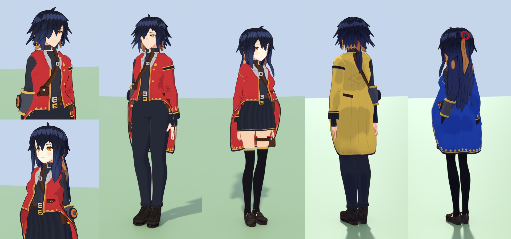

# Bespoke characters: the template

The protagonists (`hero`, `heroine`) are the first two *bespoke* characters: they are written by hand, lock by
lock and garment by garment, as plain data in `Tools/dai/anime/hero.py`, and built by the template engine
`Tools/dai/anime/bespoke.py`. Every future character that should reach the same level starts from this
template rather than from a preset look.

## Making a new bespoke character

1. **Add a design** to `hero.DESIGNS` (or a new module the registry imports): `key`, `base` (`vroid_a` /
   `vroid_b` girls, `vroid_c` boys), `female`, `height` (cm), `tint`, `hair`, `face`, `colors`, `wear`.
   Copy the closest protagonist and change it; the helper functions (`_fringe`, `_strand`, `_mirror_az`,
   `_coat`, `_strap`) are there to be reused.
2. **Add a cast entry** for it in `cast.py` (name, dorm, height, an atelier fallback design) - or point an
   existing slot at it by giving the slot's id a design in `hero.DESIGNS`.
3. **Check it**: `bespoke.check(design)` lists every place it breaks a learning below. The test suite runs it
   on every registered design.
4. **Preview** with the scratch renderer pattern used for the protagonists: `build.render_lineup(..., entries=E)`
   for a face, a 3/4 full body and a back view. Render one view at a time - parallel previews write the same
   texture files and race. Preview a runtime-tinted coat in a dorm colour (it is near white in the build).
   Previews write into `SourceAssets/Textures`: restore them (`git checkout`) or rebuild the cast before
   committing.
5. **Build**: `python Tools/build_island.py cast`.

## The design data

| Key | What it holds |
|---|---|
| `hair.sections` | recipe sections combed first (`fringe`, `sides`, `back`, `spikes`, `tails`, `braids`, `buns`, `ahoge`: `atelier/hair.py`) - use them for the bulk (crown, back, tails) |
| `hair.locks` | every hand-placed lock: `az` (deg, + = the character's left), `s0`/`s1` (rings: 0 crown, ~0.42 brows, ~0.50 eyes, ~0.58 cheeks, ~0.70 nape), `free` (m hanging past `s1`), `sweep`, `width`, `loft`, `gravity`, `forward`, `curl`, `flare`, `wave`, `kind` (`fringe` locks get no spring chain); `mirror=True` (both sides, `asym` scales the right one), `accent=True` (accent colour), `strand=True` (thin overlay lock), `over_eye=True` (allowed to cover an eye) |
| `hair` colours | `color`, `tip` (ombre), `accent`, `accent_tip`, `tie`, `sheen_color`, `sheen`; quality: `res` (2), `min_chain` (0.045) |
| `face` | `iris`, `iris_ring` (two-tone), `sparkle` (third catch-light), `lash` (lash line weight, 0 = the base's), `brows`, `expression` (base morph mix), `face_shape` (`chin`, `jaw`, `cheeks`), `earrings` (metal, stone) |
| `wear` | `[(garment, params)]` in wearing order - `atelier/outfit.GARMENTS`, including the bespoke pieces below |

Garments added for the protagonists, available to every design:

| Garment / option | |
|---|---|
| `top(hem_front=z)` | cut-away hem: short at the front, `hem` at the back (tails on the coat-tail chains) |
| `top(sleeve_sides=("l",))` | one-sleeved coat (the other side is a vest armhole) |
| `strap(path, over=...)` | strap on the torso along `[(z, azimuth)]`, over the shoulder as one piece with `over`, with buckles and a pouch |
| `legstrap` | thigh strap with a buckle and a pouch |
| `bracer` | armoured forearm guard with a duel-disk plate and a lit ring |
| style `motif=dict(..., h=...)` | border patterns (always give `h`) |
| style `crest=dict(u, v, size, color)` | a large emblem painted on a garment (the back of a coat: `u=0.5`) |

## Learnings

What made the difference on the protagonists - `bespoke.check()` enforces the first four.

- **Lock width.** Locks need about twice the width that seems right on paper (a recipe fringe lock is ~0.07
  design-m). Below 0.045 the hair turns stringy, with gaps and a heavy outline per lock - only thin overlay
  strands (`strand=True`) go narrower.
- **Sweep moves the lock.** A lock ends at `az + sweep`. A fringe lock ending below the brows over an eye
  (12-34 deg off centre) hides that eye; shorten it or move it, unless the design wants it (`over_eye`).
- **Resolution and physics.** `res=2` removes the faceted look in close-ups; `min_chain=0.045` gives the
  short side / back locks spring chains, not only the long ones.
- **Dark hair needs its own highlight colour** (`sheen_color`, a cool tone at ~0.55) or the ring vanishes.
- **Motifs need `h`** or they smear into stripes over the whole garment.
- **Eyes.** The base iris is a flat disc: paint it in layers and put two catch-lights on the highlight layer;
  ink and thicken the lash line for a sharper face. On the girls' base, `Fun` above ~0.1 closes the eyes.
- **Silhouette beats surface.** The cut-away hem, one sleeve, straps with buckles, a belt stack and one
  statement piece (the bracer) did more than any texture work.
- **Layering.** An outer coat over a flared skirt needs more ease than the skirt (`ease` ~0.036, skirt
  `flare` ~0.12), and its own `flare` kept low (~0.05) or it balloons into a bell.
- **Long hair and accents.** An accent under-layer reads on short cuts; on long back hair it shows as
  patches - keep the accent to the sides and the tail.
- **Budget.** A bespoke character is ~130-180k triangles and 11-13 materials (the regular cast ~50-80k, 9):
  the double-resolution hair is most of it.

## Still to do for real parity

The template removes the generic look; it does not make a sculpted character. The faces and bodies are the
VRoid bases', garments are generated shells with painted detail, hair is separate pointed locks, and the
Unreal cel material does not yet read the extra shading layers. An artist-made model through the replacement
slot (`Docs/CHARACTER_MODELS.md`) remains the route to full parity.
