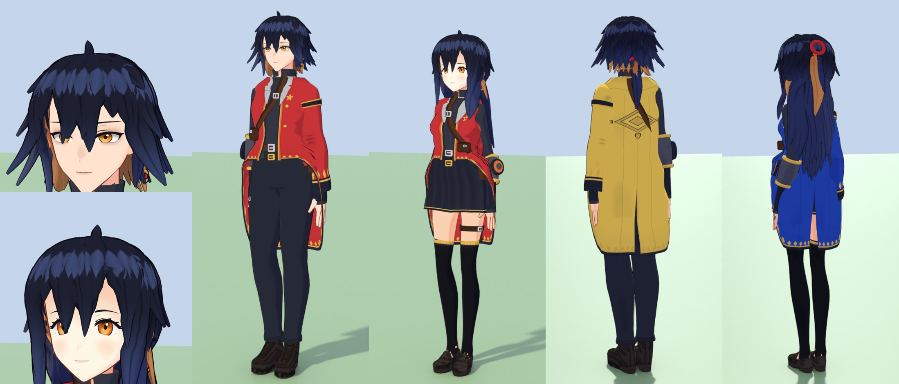

# Character models

The cast is built in layers:

1. **VRoid bases with per-slot looks** (default): the official VRoid sample avatars supply the face, body,
   facial rig and outfit; `Tools/dai/anime/looks.py` gives each cast slot its own hair restyle, colours, face
   shape, expression and height. The samples' embedded terms allow modification, redistribution and commercial
   use without credit (`Tools/thirdparty/vroid/*/SOURCE.txt` records the evidence).
2. **The atelier** (`Tools/dai/anime/atelier`): the project's own generator, used for any slot whose base model
   is not installed. Fully owned, but simpler surfaces than the sculpted bases.
3. **Artist-made models**: any slot can be replaced by a model you made, commissioned or licensed
   (`cast_models` in the registry, below).

A look (`looks.look`) names its base (`vroid_a` / `vroid_b` for girls, `vroid_c` for boys), the hair restyle
preset (`SPIKY`, `NEAT`, `MOP`, `TALL`, `MESSY`, `PUFF`, `LONG`, `BOB`, `TWIN`), hair and iris colours, outfit
colours, an optional tailored coat, `face_shape` and `expression`. The base outfits, recoloured, look better
than garments tailored onto the bases, so tailoring is used sparingly.

Models from other games are not an option: they are those studios' property.

## The protagonists (`hero`, `heroine`)

The player character is not a preset look: both protagonists are original *bespoke* designs, written lock by
lock and garment by garment as data in `Tools/dai/anime/hero.py` and built by the template engine
`Tools/dai/anime/bespoke.py` - the template every future character at this level starts from (see
[BESPOKE_CHARACTERS.md](BESPOKE_CHARACTERS.md) for the workflow, the data format and the learnings). The hero
(`SK_Anime_Hero`, boys' base, `cast.PLAYER`) and the heroine (`SK_Anime_Heroine`, girls' base,
`cast.PLAYER_FEMALE`) are a pair; the profile's gender picks one in game (`ADAStudentCharacter::BeginPlay`). The
generic students keep `student_m1` / `f1` / `f2`, so the background students never wear the protagonists' looks.

| Part | What is bespoke |
|---|---|
| Hair | every lock placed by hand (`bespoke.comb()`): the hero's side-parted fringe with one long lock between the eyes, a lifted piecey crown, flicked sides and a nape tail; the heroine's long layered cut parted the other way, half up with a tail at the crown and long face-framing locks. Blue-black with a copper under-layer, double geometric resolution (`res=2`), a cool highlight ring, spring chains on the short locks |
| Face | `bespoke.repaint_for()` replaces the base face's sheets while they are packed into the face-parts atlas: a layered amber iris (copper-ringed with an extra sparkle on the heroine), catch-lights, an inked lash line, brows in the hair colour; jaw / chin, resting expression, gold hoop earrings |
| Outfit | a dorm-tinted academy coat with one sleeve (mirrored between the two), a cut-away hem with long tails, a gold card-suit border, a copper lining edge, an ink-rimmed crest and a tailcoat vent at the back - draped
plumb from the shoulder blades and fitted over everything worn under it (`drape`, `clear`) - over a fitted black high-collar top; a leather strap over the shoulder with a buckle and a card pouch, a belt stack, a thigh strap, fingerless gloves and an armoured duel-disk bracer on the bare forearm. The hero wears tapered trousers, the heroine a pleated skirt and thigh-highs |



Both coats keep the `JacketTint` slot, so the dorm switch still recolours them; the hair has no tint slot. In
Unreal the player's avatar asks for `SK_Anime_Hero` / `SK_Anime_Heroine` (with skeleton group `VroidC` /
`VroidA` and the cast scale) and falls back to `SK_Anime_StudentM1` / `SK_Anime_StudentF1`
(`UDAAvatarComponent::FallbackCastMesh`) until the new meshes are imported. The choice is made once, at
BeginPlay: a gender set later (character creation) takes effect on the next level load.

## Atelier designs

A design (`atelier/designs.py`) is a dict of parameters:

| Key | Meaning |
|---|---|
| `female`, `build`, `bust`, `skin` | body table, stockiness, skin colour |
| `head` | `{jaw, chin, cheek, face_w, cranium}` multipliers on the skull rings |
| `eyes` | eye shape overrides (`paint.EYE`): size, tilt, lash, wing, iris size. Presets: `F_ROUND`, `F_GENTLE`, `F_SHARP`, `F_SLEEPY`, `F_BRIGHT`, `M_SOFT`, `M_SHARP`, `M_ROUND`, `M_NARROW` |
| `iris`, `iris2`, `brows`, `mouth`, `blush`, `lips`, `mole` | face paint and decals |
| `expression` | resting expression as a mix of the facial morphs, e.g. `{"Fun": 0.4, "BrowAngry": 0.3}` |
| `hair` | `{color, color2, style}`; `style` is a dict of sections (`fringe`, `sides`, `back`, `spikes`, `tails`, `ahoge`), see `HAIR` for the presets |
| `outfit` | `[(garment, params)]` in wearing order; garments are listed in `outfit.GARMENTS`, plus `hairband`, `glasses`, `hairbow` |
| `tint` | generic students: `["jacket", "hair"]` parts Unreal recolours per dorm / NPC |

`Tools/dai/anime/cast.py` maps each cast slot (name, dorm, height, dialogue, spawn marker) to a design.

```
python Tools/build_island.py cast                    # build and export the whole cast
python Tools/preview_anime.py jaden alexis           # Cycles lineup of two slots
python Tools/preview_anime.py alexis --portrait      # close-up
```

What a build produces per character: `SK_Anime_<Design>.fbx` on the shared `Cast` skeleton, a face sheet,
a hair sheet and a cloth atlas under `SourceAssets/Textures/Characters/<Design>/`, and its entry in
`SourceAssets/Data/cast.json`. A character is about 65-80k triangles and 5 materials.

## Proportions

The body and face proportions are fitted to measurements of reference anime figures (the VRoid sample
avatars), taken with `Tools/measure_character.py`. Only numbers are used: no reference geometry or texture
is in the cast, and the reference files are not in the repository.

| Proportion | Reference | Atelier |
|---|---|---|
| Hip height / body height | 0.56 | 0.53 (was 0.51) |
| Shoulder joint half-width at 1.70 m | 0.09-0.13 m | 0.125 m (was 0.175 m) |
| Heads tall, girls / boys | 6.9 / 7.6 | 7.0 / 7.5 |
| Female waist half-width | 0.08 m | 0.088 m (was 0.108 m) |
| Cheek half-width / head height | 0.42 | 0.41 (was 0.38), with a sharper chin |
| Eye size | iris height 0.15 of the head | eyes enlarged about 15 % |

Parts are modelled in the skeleton's design space and warped to these proportions when a character is
assembled (`atelier/build.py`: `warp`, `HEAD_SCALE`, `LEG_STRETCH`, `SHOULDER_IN`); the limb and torso
tables are in `atelier/body.py`, the face rings in `atelier/head.py`. To fit against another reference,
export it to VRM / glTF / FBX, run the measuring script and adjust those values.

## Replacing a slot with an artist-made model

1. Put the model in `Tools/thirdparty/<pack>/<asset>/` with a `SOURCE.txt` (author, licence, source URL).
2. Register it in `Tools/thirdparty/registry/anime.json`:

   ```json
   "anime_models": { "my_hero": { "file": "mypack/hero/hero.vrm", "female": false, "height": 1.72 } },
   "cast_models":  { "jaden": "my_hero" }
   ```

   `height` is the model's crown height in metres (without hair); it turns the slot's height in cm into
   the runtime scale. A `cast_models` key is a cast slot id or an atelier design key.
3. `python Tools/build_island.py cast`.

The model keeps its own face, hair, outfit and textures. The import (`Tools/dai/anime/models.py`):

* renames the humanoid bones to the UE5 Mannequin scheme. VRM 0.x / 1.0 humanoid maps are read from the
  file; Mixamo and `J_Bip_*` names are recognised otherwise. Required: hips, spine, head, upper and lower
  arms, upper and lower legs, feet.
* gives every material the cast's cel class (skin, face, hair, cloth or flat) from its name, and adds the
  ink outline.
* bakes the cast's takes onto the model's own proportions. Models on a different skeleton form their own
  skeleton group, with their own `A_Anime_<Group>_<State>` takes.

For the runtime features to work the model needs:

| Feature | What the model must have |
|---|---|
| Blinking, lip-sync, emotions | blendshapes for `Blink`, `Blink_L/R`, `A I U E O`, `Joy`, `Angry`, `Sorrow`, `Surprised`, `Fun` (also `EyeJoy`, `BrowAngry`, `BrowSorrow`). VRoid `Fcl_*`, VRM expression names, ARKit `eyeBlinkLeft/Right` and the plain names are mapped (`models.MORPH_ALIASES`). Missing ones are skipped. |
| Hair springs | hair bones under the head whose names contain `Hair` (`_Long` in the name selects the heavier long-hair spring) |
| Skirt / coat springs | bone chains named `skirt_*` / `coattail_*`, or containing `CoatSkirt` |
| Cel classes | material names containing `hair`, `skin`, `face`, or eye / brow / lash / mouth keywords for the flat class (`Tools/dai/anime/cel.py`) |

Check that the model's licence allows redistribution before committing it; otherwise keep it out of git
and register it only on your machine.

## Status of the artist path

The import code is the pipeline's earlier base-model path, kept for this purpose. It was exercised on VRM
0.x humanoids. Other sources (VRM 1.0, Mixamo FBX) share the same code but have not been run against a real
file in this repository, since none is checked in. Expect to adjust material names or the morph alias table
for a new source.
