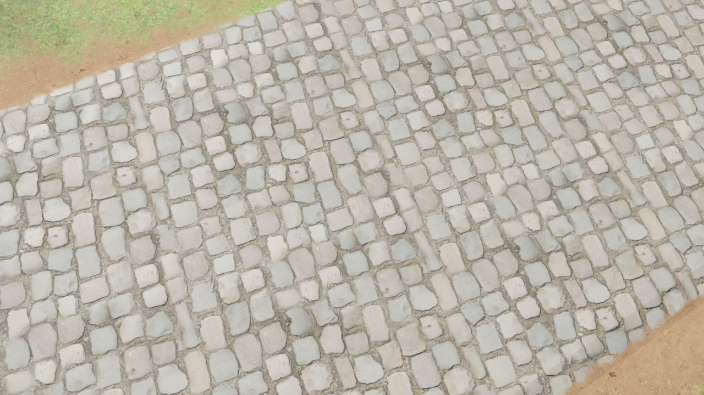
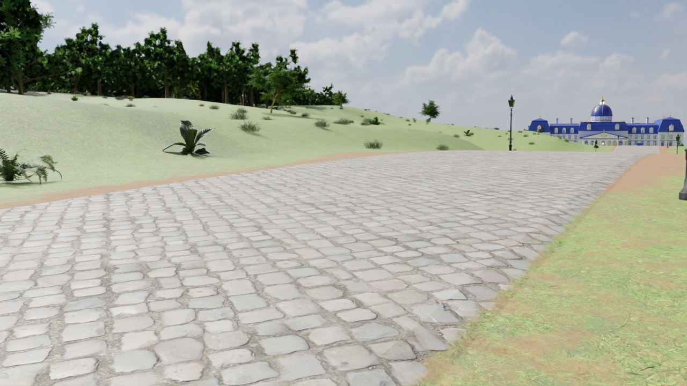
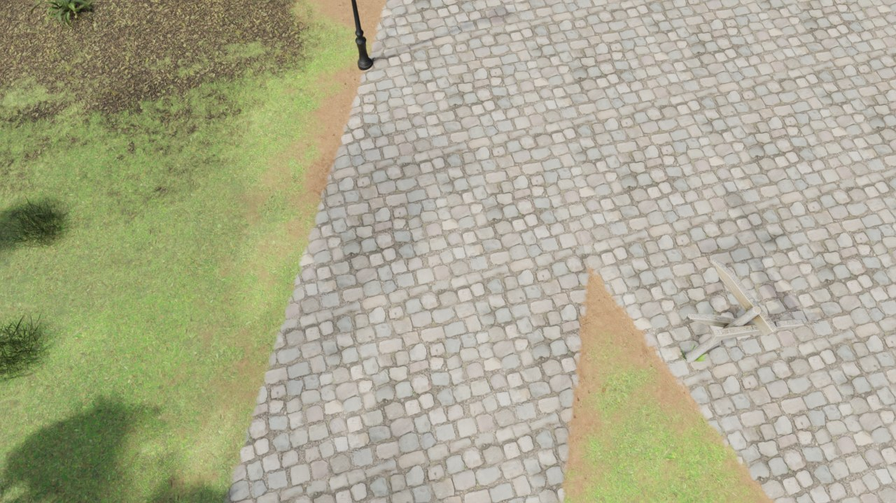
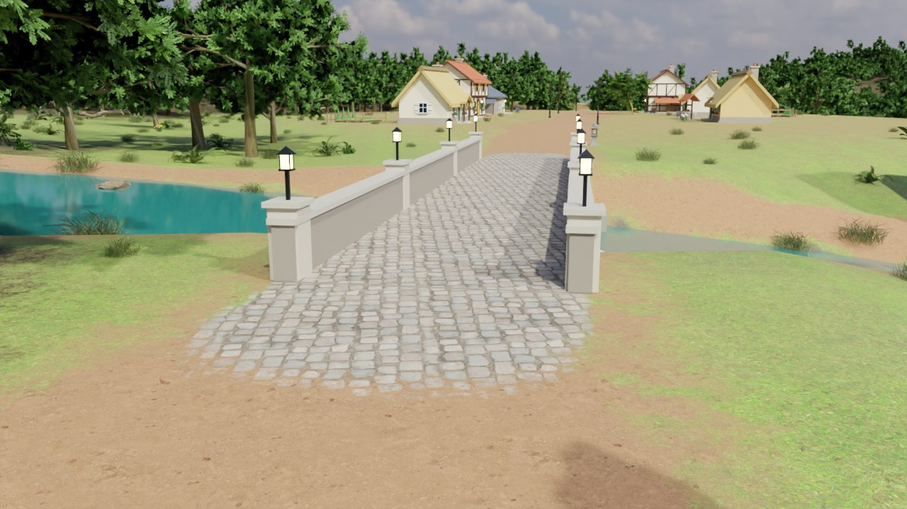
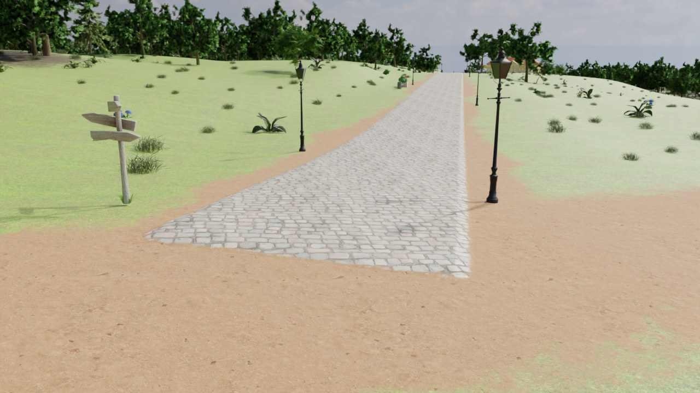
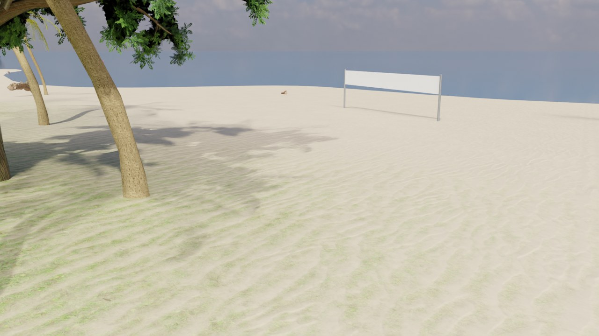

# Ground materials and their transitions

Grass, forest floor, sand, wet sand, ash, rock, earth and paving are the eight layers of one terrain
material. Roads, bridge decks and the verges beside them are drawn with that same material, so nowhere on the
island does one ground stop and another begin along a line.

> **Status.** The pipeline half (relief maps, splat maps, road meshes with their vertex colours) is built and
> rendered in Blender, where the preview materials use the same blend. The Unreal half (`M_DA_Terrain`,
> `M_DA_Road`, the vertex-colour import) was written without an engine at hand: the graphs are built and
> evaluated numerically against a stand-in for the `unreal` module
> (`Tools/tests/test_material_transitions.py`), but nothing has been compiled or looked at in Unreal yet. See
> [Not yet verified in the engine](#not-yet-verified-in-the-engine).

| | |
|---|---|
|  |  |
| From above: the stones leave the road one by one | Paving, earth verge, grass - no line between them, no edge on the ribbon |
|  |  |
| A branch runs into the main road's paving; the verge fills the fork | A stone bridge on an earth path: its paving runs out and breaks up |
|  |  |
| Where a road ends on open ground | Behind the beach: sand lies in the hollows before it covers the grass |

*(Cycles previews with the same blend as the Unreal materials.)*

## Layers blend by height

The splat maps (`T_TerrainSplatA/B`, 4096², 75 cm a texel) say how much of each layer a spot has. A plain
cross-fade of two photo textures over a few metres reads as a smear, so every layer also has a relief map
`T_Terrain_<Layer>_H` and takes over from what lies under it by height:

    w' = w + (noise - 0.5) * 4 B w (1 - w)               noise frays the edge, never a pure area
    a  = saturate((2 w' - 1 + (h - h_below) k) / s + 0.5)

`w` is the layer's splat weight, `h` its relief at that pixel, `h_below` the relief of what has been blended
so far, `k` the height influence and `s` the softness (`LAYER_BLEND` in
`Content/Python/duel_academy/materials.py`; material parameters `<Layer>BlendHeight` / `<Layer>BlendSoft`).
With `s <= 2 (1 - k)` - enforced when the graph is built - a layer is exactly absent at weight 0 and exactly
complete at weight 1. In between, its own relief decides where it shows first: grass tufts stand out of the
earth, sand lies in the joints between cobbles before it covers them, rock breaks through along its ridges.

The relief maps are not painted. `Tools/dai/textures.py height_from_normal` integrates each layer's normal map
in the frequency domain (Frankot-Chellappa, exact for a tileable texture) and damps the longest undulations so
the blend follows blades, grains and joints rather than metre-wide blotches. They are written by the
`textures` stage.

## Roads are the terrain

A splat texel cannot hold the edge of a road, so paved roads have a ribbon mesh (`SM_Road_<id>`). It used to
carry its own paving material on top of paving painted into the splat; the two never quite matched, and the
ribbon ended in a hard line. Now:

* **`M_DA_Road`** is the terrain's surface function looked up by world position, with the terrain's own
  Paving layer laid over it by the mesh's vertex colour (R = coverage) - through the very same height blend.
  At coverage 0 it returns what `M_DA_Terrain` returns at that spot (colour, roughness, normal, the far tint,
  the wet band along a bank); at coverage 1 what paved ground returns. The layer normals are applied in the
  terrain's tangent frame (world +X, the direction v grows in) rebuilt on the mesh's own normal, so a ribbon
  or a rotated bridge deck is lit like the ground.
* **The ribbon has a rim** (`Layout.ribbon_sections`): seven vertices across, the outer two at coverage 0 and
  1.5 cm *under* the ground, the rest fully paved 6 cm up. Over the outer 45 cm the stones thin out one by
  one into whatever the ground is there, and the surface dips into the terrain while it is still drawn as
  that terrain - the ribbon has no edge to see, no step and no shadow line. Extra sections go in wherever the
  ground bends between two of them, so the edge stays in the ground along its whole length. An end on the
  ground closes with the same rim; an end at a bridge stays paved across (the deck is paved edge to edge); an
  end on another road runs on over that road's rim and stops inside its paving. A branch that stops at the
  kerb of the main road is carried straight on until it is inside (`Layout.ribbon_line`).
* **The splat paints the road's bed, not its stone** (`terrain.py splat`): bare earth under the ribbon and a
  ragged verge beside it - a metre and a half wide here, gone there, where the grass reaches the stones.
  Stone -> earth -> grass, each step a height blend. On a plaza the ground under the rim is paving, so the
  road simply merges into it.
* **Bridge decks** of the stone bridges use the same material (palette `M_RoadPaving`, kind `road`), without
  vertex colours - paved all over, the same stone at the same scale as the ribbon that runs onto them (the
  threshold strips that used to mark the joint are gone). Where a stone bridge carries an earth path, the
  terrain's paving runs out a few metres onto the approaches and breaks up there.
* `T_TerrainColor` (the far-distance tint and the minimap) still shows the roads as paved; ground and ribbon
  share that lookup, so they fade to the same colour with distance.

## Where things are

| What | Where |
|---|---|
| Relief maps | `Tools/dai/textures.py` `height_from_normal`, `build_layer_heights` |
| Road bed / verge, bridge approaches, colour map | `Tools/dai/terrain.py` `splat`, `colour_map` |
| Ribbon rim, junction and bridge ends | `Tools/dai/layout.py` `ribbon_line`, `road_runs`, `ribbon_sections`, `road_ribbon` |
| Vertex colours on meshes | `Tools/dai/geo.py` `MeshBuilder.cquad` / `colors` |
| Masters | `materials.py` `_height_blend`, `_terrain_surface`, `_terrain_finish`, `build_terrain`, `build_road` |
| Blender preview of both | `Tools/dai/render.py` `_terrain_material` |
| Checks | `Tools/tests/test_material_transitions.py`, `Tools/alignment_check.py` (ribbon rim, ends) |

## Tuning

* How sharply a layer takes over: `LAYER_BLEND` (and the same table in `render.py` for the previews), or the
  `<Layer>BlendHeight` / `<Layer>BlendSoft` parameters on `MI_M_Terrain` and `MI_M_RoadPaving`.
* How ragged the edges are: `BLEND_NOISE`.
* Width of the paving's edge strip: `Layout.RIBBON_RIM`; the verge: `bed` in `terrain.py splat`.
* After changing the splat: `python Tools/build_island.py terrain layout`, then rebuild materials and level in
  the editor.

## Not yet verified in the engine

* **Vertex colours through the FBX import.** `importer.py` sets `vertex_color_import_option` to `REPLACE`. If
  the colours do not arrive, every ribbon is paved to its very edge and ends in a line again (a mesh without
  colours is white = fully paved). Check `SM_Road_main_road` with the vertex-colour view mode.
* **`M_DA_Road` outputs a world-space normal** (`tangent_space_normal = False`), built with `VertexNormalWS`
  and a `CrossProduct` node. If the roads are lit differently from the ground beside them, this is the place.
* **The world-position lookup** assumes the terrain's UVs run with world X and Y the way the water materials'
  island maps do (`MirrorY` is set on the instance for a mirrored level). A road showing the wrong ground
  under its rim means that mapping is off.
* **Ten more texture samples** in the terrain material (eight relief maps, two noise lookups). They use the
  shared wrap sampler like the layer textures before them, so the sampler limit should not be reached - but
  the shader cost of the terrain has not been measured.
