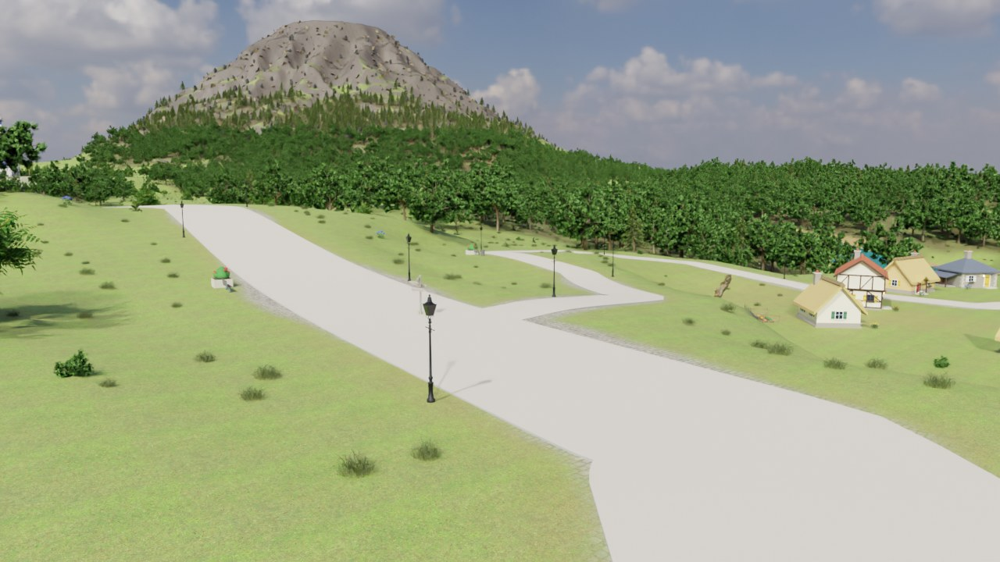
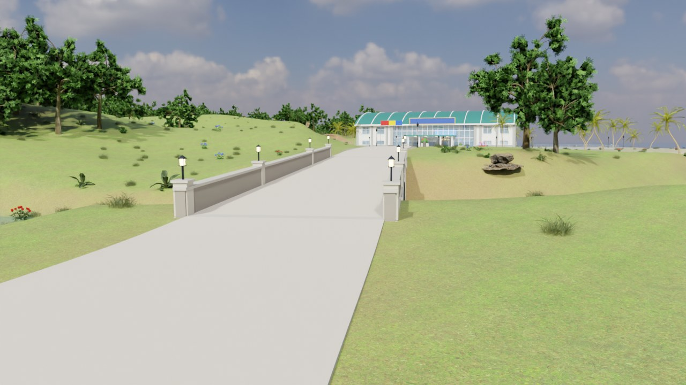
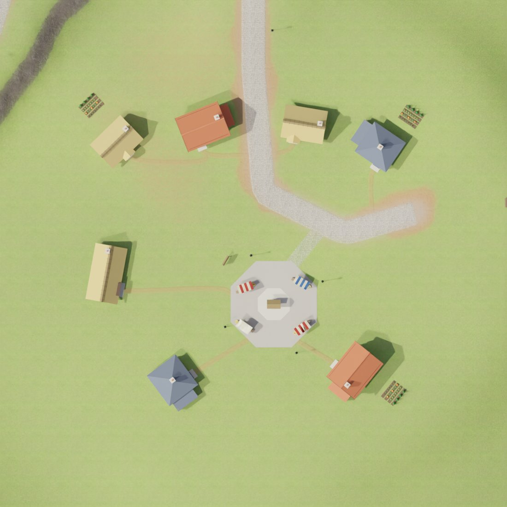
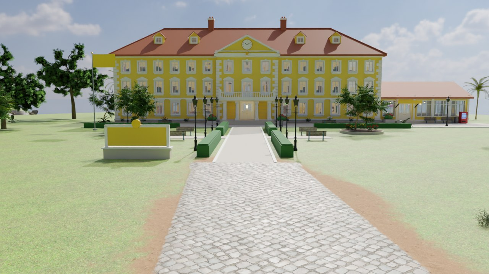
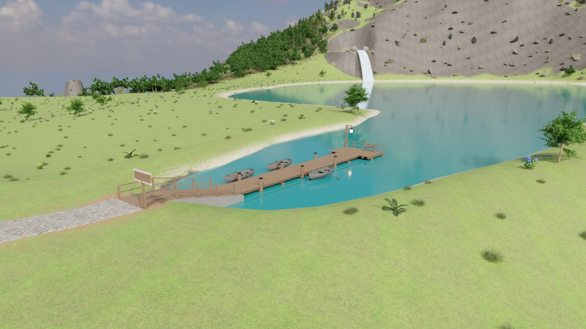
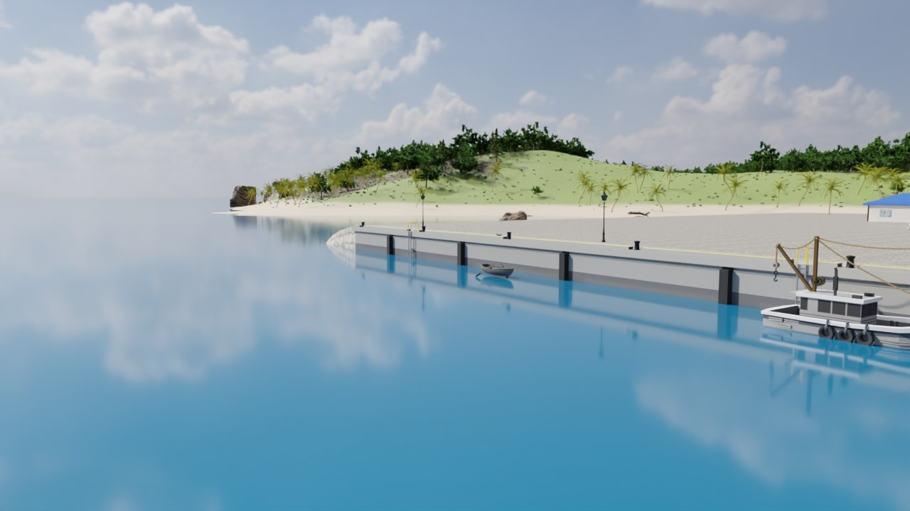

# World alignment - roads, bridges and the ground (2026-11-11)

The waterways / road-grading work was followed by a second alignment pass with one rule: **"the ground" is the
terrain mesh as it is drawn**, and everything that lies on it is checked against that surface.

## What was wrong

* Placement sampled the 1.5 m heightfield, but the terrain is drawn from every second sample (3 m quads). At
  any crisp edge - a road shoulder, a river bank, a pad rim - the two differed by decimetres (99th percentile
  19 cm, up to 1.4 m), and the split of each quad into triangles was left to the FBX importer.
* Road ribbons were level across and lifted to the highest ground under them: up to 52 cm of air under the
  paving at junctions and beside pad aprons.
* A branch road's wide shoulder reshaped the bed of the road it joined; a road whose edge touched a pad was
  half on the pad and half 40 cm below it.
* Bridge decks ended where the bank met the road *on the centre line*: on a skew crossing one side of the
  abutment hung over the bank (up to 1.9 m of air), and the change of grade at the joint left 5-12 cm steps.
* Landmark meshes that are built onto the terrain (summit stair, viewpoints, shrine ...) had not been
  re-exported after the terrain under them changed.

## What changed

| Area | Now |
|---|---|
| Terrain mesh | exported as explicit triangles; each quad is split along the diagonal joining the two corners closer in height (`terrain.mesh_diagonals`), so creases follow road edges and banks |
| Ground lookups | `terrain.MeshField` reproduces those triangles exactly; the layout stage and every location module sample it (`terrain.load_cached`) |
| Road beds | level across the ribbon plus one mesh cell (`ROAD_FLAT_EXTRA`); a road is fixed to pad height while any part of its bed is on a pad; the carriageway of an earlier road is locked, later roads join it at its edge |
| Ribbons | draped: 7 vertices across, the paved ones 6 cm above the terrain under them, the rim (outer 45 cm, where the paving thins out into the verge - see [GROUND_MATERIALS.md](../GROUND_MATERIALS.md)) dipping 1.5 cm under the ground at its edge, with extra sections wherever the ground bends between two of them; cut exactly at bridge abutments and just inside the paving of the road they join (skewed ends, no wedge); closed ends |
| Bridges | the road is straightened over each crossing; the deck runs one mesh cell past the top of the bank on both sides, further on the long side of a skew crossing; the profile is a straight line under the deck and its run-outs, so the change of grade is not at the joint; banks have no noise near a crossing |
| Exports | every location mesh carries a geometry signature in `assets.json`; with `DAI_EXPORT_ONLY` set, a mesh whose geometry changed is still written |
| Scatter | plants and stones that come up under a roof are removed |

## The audit

`Tools/alignment_check.py` (needs Blender's `bpy`) builds the layout in memory and reports:

| Check | Limit | Result |
|---|---|---|
| paving above the terrain under every ribbon | 1.5 - 20 cm | 5.1 - 12.3 cm on all 7 paved roads |
| the rim strip of every ribbon (drawn as the ground itself) | at most 4 cm into the ground, its edge nowhere out of it | at most 2.2 cm in; the edge 0.3 - 2.2 cm under the ground everywhere |
| ribbon ends against the deck / road / ground they meet | 3 cm | <= 2.2 cm at all 16 ends |
| bridge: road centre line vs deck | 5 cm | 0.0 cm (6 bridges) |
| bridge: deck end vs road, abutments on the ground, clearance, piers to the bed, parapets | - | all pass |
| footings of the villages and landmarks (every separate piece reaches the ground) | 5 cm | 7,920 pieces, none off the ground |
| building bases vs pads | 35 cm | all pass |
| props and vegetation vs terrain | +20 cm | 87,275 checked, none floating (the 1,234 below -60 cm are the deliberate rock sinks) |
| a way on made ground from every door to a road | must exist | all 224 doors near the ground, in 13 locations |
| door thresholds | 21 cm | 587 doors, only the 5 accepted exceptions |
| vegetation inside buildings / at doors | 0 | 0 |
| story anchors on open ground | not buried, no air under them | 10 checked, pass |
| every boat at the water's surface, with water under its whole hull | 30 cm under the keel | 18 boats, pass |

| | |
|---|---|
|  |  |
| The pond lane runs into the main road's paving; the earth verge fills the corners | The gym road runs onto its bridge deck without a step or a joint |

## Every door is joined to a road

The paths were graded between the edges of the grounds they lead to, and several simply stopped there: three
roads ended in the lawn round the Academy 40-55 m from its forecourt, the Ra road 18 m from the dorm's
entrance walk, the Obelisk road 12 m outside the garden gate, the hot-springs path 20 m below the gate, the
cliff trail 40 m out in the Obelisk lawn. The cottages of the three villages stood in the grass with no path
at all, and the market square of Willow Pond lay beside its lane without touching it.

| | |
|---|---|
|  |  |
| Willow Pond: a path from every door to the lane or the square, the square paved through to the lane | The Ra road runs on to the dorm's entrance walk and meets it square |

* **`config.PATH_EXTENSIONS`** carries a path on across the grounds to the entrance paving - waypoints in the
  building's own frame, so the road keeps meeting the walk if the building moves. No earthworks (a pad is
  level): a paved road's ribbon runs further and the splat paints its bed, a dirt path is trodden further. An
  end at a built slab is paved across and square to its edge (`end_edge`), 1 cm above it; an end on painted
  paving thins out into it.
* **Village footpaths** (`assets/village.py` `Village.footpaths`): from every door - 20 cottages and sheds,
  the mill, the gangways of the two stilt huts - the shortest way over ground that is neither steep nor wet,
  round the houses and whatever stands in the village, to the lane, the road, the square or a path already
  laid (so they join up into a small network). Drawn as a strip of trodden earth with the road material
  ([GROUND_MATERIALS.md](../GROUND_MATERIALS.md)); plants are cleared off it. A paved link joins the square
  to the lane.
* **The check** (`alignment_check.py`, ENTRANCES): from every door socket near the ground and every village
  door, a walk over half-metre cells that may only use made ground - floors, slabs, decks and steps of the
  buildings, painted paving and earth, paths, footpaths - with steps of at most 0.36 m per cell (stairs
  pass, ledges do not), has to arrive on one of the island's paths. Only floors are probed, not walls: what
  is verified is that the made ground a door opens onto reaches a road. `DAI_AUDIT_ONLY=entrances` runs
  this section alone, `DAI_AUDIT_MAP=1` prints the ground round a door that fails.

Three story anchors moved with the ground: the Ra and Obelisk front gates (their roads were regraded) and
`lighthouse_view`, which had always hung 6.7 m over the water 12 m off the breakwater and now stands on it.

`Tools/tests/test_alignment.py` covers the parts that need no Blender (the mesh sampler, the signatures).

Known and left as is: the volcano trail's hairpins are tighter than the 3 m mesh can hold, so the ground there
deviates from the solved profile by up to half a metre over a few metres (a dirt trail: nothing is laid on it).

Where a road meets the stretch it is carried on by at an angle (the Obelisk road turning onto the Academy
lawn, 51 degrees), it now turns on a curve instead of a kink: `strips.round_joints` replaces the 12 m before and
after the corner by a curve tangent to both legs, for the ribbon (`Layout.ribbon_line`) and the bed the splat
paints under it alike. The last legs onto a slab stay straight and square to it.

## The water's edge

Two findings of the November audit below were still open: boats moored on dry land.

| | |
|---|---|
|  |  |
| The lake's new arm reaches the girls' dorm jetty; the garden walk runs on to its landing | The harbour basin is dredged flat up to the quay wall; the boats float |

* **The girls' dorm jetty** stood in a dry hollow 70 m from the lake, 2.5-3.5 m over the grass, with three
  rowing boats on the lawn beside it. The lake now has an arm (`config.LAKE_INLETS`): a polyline with a water
  width at each point, from the head of the arm out into the open lake. `shoreline.inlet_q` turns it into the
  lake's own normalised radius - 0 on the middle line, 1 at the water's edge, then 1 + metres / bank width -
  and the terrain stage takes the minimum of that and the ellipse as the lake's `q`, so the arm has the
  lake's shoreline, sand and bank shaping and lies in the same water raster. Its bed is the one it is given
  (27.2 m in the middle, 2.8 m of water; the jetty's piles reach it), not the hollow it was cut into. The
  lake mesh is sized to take it in; `water.json` lists it under `inlets`, and `level.py` adds it to the
  island manager like a river (a still sheet at the lake's level), because the manager's lake test is the
  ellipse. Pads' aprons and road beds no longer fill an arm.
  The jetty moved 10 m onto the axis of the garden walk, which now runs on to its landing (path
  `girls_jetty`, paved, square to the walk and to the landing). The ground where the paving meets the
  landing is levelled 6 cm under the deck, so the paving ends flush with the planks.
* **The harbour**: the quay's pad apron put a shelf at +3 m in front of the quay wall, 6 m deep, and the
  dredged basin began 10 m out - the rowing boats and a trawler moored along the quay sat in the ground.
  The basin (`config.HARBOR_BASIN`) now reaches the quay face and is dredged flat to `HARBOR_DEPTH` (-12 m;
  the quay wall stands 1 m into that bed, the pier's piles on it - the natural floor fell to -35 m within
  50 m of the quay, under piles that stopped at -12). The pad's apron stops at the quay face and comes back
  over 15 m beyond the ends of the wall. The east trawler moved 32 m west, off the breakwater's embankment.
* **Fisher's Cove**: the rowing boat lay 6 m back from the pier head on the railed side, on the sand under
  10 cm of water; it now lies alongside the head on its open side.
* **The check** (`alignment_check.py`, BOATS; `DAI_AUDIT_ONLY=boats`): every boat - they are floating
  actors, so no other check looked at them - sits at the water's surface, and the ground under its whole
  footprint (5 x 3 points of its rotated bounds) is at least 30 cm under the keel.
* The story anchor `obelisk_girls_gate` stood in the old hollow; it follows the new bank (+2.95 m).

---

# World alignment audit — 2026-11-08

Systematic check of floor, wall, door, furniture and scenery alignment across the Duel Academy Island
overworld, its interiors, the portal-cell interiors and the optional Fab nature layer.

## Method

- 17 parallel read-only sub-agent audits, split by location / system:
  academy + plaza, slifer + ra, obelisk boys + girls, harbor + lighthouse,
  abandoned + gym + hot springs, island features, doors/openings, furniture origins,
  collision vs visuals, lights/emitters/audio, windows/glass/sills, stairs/storeys,
  portal cells, paths/roads/water edges, foundations/terrain seams, vegetation scatter,
  Fab nature.
- Existing pipeline checks:
  `Tools/audit_interiors.py` (all 17 placements), `Tools/people_check.py`,
  `Tools/storey_report.py`, `Tools/spec_check.py` rules, `Tools/world/validate_layout.py --strict`,
  `Tools/world/test_interiors.py`, `Tools/tests/test_fab_nature.py`.
- New world-space probe built on the layout stage: location base samples vs terrain/pad,
  every non-location prop/vegetation instance vs terrain, every door threshold against the
  world floor, and vegetation inside building volumes.
- Blender 5.2.3 LTS used for all geometry checks (bpy + the local `.blender_site` scipy).

## Baseline results

- `people_check.py`: **0 problems** (all arrival points and NPC spots have standing room),
  re-run after the collision fixes.
- `audit_interiors.py all`: **0 unexpected issues**. The final full re-audit after all fixes
  reports **6 issues total**, exactly the known academy tower-threshold exceptions (4) and the
  harbor crane-container / floating-ferry lamp exceptions (2), all already accepted in
  `Tools/spec_check.py`. Every other placement, including the lighthouse after the crate fix,
  reports 0. A separate re-audit of the modules touched by the last fixes (slifer, ra, obelisk,
  harbor, abandoned, gym, hot springs) likewise reports only the 2 accepted harbor lines;
  abandoned is 0 after the holed-floor/clutter fix.
- Detail coverage: only the two waived views are below the 35 % hall target
  (`gym/court` 34 %, `harbor/ferry_lower_corridor` 28 %). Every room view is >= 45 %.
- `storey_report.py`: painted-window areas remain inside the spec allowances
  (academy ~1247 m2 < 1300 m2, harbor ~5.4 m2 < 7 m2).
- `validate_layout.py --strict`: **PASS** (36 zones, 36 locations, 10 interiors, 20 portals,
  104 anchors, 38 spawns, 0 missing anchors).
- `test_interiors.py`: all 10 portal routes **PASS**.
- `test_fab_nature.py`: **8/8 tests pass** (formula and bottom alignment).

## New tooling

- `Tools/alignment_check.py` builds the layout in memory and checks location bases vs
  terrain/pads, every non-location prop/vegetation instance vs terrain, every door threshold
  against the world floor, and vegetation inside buildings or next to doors. It reports the
  over-water structures (harbor, lighthouse, girls' jetty) and the accepted door exceptions
  explicitly; the 1,289 scatter sink groups are deliberate rock/bush sinks, not failures.
- `Layout` now keeps `assets` and `location_xforms` after placement so world-space audits can
  reuse the exact AssetSets and transforms instead of rebuilding them.
- `inspect.audit` now treats tall halls (up to 60 m) as indoors, so arena/lobby/concourse props
  are no longer skipped as "outdoor".

## Confirmed and fixed

| # | Finding | Fix |
|---|---|---|
| 1 | A 5 m `SM_Rock_D` scatter cluster sat inside the bobbing ferry hull (lower-deck lobby). The harbor pad ends at y=-1126; the ferry is at y=-1137; the floating socket had no scatter clearing. | `layout.py` now adds a clearing for every floating special; `harbor.py` sets `clear=45.0` for the ferry. |
| 2 | Sunset Point signpost was sunk 4.8 cm because it sampled terrain at the path endpoint, not at its own XY. | `features.py` samples `H(ex+ox, ey+oy)`. |
| 3 | Slifer dining->kitchen inner door was blocked by three rice sacks placed directly in the swing. | Rice sacks moved to the west end of the galley (`slifer.py`). |
| 4 | Obelisk attic `hall3 -> back3` doors were blocked by store shelves at x=-6 / +6. | Shelves moved to x=-7.8 / +7.8 (`obelisk.py`). |
| 5 | Academy upper-storey lockers (2F/3F/4F) and teachers' lounge clutter were placed on the ground floor (helpers defaulted to `FLOOR`). | Added `z=z` to both calls (`academy.py`). |
| 6 | Academy 3F library annex and library stacks shared one camera label; fast travel was order-dependent. | Library-stacks camera renamed `..._library_stacks` (`academy.py`). |
| 7 | `inspect.audit` skipped props in rooms taller than 12 m (arena, lobby, concourse). | `indoors()` cast raised to 60 m (`inspect.py`); re-audit then found and fixed the concourse clipping below. |
| 8 | Academy concourse benches/vending machines poked 17-29 cm into the 16-gon drum wall at corners. | Props inset from `r-0.5` to `r-0.8` (`academy.py`). |
| 9 | Gym basketball hoops were rotated outward, 1.15-1.45 m outside the hall. | Rotation corrected to `-90*sx` (`gym.py`). |
| 10 | Gym gallery stairs ended 0.28 m short of the landing on both sides. | Landing extended to the stair top (`gym.py`). |
| 11 | Hot-springs vanity counters/stools were mirrored through the men/women partition. | Offsets changed from `xv - side*...` to `xv + side*...` (`hotsprings.py`). |
| 12 | Abandoned watchman's stove faced the north wall. | Yaw 180 -> 0 (`abandoned.py`). |
| 13 | Shared `PROP_LIGHTS` offsets were authored for procedural stand-ins, not the curated meshes: lamp post 4.2 -> 3.80, buoy 1.2 -> 0.93, chandelier -0.75 -> -0.59, ceiling lamp -0.55 -> -0.75, chandelier B -0.6 -> -0.45, wall sconce/lamp moved into their shades. | Corrected in `props.py` / `furniture.py`. |
| 14 | Path lamps hard-coded `z + 4.2` instead of the lamp-post offset. | Uses `PROP_LIGHTS["SM_LampPost"]` (`layout.py`). |
| 15 | Prop light X/Y offsets were not scaled with the prop scale. | Both layout and preview now scale all three axes (`layout.py`, `inspect.py`). |
| 16 | Academy arena ring lights were at radius 25 / z=25 while the glow ring is radius 15.5 / z=23.6; lobby chandeliers were 0.6 m below their glow; gate-pillar, entrance-facade, direction-board and fountain lights floated off their fixtures. | Sockets moved onto the visible fixtures (`academy.py`). |
| 17 | Slifer sign, stair-landing, porch and dining-pendant lights were off their fixtures (one sign light sat between two lamps). | Split/ moved onto the glow boxes (`slifer.py`). |
| 18 | Harbor crane-cab door swung inward into the side console (0.44 m clearance). | Door now opens outward onto the catwalk (`harbor.py`). |
| 19 | Academy end-pavilion 4F->5F stair had only 1.65 m headroom (5F unreachable): the first flight ran under the solid 5F slab outside the stairwell hole. | Stairwell hole widened from y=-7.0 to -8.4 in both pavilions; 2F tiled strip over the hole removed; north-edge guard rail added (`academy.py`). |
| 20 | Shared straight-stair handrail was one riser low (posts/beam based on the tread below). | `interior.stairs` bases posts and beam on the tread above (`interior.py`); affects all staircases. |
| 21 | Gym annex stair landing had no south guard rail over the court. | Rail added along the landing's south edge (`gym.py`). |
| 22 | RA 2F/3F stairwell holes ended 1 cm short of the stair top, causing a coplanar tread/floor overlap. | Holes extended to 5.90 (`ra.py`). |
| 23 | Lighthouse store-room crate poked 16 cm into the round wall. | Crate moved from radius 1.95 to 1.72 (`harbor.py`). |
| 24 | Obelisk boys' lounge had two display shelves facing the wall. | Yaw 180 -> 0 (`obelisk.py`). |
| 25 | Obelisk boys' attic `front3` had an embedded clock, wall-facing coat hooks and two backwards cabinets. | Clock/hooks/cabinets yaw 180 -> 0 (`obelisk.py`). |
| 26 | Obelisk girls' tea-room cabinet faced the wall. | Yaw 180 -> 0 (`obelisk.py`). |
| 27 | Obelisk girls' turret-top shelf faced the wall; silk lanterns hung 15 cm below their rods; chandelier rod stopped 26 cm below the cone. | Shelf yaw corrected, lanterns raised to the rods, chandelier raised to the cone (`obelisk.py`). |
| 28 | Obelisk en-suite mirrors sat 2 cm behind the 6 cm tiled wainscot. | Mirrors moved 7 cm into the room (`obelisk.py`). |
| 29 | Curated wall props were centre-pivoted (back at +depth/2), so paintings/frames sank 1-2 cm and cameras/utility boxes 18-25 cm into walls. | `thirdparty.py` now supports `origin: "wall"` (back face on the pivot plane); all 15 wall props in `interiors.json` use it. |
| 30 | `SM_Int_PhotoFrame`/`PhotoFrameB` faced sideways (±X) and `SM_Int_CoffeeTableB` had its long axis on Y. | Registry `rotate: 90` for all three (`interiors.json`). |
| 31 | Two academy `SM_Int_SofaB` sofas faced the north wall with their coffee tables behind them. | Yaw 180 -> 0 (`academy.py`). |
| 32 | `collision.blockers` dropped every table/desk top as a "rug" (legs only) and merged thin window lining boards into solid boxes filling the openings. | Rug test limited to near-floor pieces; thin (<3 cm) trim skipped; table tops kept (`collision.py`). |
| 33 | `_Glass_NoCol` meshes received hidden furniture collision; `floor_fn` returned 0 on a miss, so floor-level NoCol furniture at z=2.0 was skipped as "hung". | Glass excluded; `floor_fn` returns `None`; blockers keep collision when no floor is found (`collision.py`). |
| 34 | Slifer ground-floor rear window frames/sills were 25 cm above their wall openings. | Frame row lowered to `ZG+0.9` (`slifer.py`). |
| 35 | RA cafeteria windows had a duplicate sill 2 cm below the opening; RA French-door surrounds started 5-6 cm high. | Duplicate sill removed; surrounds lowered to the real floor (`ra.py`). |
| 36 | The shared window inside-sill top was 5 mm below the opening. | Sill raised so its top is flush (`interior.py`). |
| 37 | Obelisk girls' conservatory door was 2.0 x 2.55 m in a 2.2 x 2.65 m opening. | Door resized to 2.2 x 2.65 m (`obelisk.py`). 2026-11-11: that was the bay pitch; the clear opening between the glazing bars and under the transom is 2.08 x 2.6 m, the door's size now (`OBELISK_LAYOUT.md`). |
| 38 | Abandoned plank door leaves could exceed their nominal height by 3.4 cm and clip the head. | Plank offsets made ragged downward only (`doors.py`). |
| 39 | Academy office door swung through the frock-coat rail, side table and oil lamp in Crowler's dressing room. | Coats/rail moved west of the swing; table/lamp moved south (`academy.py`). |
| 40 | Abandoned clock-tower floor planks covered the spiral and both flight holes, blocking all three stairs near the top. | Replaced the plank floors with holed `K.slab` surfaces (`abandoned.py`). |
| 41 | A store-room clutter box floated 148 cm over the new spiral hole because its `clear` rectangle had reversed Y bounds. | Clear rectangle sorted (`abandoned.py`); abandoned re-audit is 0 issues. |

## Confirmed, not yet fixed (require terrain rebuild or design decision)

### Harbor quay / basin - fixed 2026-11-12
Boats buried in a shelf in front of the quay, the basin stopping short of it, the pad re-flatten passes
raising it, piles over a -35 m floor: see [The water's edge](#the-waters-edge) above.

### Girls' dorm jetty / lake - fixed 2026-11-12
The jetty and its boats on dry ground 70 m from the lake: the lake now has an arm up to the jetty, see
[The water's edge](#the-waters-edge) above.

### Ferry bob vs static actors
- The ferry bobs ±0.15 m, but its 39 light sockets and 43 text sockets are static world actors;
  texts shift up to 15 cm off their backing plates. No props/doors are static inside the hull.
- Gangway top is 1.06 m while the ferry deck is 1.0 ±0.15 m, giving a -9..+21 cm lip.
- Fix options: parent the ferry lights/texts to the `DAFloatingActor`, or reduce the bob /
  add a hinged gangway plate.

### Fab nature
- Fern target 0.45 m vs native 0.8 m (-44 %); Bush_A +14 %; several targets stale.
- Flower clumps are much wider than native (+22..83 %); fern +41..63 % wider.
- White flower beds reuse the red/blue clump meshes, so colour identity is not preserved.
- The measurement workflow discards pivot X/Y; `translate` only corrects Z, so a non-centred
  Fab pivot would be laterally offset. The docs also omit the cm -> m conversion.
- Fab trees use their own convex collision hulls, not the native trunk proxies; needs in-engine
  verification that players cannot be blocked under a canopy.

### Remaining light/emitter/audio sockets
- The shared offsets are fixed, but many location-specific sockets are still off their
  fixtures (academy lobby wall lights, tower floodlights, several ra/obelisk/harbor/hotsprings/
  gym/features sockets), and the buoy light does not bob. See the detailed sub-agent report.
- Waterfall foam/mist/audio sit ~15 % of the reach upstream of the visible plunge; the main
  volcano plume is ~39 m above the lava lake; a lifeguard light stays on in daylight; two
  `A_Wind` sources are inside roof volumes.

### Slifer / Ra minor alignment
- Slifer genkan shoe shelf floats ~7 cm; ground-floor rear window frames are 25 cm above their
  openings; posters overlap tapestries; Banner's flasks float; most room furniture sits 3 cm
  inside the tatami; flush panel lights intersect ceiling battens.
- Ra kitchen back-wall shelves and laundry wardrobe face the room (yaw 0). ~~Hall banners/exit sign
  penetrate the 2F slab; the attic stair intersects the 3F slab; the servery sign penetrates the
  cafeteria ceiling~~ fixed 2026-11-11 (see RA_LAYOUT.md).
- These are small geometry edits but need a re-audit after the fixes.

### Windows / doors (residual)
- Gym entrance curtain wall: the bottom glass row is skipped for every bay between -3 and +3 m,
  leaving two ~0.78 x 3.7 m unglazed holes beside the 5.7 m door plus a 0.3 m slot above it.
- ~~Academy ground-storey painted panes overlap the wing/end-pavilion doorways (8 panes)~~ fixed
  2026-11-10: the panes beside the portals are left out (`fwin(omit=...)`); see ACADEMY_LAYOUT.md.
  Still open: 24 painted `M_Glass` panes on the wing north face sit in front of walkable lecture
  halls (not covered by the `PAINTED_OK` reason).
- ~~RA dorm curtains intersect the inside sills~~ fixed 2026-11-11 (RA_LAYOUT.md).
- ~~RA upper-floor doors have a ~3.5 cm gap under the leaf~~: re-measured 2026-11-11, the floor under every
  RA room, washroom and balcony leaf is flush with the leaf bottom (probe: rays down at and either side of
  each leaf).
  ~~Slifer/RA cafeteria leaves are ~15 mm below the finished floor~~ fixed 2026-11-11: `mb.room` lays its
  floor 2 cm above the slab; the cafeteria / dining-hall doorways now start at that floor (a threshold flush
  with it) and the leaves stand on it (Ra front + terrace, Slifer entrance + kitchen door).
- Academy main/side portal leaves are not on the wall middle plane; entry-step tops overlap
  leaves by 5 mm.
- No automated check compares a door socket's width/height with the actual wall cut, or a
  window pane/frame/sill with its opening.

### Collision
- The doorway exclusion in `collision.py` removes collision from anything within a 1.4 m deep
  rectangle around a door, full door height; a desk 0.5 m in front of a door gets no collision.
- Long visible barriers (>6 m, e.g. the academy museum stanchion/rope) are classified as
  architecture and get no collision.
- Round furniture (`Ottoman`, `Basket`, `Bucket`, `Bust`, `Extinguisher`) gets a square AABB
  collision with corner overhang.
- Collision presence differs between procedural fallbacks and curated third-party assets for
  several props (e.g. `WhaleStatue`, `Broom`, `LifeJacket`, `UtilityBox`, `Notepads`).
- No check compares UCX bounds with the visual mesh, or checks that every visible floor-standing
  piece has collision.

### Furniture catalog / fallbacks
- The curated wall props were centre-pivoted; fixed by the new `origin: "wall"` normalization
  (15 registry entries). `PhotoFrame`/`PhotoFrameB` and `CoffeeTableB` rotations are fixed too.
- The procedural fallbacks still differ from the curated assets: `SM_Int_DeskLamp` is top-origin
  (the curated lamp is base-origin); `SM_Int_Chalkboard` and `SM_Int_ProjectorScreen` are thin
  wall panels instead of standing boards; `SM_Int_Bench` is 44 cm too low; `SM_Int_BarStool`
  ignores its height; `SM_Int_PottedPlant`/`PottedPlantB` are ~2x too large; many other
  fallbacks differ in size. These only appear when a third-party import fails.
- `SM_Int_DisplayShelves` is rotated in the registry, but placements still use the pre-rotation
  depth/width: 37 cm wall gaps and 2.8 cm overlap between adjacent shelves in the academy.
- `obelisk.py:1237` shelf levels are 1.4-3.7 cm low vs the curated bookshelf; `abandoned.py`
  `SM_Int_Shelves` items are 4-4.6 cm off the measured shelf tops.
- Collision policy differs between the registry and fallback for several props (e.g.
  `UtilityBox`, `ProjectorScreen`, `WhaleStatue`, `LifeJacket`, `Broom`, `Boots`, `Register`,
  `TVB`); verify after a fallback import.

### Portal-cell interiors (10 cells)
**Fixed 2026-11-10** (`Tools/dai/assets/interiors.py`, see `Docs/World/ACADEMY_LAYOUT.md`): wall decor,
windows, skirting, crown moulding, room signs, blackboards, clocks, banners, posters and crests sit on the
wall faces; the door is a real leaf (or pair) on the wall's middle plane filling a framed opening
(1.0 x 2.15 m single, 1.8 x 2.25 m pair for the classroom / exam room / dining room); furniture stands on
the finished floor; beds face the right way; wardrobes, book cases and sideboards stand against walls
without clipping; books stand on shelves; the teacher's / proctor's chair is behind the desk; the
Chancellor's ending mark has 1 m clear all round; the dining room has 12 chairs; lamps hang from the
ceiling on stems; the chandelier hangs on chains; `kind: office` now selects Crowler's and the
Chancellor's own dressing by cell id. The NPC marks that clipped furniture were moved (Chancellor,
classroom student 02, Chumley). Still open: the Obelisk player room has no balcony door. (Jaden's room got
the Slifer triple bunk on 2026-11-11 - `Docs/World/SLIFER_LAYOUT.md`.)

### Stairs / floor holes (critical walkability)
- **Abandoned clock tower:** the floor planks over the spiral/flight holes are now replaced by
  holed `K.slab` surfaces, so the three stairs are open. The straight flights still have
  unbridged rotten-tread gaps (tread 23 etc.) and need a walkability pass.
- **Lighthouse lantern hatch is not an opening:** the watch-room ceiling is a solid polygon at
  18.3 and the hatch panels sit above it; the ladder passes through the ceiling and the gallery
  deck. Cut a real 0.75 m hole or shorten the ladder.
- ~~**Obelisk cupola:** the guard-rail gap is one segment off (the top tread is partly covered by
  the k=8 rail), and the floor annulus starts at r=1.25 while the spiral outer radius is 1.15,
  leaving a 10 cm annular gap. Shift the gap to k=8,9 and add a landing sector.~~ Fixed 2026-11-11
  (`OBELISK_LAYOUT.md`): rail gap at k=8,9, a landing sector from the top tread to the floor ring, and the
  attic hall's coffers and ceiling rose no longer hang in the stairwell.
- **Harbor terminal control-room spiral:** the top tread's 180-182 degree sliver is under the
  solid SW slab corner; extend the hole by ~2 degrees or trim the tread.
- **Academy pavilion 3F-5F:** the structural slab top is exposed over the old north strip
  (4 mm finish step); the widened hole now removes the strip, so re-check the finish after a
  rebuild.
- **Gym annex / academy entry:** 12 mm gallery seam and 1 cm entrance landing lip; minor.

### Other
- Abandoned clock-tower stair has unbridged gaps (tread 23 and the straight flights).
- Gym bleacher clutter can land in aisles; auto-dresser fixtures can overlap built-ins; shower
  heads vs dividers may be intentional.
- `inspect.audit` still does not check mesh-built furniture, `style=None` doorways, light/
  emitter/audio sockets, or door swing against built-ins. The world-space probe covers outdoor
  props/vegetation, building bases and door thresholds, but not these.

## Applying the fixes

The source changes above only take effect after the generated assets are rebuilt:

```powershell
# regenerate layout.json + the affected location/prop meshes
& 'C:\Program Files\Blender Foundation\Blender 5.2\blender.exe' --background --factory-startup `
  --python Tools\build_island_blender.py -- layout

# rebuild the Unreal level
UnrealEditor-Cmd DuelAcademyIsland.uproject `
  -ExecutePythonScript="C:/dev/GX/DuelAcademyIsland/Content/Python/rebuild_level_cli.py" `
  -unattended -nosplash -nullrhi
```

A full `Duel Academy > Build Island` run does both. `layout.json` in the repository is
still the pre-fix artifact until this is run.

## Reproduction

```powershell
# interior audits (all placements)
& 'C:\Program Files\Blender Foundation\Blender 5.2\blender.exe' -b --factory-startup `
  -P 'C:\Users\Sebas\AppData\Local\Temp\opencode\da_runner.py' -- 'Tools/audit_interiors.py' all

# people / storeys / spec
& '...\blender.exe' -b --factory-startup -P '...\da_runner.py' -- 'Tools/people_check.py'
& '...\blender.exe' -b --factory-startup -P '...\da_runner.py' -- 'Tools/storey_report.py'
& '...\blender.exe' -b --factory-startup -P '...\da_runner.py' -- 'Tools/spec_check.py'

# world-space alignment check (new tool)
& '...\blender.exe' -b --factory-startup --python Tools/alignment_check.py

# data / portal / Fab nature
python Tools/world/validate_layout.py --strict
python Tools/world/test_interiors.py
python -m unittest Tools.tests.test_fab_nature -v
```
