# Duel Academy Island — Unreal Engine 5.8

A fully explorable, fan-made recreation of **Duel Academy island** from *Yu-Gi-Oh! GX*, built for
**Unreal Engine 5.8** entirely with free tools: Blender 5.2 (used as a Python module), Python/numpy and
the Unreal Editor's own Python + C++.

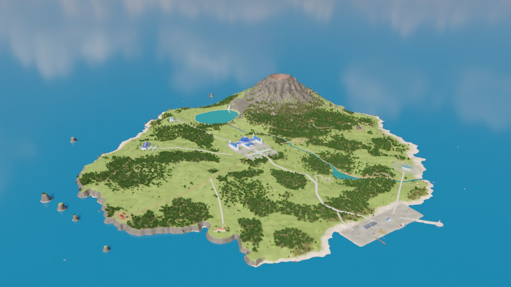

| | |
|---|---|
| 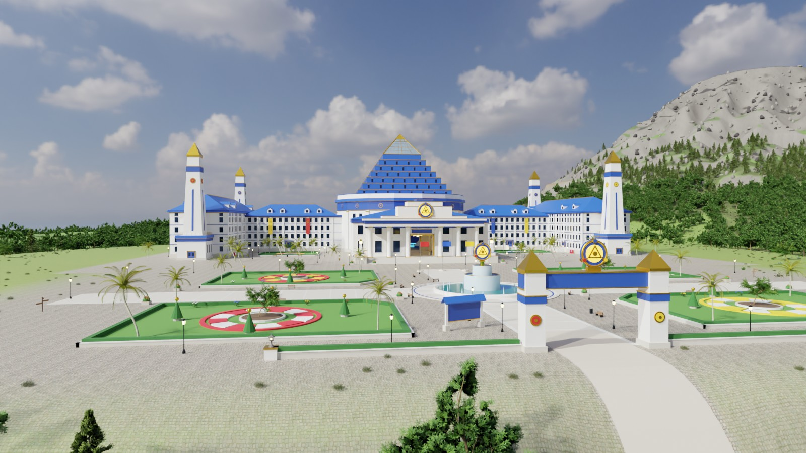 | 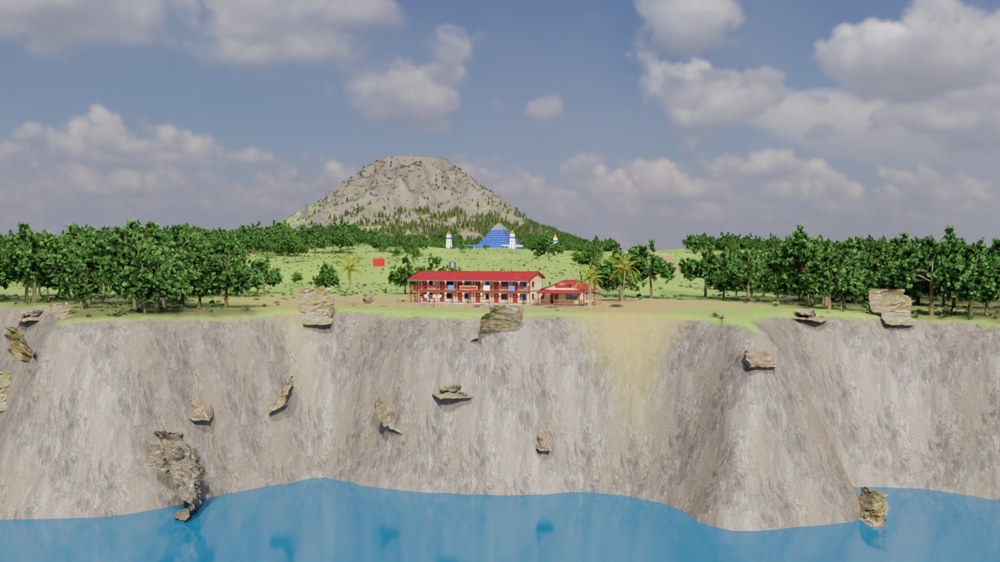 |
| 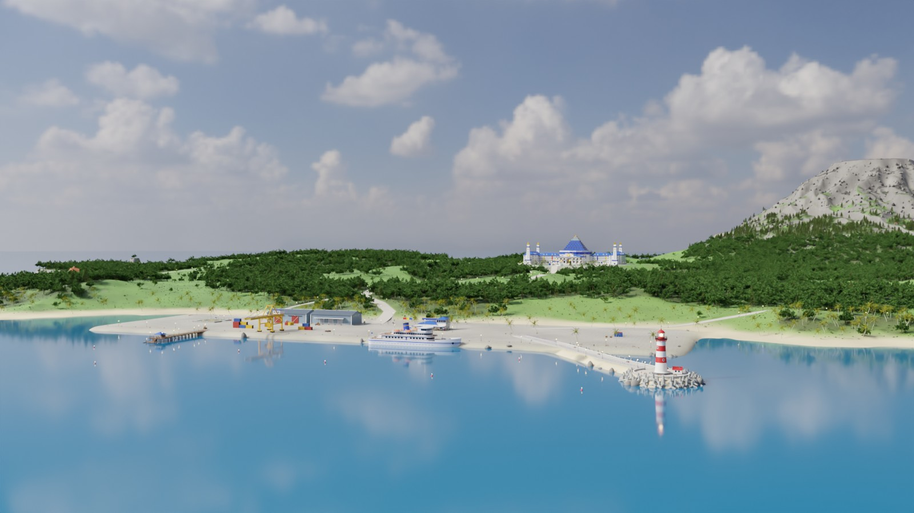 | 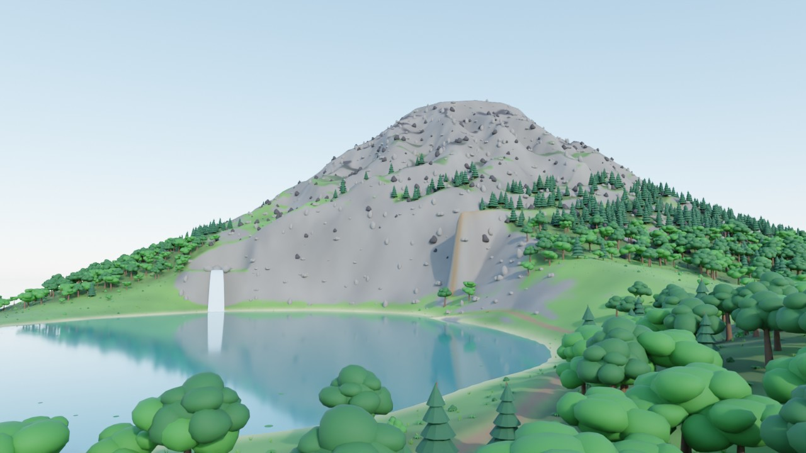 |
| 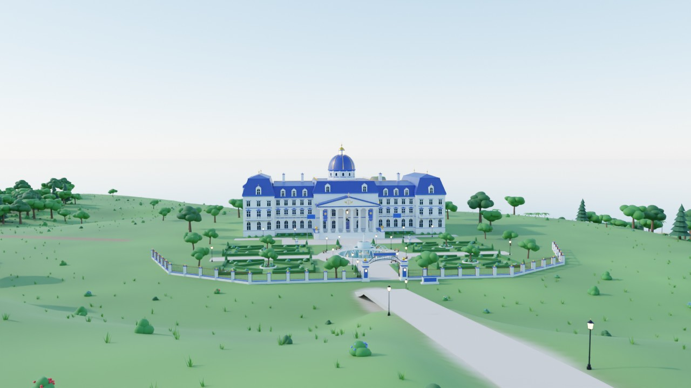 | 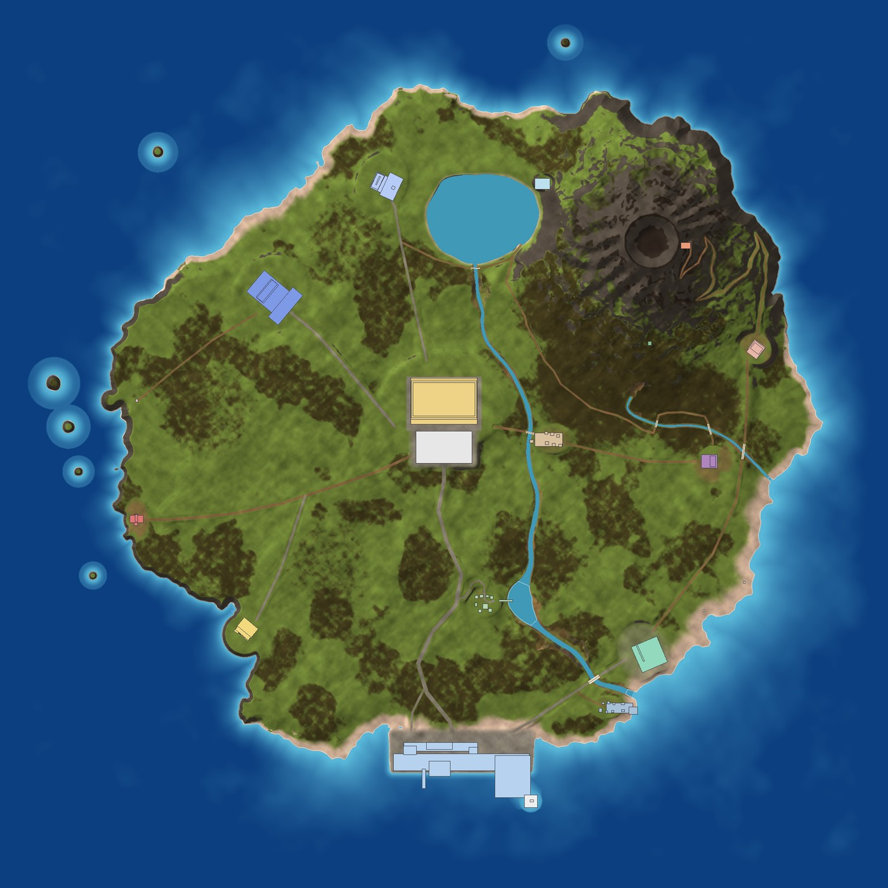 |

*(Cycles previews of the generated island. In Unreal it is lit by Lumen, a dynamic sky atmosphere,
volumetric clouds and a full day/night cycle.)*

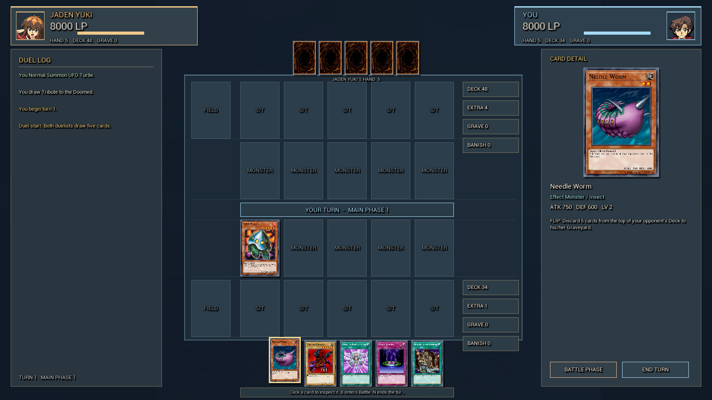

*The ported duel board: hand, field, card detail, piles, duel log and AI opponent. The deck picker and
result screen are in `Docs/renders/duel_deck.png` and `duel_result.png`.*

## GBA campaign port (Gate 1)

This branch (`port/baseline`) ports the single-player campaign of the GBA game into the 3D island. The masterplan is [Docs/PORT_MASTERPLAN.md](Docs/PORT_MASTERPLAN.md); live status is [Docs/PORT_STATUS.md](Docs/PORT_STATUS.md).

| 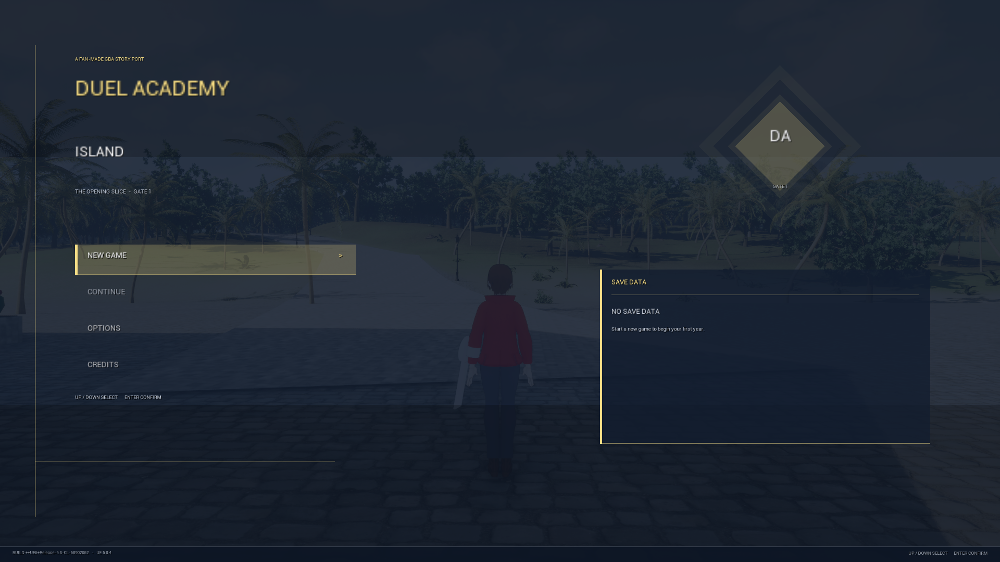 | 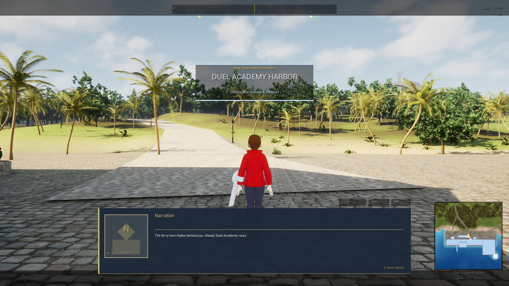 |
|---|---|
| **Title / New Game / Continue** | **Opening ceremony → Slifer dorm → first free roam** |
| 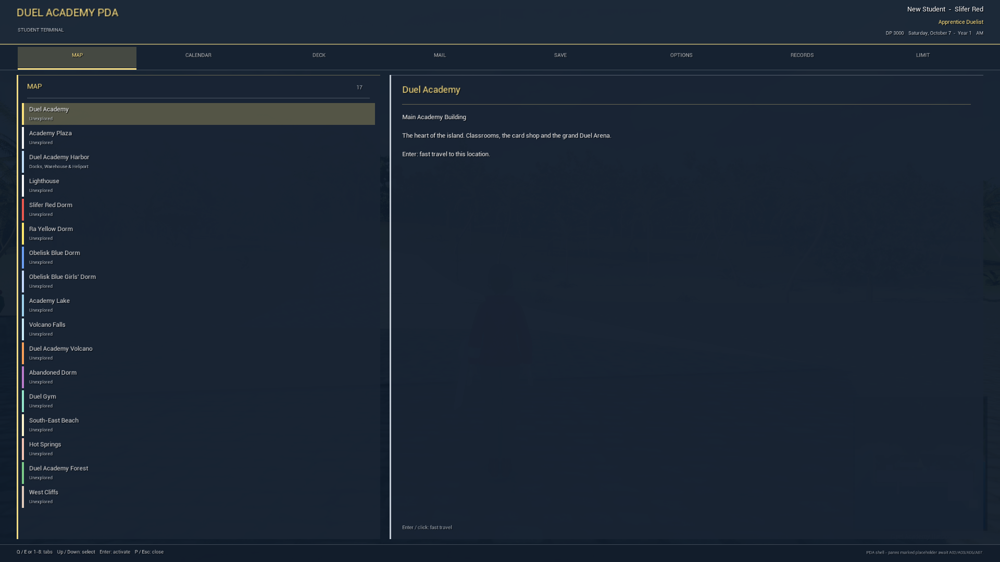 | 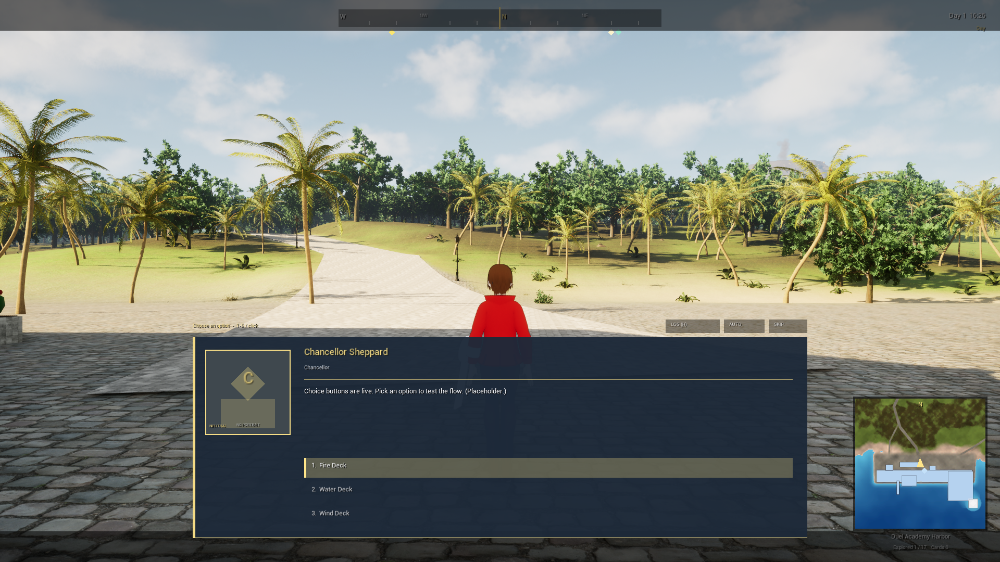 |
| **PDA map, calendar, deck, mail, save, options, records, limit** | **Dialogue with portraits, typewriter, choices and history** |

Implemented so far:

- **Campaign backbone:** 37 event definitions (35 canon + the opening checkpoint/free duel), 56 scenes, 161 dialogue lines, 6 email contacts, schedules, flags and rewards. The opening (`E01`/`E01b`) is fully runnable; the 35-event campaign scaffold validates and is reachable with progress.
- **Progression:** profile, 12-month calendar, DP, titles, dorm promotion/demotion, Dropout Boy recovery, flags, counters and settings.
- **Save/load:** 3 slots + autosave, atomic writes, checksum trailer, backup recovery, corruption detection and v0→v1 migration.
- **Duel content:** 26 duelists / 32 decks, 100 timed puzzles, 12 exam cycles, 48 booster packs, the full 1,200-card database, 76 Fusion recipes and 22 Ritual procedures.
- **Rules:** chain stack, targeting/choice queue, player response windows (you choose when to use Set Traps/Quick-Plays on the opponent's turn), player-chosen targets, activation timing, Quick-Play/Counter Trap scaffolding, banned/limited list, deck validation, ante, scenarios and result statistics.
- **Economy:** 1,200-card inventory, 3-copy ownership, deterministic pack opening, 48-pack shop, deck construction/validation.
- **UI:** title/new game/continue, PDA, dialogue, choices, history, credits, options and debug screenshot harnesses.
- **World data:** 36 mapped GBA locations, 89 scene anchors, 10 planned interior cells and 20 portal pairs.

Run the runtime suites from the editor/game command line:

```text
-DAProfileSelfTest        # 182/182
-DAEconomySelfTest        # 446/446
-DADuelRulesSelfTest      # 179/179 (incl. player response windows)
-DAStorySelfTest          # 14/14
-DAFullStorySelfTest      # 20/20, 35/35 reachable with progress
-DAPuzzleSelfTest         # 100/100 authored puzzles replayed in-engine
-DAExamSelfTest           # 12/12 monthly exam cycles
-DAPuzzleExamSelfTest     # both A07 suites in one process
-DAUITest                 # 8 PDA + 2 dialogue screenshots
-DATitleTest / -DANewGameTest
-DACastLifeTest           # anime cast: cel materials + stencil + PP, face morphs, lip-sync, springs, look-at
-DAMovementAudioTest      # procedural footsteps, surfaces, wading/swimming; writes Saved/MovementAudioTest.wav
```

Data validators:

```text
python Tools/validate/validate_all.py      # PASS, known gaps listed
python Tools/puzzles/validate.py           # 145 checks, 0 failures
python Tools/opponents/import_canon_decks.py --check  # 32/32 runtime decks, 37/37 constructed
python Tools/effects/audit.py              # PASS; 362 scripted + 345 vanilla, 493 pending
python Tools/portrait_check.py --strict    # every named speaker/opponent has a bust and all declared expressions
```

Still open before calling the port complete: the 493 pending card effects, exact GBA dialogue (the full text is local-only), renderer/interaction QA for the shop/deck/exam screens, interior generation/entry polish, dedicated 3D meshes for the named contacts who still use a generic student look, and the remaining canon gaps recorded in [Docs/PORT_STATUS.md](Docs/PORT_STATUS.md). The full E02–E33 campaign playthrough is covered by `-DAStoryPlaythroughTest`.

## What's on the island

| Location | What you'll find |
|---|---|
| **Duel Academy** (main building) | The landmark: classroom wings, four obelisk towers, a stepped-pyramid **Grand Duel Arena** you can walk into (full duels), lobby and **Card Shop** (booster packs). |
| **Academy Plaza** | Fountain courtyard, dorm flags, the direction board and the gate where the harbor road arrives. |
| **Slifer Red Dorm** | The humble two-storey cliff-top shack with the outdoor walkway, curry-scented dining hall and the best sunset view. |
| **Ra Yellow Dorm** | Tidy yellow dormitory with its famous cafeteria and sea-side balconies. |
| **Obelisk Blue Dorm** | Palatial white-and-blue mansion with portico, cupola, fountain and formal gardens. |
| **Obelisk Blue Girls' Dorm** | Elegant lakeside mansion with turrets, gazebo and a jetty with rowing boats. |
| **Academy Lake & Volcano Falls** | Lily pads, reeds, a waterfall plunging off the volcano's flank. |
| **Duel Academy Volcano** | Smoking, glowing crater with a lava lake, fumaroles and a viewpoint (that's still active!). |
| **Abandoned Dorm** | The decaying old Special Dorm deep in the forest — boarded windows, broken gate, an explorable creepy hall. |
| **Harbor & Lighthouse** | Quay, pier, warehouses, crane, terminal, heliport, the island ferry (bobbing at its berth) and the breakwater lighthouse with a rotating beam at night. |
| **Duel Gym & South-East Beach** | Beachside sports hall with practice duel fields, beach umbrellas, lifeguard tower and a beach duel court. |
| **Hot Springs** | Volcanic onsen with steaming rock pools. |
| **Forest, West Cliffs (Sunset Point), sea stacks** | Dense jungle with a hidden spirit shrine, cliff-top viewpoint deck, roaming students. |

**Every building can be entered.** Each door on the island is a real doorway with an automatic door (it swings
open away from you as you walk up, shoji and glass doors slide) and leads into a furnished interior designed
after its building - see [Interiors](#interiors) below.

The exact architecture of the anime's buildings was never published, so every building is a
faithful-in-spirit interpretation of the show's style (colours, silhouettes, dorm hierarchy, the
Egyptian-god theming), not a copy of any copyrighted asset. All card names in the card shop are original.

## The cast

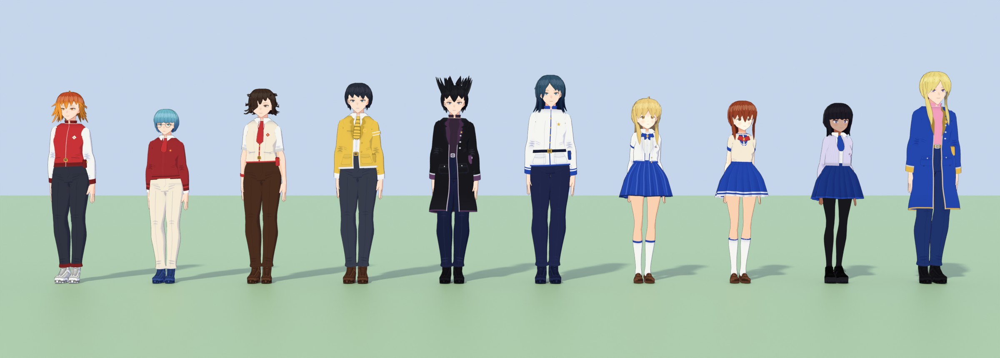

*The island's cast in the idle take (Cycles preview: VRoid bases with per-slot looks, real heights, cel shading).*

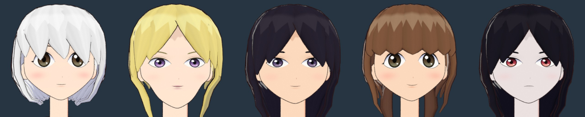

*Close-ups of the cast.*

Everyone on the island is built on the official **VRoid sample avatars** (AvatarSample_A / B / C by the VRoid
Project; their embedded terms allow modification, redistribution and commercial use, credit not required).
The base supplies the face, body and facial rig; each cast slot then gets its own look
(`Tools/dai/anime/looks.py`):

* **Hair** (`clumphair.py`, `atelier/hair.py`, recipes in `atelier/styles.py`): generated clump hair fitted to
  the base head, from 33 style recipes (long, hime, bob, ponytail, braids, buns, spikes, crest, undercut,
  curly ...) with per-look fringe, parting, ties, accent locks and ombre, on spring-bone chains.
* **Outfit** (`wardrobe.py`, `atelier/outfit.py`): garments cut from the base body's own cross-sections
  (bomber, sweater, vest, blazer, tunic, long coat, suit, sailor blouse, cropped blazer, cardigan, pinafore,
  dress) in the slot's dorm colour; skirts and coats hang from spring chains.
* **Face and size**: hair and eye colours, a face shape (`chin`, `jaw`, `cheeks`), a resting expression,
  glasses, and a real height.

Standing characters play a 12 s idle loop (weight shift, breathing, a look to one side) and blink through the
face morphs. The Fab Anime Character Pack is no longer used.

The project's **own generator** (`Tools/dai/anime/atelier`) can also model a whole character from scratch
and is used when the VRoid samples are not installed. Its proportions are fitted to measurements of the
samples (`Tools/measure_character.py`), but its surfaces are simpler than the sculpted VRoid meshes:

* **Head and face** (`atelier/head.py`, `paint.py`): the skull is a loft of tilted rings, so the front
  silhouette (cheek to chin) and the profile are shaped independently per design (`jaw`, `chin`, `cheek`,
  `face_w`). The eyes are painted at 2048 px: eye white with a lid shadow, a layered iris (limbal ring, pupil,
  lower glow, lash shadow, two highlights), upper lash with a wing, crease and lower lash, in eye shapes from
  round to sharp to sleepy. Blush, a nose tick and a lip tint are painted on the same sheet.
* **Facial rig**: 16 morph targets with the runtime's names (`Blink`, `Blink_L/R`, the visemes `A I U E O`,
  `Joy`, `Angry`, `Sorrow`, `Surprised`, `Fun`, `EyeJoy`, `BrowAngry`, `BrowSorrow`). Eyelids are skin patches
  tucked under the lid that slide over the painted eye; the mouth is two lip-line strips that open onto an
  interior; brows are separate strips. A design's resting expression is baked from the same morphs.
* **Clump hair** (`atelier/hair.py`): a few dozen thick, pointed locks combed from the crown over the scalp
  and then left to hang, flick or spike, over a closed scalp cap. Styles are recipes of sections (fringe
  kinds, side locks, back layers, spikes, tails, an antenna lock): long, hime cut, bob, flipped, ponytail,
  twin tails, wavy, side tail, low tails and short cuts for the girls; spiky, neat, messy, swept, mop, tied,
  tall and long for the boys. The hair sheet carries a painted highlight band at a fixed distance from the
  crown, so it forms a ring round the head, plus an optional second tone towards the tips.
* **Hair physics**: locks that hang free are skinned to spring-bone chains
  (`HairJoint_<Key>_Long<nn>_<j>` / `_Short<nn>_<j>`), grouped by sector so neighbouring locks swing together.
  They are the bones the native spring solver in `UDAAvatarAnimInstance` already drives (head and body
  collision, per-class stiffness, drag and gravity).
* **Body** (`atelier/body.py`): torso, neck, arms, hands with separate fingers and legs are lofted from
  cross-section tables, with a female and a male table and a `build` factor. Only the skin an outfit leaves
  visible is built.
* **Outfits** (`atelier/outfit.py`): every garment is cut from the body's own cross-sections plus an ease, so
  layers stack without intersecting: shirts, blazers, bombers, vests, long coats, sailor blouses, knitwear,
  pleated skirts, trousers and shorts, thigh-highs and socks, loafers, sneakers and boots, collars (shirt,
  stand, sailor), bows and ties, belts with a deck box, gloves, arm bands, back capes, scarves, badges,
  buttons, hair bands, hair bows and glasses. Open edges get an inner side and a rim. Trim is painted into a
  per-character atlas in UV space: hem bands, piping, cuffs, stripes, checks, gradients.
* **Cloth physics**: skirts, dresses, long coats and capes are skinned to eight shared two-segment hem chains
  (`skirt_*`, `coattail_*`), the bones the runtime's cloth springs swing.
* **Budgets**: a character is about 65-80k triangles with 5 materials (face, skin, hair, cloth atlas, ink
  outline) and 20-70 helper bones on one shared skeleton.

Named slots stand where the story needs them (`Tools/dai/anime/cast.py` keeps each slot's name, dorm, height,
dialogue and spawn marker; `looks.py` holds its look). Every other student is a named character
too: all 164 placed NPCs have a unique name; the 154 ambient markers get a dorm/location-appropriate voice
with three lines, a stable hair colour and a size variation (`Tools/dai/anime/roster.py`), on three generic
looks whose jacket and hair Unreal tints at runtime. The schedule-spawned story contacts carry their own
looks and dialogue in `Content/Data/World/spawns.json`.

Story portraits for speakers without ported art are rendered from the cast models
(`Tools/render_portraits.py`, expression recipes in `Tools/dai/anime/expressions.py`); `python
Tools/portrait_check.py --strict` verifies the base busts and every declared expression frame.

The skeleton uses the **UE5 Mannequin** naming (`pelvis`, `spine_01`, `upperarm_l` …). Locomotion is
solved rather than lifted from a stock clip: `Tools/dai/anime/gait.py` generates the **idle, walk and run**
cycles from a biomechanical gait model authored to human gait-lab norms. The walk is 1.5 m/s at 120 steps/min
(0.75 m steps, 60 % stance, ~4 cm pelvis bob); the run is 4.2 m/s at ~171 steps/min (1.47 m steps, ~0.2 s
ground contact and a real flight phase). The walking shoe rolls heel → flat → ball → toe, while the run lands
on a level midfoot and quickly recovers the heel after toe-off. Two-bone leg IK plants the ankle on the ground
while the pelvis follows the natural bob (walk: lowest at double support, highest at midstance; run: compressed
at midstance, highest mid-flight). Reach-aware release and landing anticipation keep the pelvis continuous at
the flight boundaries; the pelvis sways/yaws under a counter-rotating spine, the head stays level, and the arms
swing in opposition (a fraction of a beat behind the legs) with 80-105° elbow flexion and relaxed wrists. The
idle breathes ~15 times a minute with a slow weight shift.
Every cycle is validated at build time for contact speed, ground penetration, contact percentage, knee and
elbow ranges, loop closure **and human cadence / step length**, with dense sub-frame reach checks on the run,
so a take that would read as shuffling, as legs spinning faster than the body travels, or with an IK-clamped
running leg fails the build.

At runtime a native animation instance (`DAAvatarAnimInstance`) blends **idle → walk → run** following a
human cadence model: below the walk speed the step rate *and* the step length drop together (~√speed, no
fast little shuffle steps when starting, stopping or strolling slowly), and between walk and run the cadence
rises steadily. Both locomotion clips are driven from one contact phase whose rate is solved from the stride
of the pose actually shown and the (lightly filtered) real ground speed, so the planted foot moves backwards at
exactly the speed the capsule travels — the legs never cycle faster or slower than the body moves. The body
leans into turns (a fraction of the centripetal angle, capped) and briefly into acceleration and braking.

Jump, Fall, Land, Swim, Tread, Duel and gestures are crossfaded action layers with per-action blend times:

* **Jump / Fall / Land** are authored on the cast skeleton: the airborne jump (extended, toes pointed, then a
  tuck) is timed to the real rise (v₀ / g); walking off a ledge or a kerb keeps the stride and only shows the
  fall pose after a real drop; the landing absorbs through hips, knees and ankles with planted feet, and its
  depth scales with the impact speed (landing in stride keeps the legs running).
* **Swim** is a front crawl with ~40° body roll, high-elbow catch and pull, breathing every second stroke and a
  six-beat flutter kick; its stroke rate follows the swim speed (one cycle ≈ 2 m). Below a slow drift the
  avatar rights itself and **treads water** (sculling hands, eggbeater kick). The player swims 1.5 m/s
  (2.2 m/s with Shift) — the old 3.3 m/s outpaced any human swimmer and left the stroke behind the body.
* **Duel** stance has IK-planted feet, soft knees, the disk forearm level across the body and the card hand by
  the chest, breathing through a 4 s loop.
* **Gestures** (wave, yes / no, clap, interact) are CC0 Quaternius takes retargeted onto each model with the
  legs re-solved so both feet stay planted. Students wave when you walk up to them, nod (or shake their head)
  when they talk, and the player reaches out when using doors and counters; a gesture never plays while
  moving, so it cannot freeze the legs over the ground.

The player moves at a human-scale 1.5 m/s walk and 4.2 m/s sprint; NPCs stroll at 1.4 m/s and take a step or
two to get going and to stop. The single-node `SK_Student` and procedural fallback avatars use the same rules
(play rate = speed ratio; the procedural figure solves its stride and cadence from the ground speed).
Unreal's IK Retargeter auto-maps the skeletons to Manny/Quinn if you want the engine's own animations.

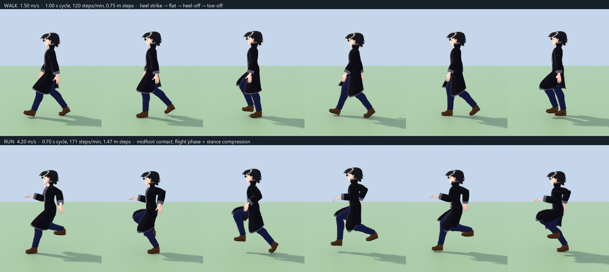

*Walk and run cycles rendered from the gait solver at human cadence (120 and 171 steps/min): walking heel strike, flat, heel-off and toe-off; running midfoot contact, a real flight phase and stance compression, with the arms and shoulders counter-swinging.*

### Anime rendering, cloth and animation

The cast is rendered, dressed and animated with the techniques current anime games use, all built from
free tools (Blender as a Python module, numpy / scipy, Unreal's own C++):

* **Cel shading** (`Tools/dai/anime/cel.py`): every cast material is classed as skin, face, hair, cloth or flat
  (eyes, brows, lashes, mouth). Each class has a hard half-Lambert light/shadow step with a coloured shadow
  (warm for skin, cool for cloth and hair), a rim light on the side the key light comes from, and an
  "angel ring" highlight arc on hair. In Unreal the characters stay lit by the real scene (Lumen GI, cast
  shadows, interior lamps, the night): `M_DA_Cel` turns specular off (no plastic sheen) and adds the rim
  and hair highlight from the key-light direction that `ADAIslandManager` publishes (`MPC_DuelAcademy`
  `SunDirection`, sun by day and moon by night). The stencil-masked post-process `PP_DA_Cel` then bands the
  lighting on the cast (custom stencil 1) into a lit tone and a shadow tone with a saturated, cooler
  shadow colour. The Cycles previews evaluate the same ramp.
* **Anime face normals** (`Tools/dai/anime/shading.py`): the face's corner normals are blended towards an
  ellipsoid fitted round the skull, so the face shades as one clean shape instead of throwing blotchy
  nose and lip shadows. They are exported as custom normals and imported as such.
* **Layered garments** (`Tools/dai/anime/atelier/outfit.py`): clothes are cut from the body's own
  cross-sections plus an ease per layer (legwear, shirt, jacket, coat), so a layer can not intersect the one
  under it in the rest pose, and the skin a garment covers is not built at all, so nothing can poke through.
  Garments are skinned with the same weight fields as the body they were cut from.
* **Cloth bones**: skirts and long coats get eight two-segment bone chains round the hem (`skirt_*`,
  `coattail_*`). They carry most of the hem, and the thighs carry the rest, so the legs still push the
  fabric. The chains are shared: every character uses the same rest pose, so the cast has one skeleton.
* **Secondary motion** (`UDAAvatarAnimInstance`): a VRM-style verlet spring solver in the native
  animation proxy swings the hair (the `HairJoint_*` chains, see "Hair physics") and the skirt and
  coat-tail bones in world space. They lag, overshoot and settle when a character starts, stops or
  turns, and a head sphere keeps hair out of the face. It runs after the blended takes, so it works on every
  clip.
* **Facial animation**: the face has 16 **morph targets** relative to each
  character's baked resting expression (`Blink`, `Blink_L/R`, the visemes `A I U E O`, `Joy`, `Angry`,
  `Sorrow`, `Surprised`, `Fun`, `EyeJoy`, `BrowAngry`, `BrowSorrow`). At runtime the characters blink every
  2-6 s (one in five is a double blink) and lip-sync while speaking, and emotions ease in and out
  (`UDAAvatarComponent::SetTalking / SetEmotion`). NPCs smile a little while you chat with them.
* **Look-at**: neck and head turn towards the player while talking or standing close (clamped to 65° yaw and
  28° pitch, split 40 / 60 between neck and head, released when you walk behind them).
* **Takes**: the idle stands in contrapposto (the weight on one leg, hip shifted over it, the free knee
  relaxed and the shoulders counter-tilted) with breathing on top. A new **Talk** take raises a hand
  palm-up in two explanatory beats with head nods, and plays over the idle while a character speaks.
* **Real heights**: each character has a standing height in cm (`cast.py` `height`: students 153-183 cm,
  staff up to 186 cm, generic boys 170 cm and girls 160 cm ±5 %). The runtime scale is derived from the
  body's own height, so a door, a stair step and a 1.5 m/s walk read at the same human scale as
  the people using them.

**Using artist-made models.** Any slot or design can be replaced by a rigged humanoid **VRM / glTF / FBX**
that you made, commissioned or licensed: put it in `Tools/thirdparty/<pack>/<asset>/` with a `SOURCE.txt`,
register it under `"anime_models"` in `Tools/thirdparty/registry/anime.json`, name the slot it replaces under
`"cast_models"` and run `Tools/build_island.py cast`. The model keeps its own face, hair and outfit; its bones
are renamed to the cast scheme and it gets the cast's cel materials, outline and takes.
[Docs/CHARACTER_MODELS.md](Docs/CHARACTER_MODELS.md) lists what the model needs for the facial rig and the
hair and cloth springs to work. Check that its licence allows redistribution before committing it.

## Interiors

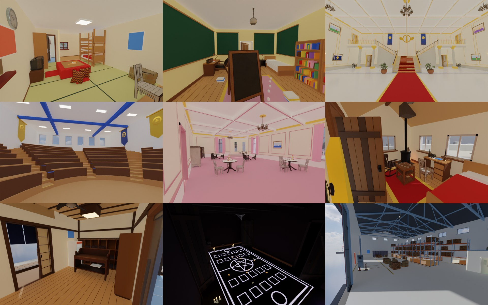

*(Slifer room 101, Bastion's attic observatory at Ra Yellow, the Obelisk cupola lookout, a 3F physics lab at Duel
Academy, the girls' tea room, a lighthouse window gallery, the hot-spring washing area, the abandoned dorm's
clockwork room and a ferry cabin - Cycles previews lit by the rooms' own light sockets.)*

**The interiors are part of the overworld.** There is no loading screen and no separate interior map: every
building is hollow and furnished inside the one open-world level, and every door is an automatic door that
opens as you walk up (`ADADoor`). Under a roof the player camera pulls in to a 2.4 m boom and eases back out
outdoors, so rooms stay readable (`ADAStudentCharacter::IndoorZoom`). Interiors are lit day and night by their
own light sockets and take daylight through real window openings (Lumen).

**Every floor of every building is walk-in.** Each storey a building shows from outside - window rows, dormers,
turrets, towers, the ferry's portholes - is a real floor behind clear glass, reached by inner stairs with
landings, styled after its building and furnished: 587 automatic doors and 350 interior preview cameras across the rooms, corridors and stair
halls. Windows that stay painted are those with nothing walkable behind them: the arena pyramid's roof slits, the
arena drum's windows that face the arena volume or sit behind the raked stands (also behind the lecture halls'
seating), the Academy's hip-roof dormers over the top storeys' ceilings and the ferry's outboard lifeboats;
the abandoned dorm's holed attic stays closed behind boarded windows, and the lighthouse lantern is reached by
its hatch ladder (its glass is clear). `Tools/storey_report.py` lists them per floor.

* **Cel-shaded interiors**: walls, floors and fittings use the cast's cel material (`M_DA_Toon`: flat colour
  with a soft fill light, a faint plank / tile / tatami detail).
* **Open-source furniture at real size**: 152 CC0 models from [Poly Haven](https://polyhaven.com) - sofas,
  school desks, beds, wardrobes, chandeliers, wall lamps, lanterns, plants, paintings, clocks, a CRT TV, a
  cash register, laptops, binders, chess, a dartboard, kitchenware and food, vases and statues, AC units ...
  fetched md5-verified by `Tools/fetch_polyhaven.py` (only the base-colour maps are kept for the newer set)
  and registered in `Tools/thirdparty/registry/interiors.json`. They are imported at their **real-world
  size** (Poly Haven models are true scale), their photo textures re-painted into flat cel colours and given
  an inverted-hull **ink outline**. Every model has a procedural stand-in (`Tools/dai/assets/furniture.py`).
* **GX pieces modelled by the pipeline** (`Tools/dai/assets/interior.py`): Slifer triple bunk beds, kotatsu with
  mikan, tatami, curved lecture-hall tiers, chalkboards with duel theory, lockers, fireplaces, a grand piano,
  spiral stairs, coffered and beamed ceilings.
* **The lived-in layer** (`Tools/dai/assets/detail.py`): light switches beside every door, outlets, smoke
  detectors, AC units, sprinklers, vents and exit signs by building type; desk, table and shelf sets, floor
  clutter, coat hooks with dorm jackets, blinds, radiators, trophies, deck boxes, card spreads and duel disks.
* **Real-world scale**: ordinary doors 0.9-1.0 x 2.05-2.2 m, ceilings 2.4-3.3 m (tall palace rooms get dados,
  picture rails and low-hung chandeliers), stairs 0.16-0.19 m rise / 0.27-0.30 m run, desks 0.76 m, counters
  0.9 m, switches at 1.1 m, outlets at 0.3 m.
* **Automatic doors** (`ADADoor`, C++): one actor per doorway with a leaf in the building's door style
  (`Tools/dai/assets/doors.py`); opens away from whoever approaches, shoji and glass doors slide. The leaves
  never block anyone.
* **Performance**: dense furnished meshes go on **Nanite** automatically (their glass is split into small
  classic meshes), furniture is instanced, and the Academy keeps one in four of its indoor students.

| Building | Inside |
|---|---|
| **Slifer Red Dorm** | 12 dorm rooms on both floors (genkan, tatami, triple bunk, kotatsu, desk, CRT TV, WC, manga piles, laundry line); Jaden, Syrus and Chumley's room 101; Professor Banner's study with Pharaoh; dressed dining hall and galley kitchen. |
| **Ra Yellow Dorm** | Hall, lounge, duel practice room, study, office, laundry, kitchen; 22 twin rooms behind the 30 balcony French doors; top-floor library and Bastion's equation room 309; a walk-in attic through the dormers with storage, a study nook and Bastion's telescope observatory; the cafeteria. |
| **Obelisk Blue Dorm** | Marble foyer with imperial staircase, library, lounge, music room, banquet hall, kitchen, duel salon, trophy hall, games room; rooms 201-208 and 301-308 with en-suites, eight suites; the attic storey (suites 401-408, artist's studio, servants' rooms) and a cupola lookout in the dome. |
| **Obelisk Blue Girls' Dorm** | Pink foyer, parlour, garden hall, library, tea room, dining room, salon, music gallery; suites with canopy beds and en-suites on two floors, a ladies' salon, walk-in bays; an attic studio and maids' rooms, four turret-top lookouts. |
| **Duel Academy** | Lobby, glazed card shop, arena concourse; four tiered lecture halls, duelist waiting rooms, wing galleries, exam hall, library hall and club hall; pavilions with five floors of classrooms, labs, clubs, studios, a trophy floor and an attic club floor; tower stair halls and balcony observation decks; Chancellor Sheppard's and Dr. Crowler's office suites, faculty rooms, archives, observatory and broadcast room. |
| **Harbor** | Warehouses with offices, crew room and a rare card vault; terminal hall, ticket office and harbour master's room; heliport hut with check-in and pilot lounge; crane cab and machinery house on stair towers; the ferry's saloon, sky lounge, bridge and a cabin deck behind its portholes. |
| **Lighthouse** | Store room, spiral stair with four window galleries (lookout, archive, weather room, lamp store), the keeper's watch room; keeper's hut. |
| **Abandoned Dorm** | Hall, library, portrait salon, ritual room; eight ruined ground-floor rooms (kitchen, scullery, warden's office, boiler room ...); two upper dorm floors with 28 ruined rooms through the nailed-up stairwells; the clock tower up to the clockwork room. |
| **Duel Gym** | Foyer and front gallery behind the glass front, court, galleries, office, store, lockers, showers, first-aid corner. |
| **Hot Springs** | Changing rooms, bandai, washing areas, rest pavilion. |
| **Lifeguard tower, shrine, viewpoints** | Dressed at real scale (duty gear, offerings, telescopes, boards). |

**Checking it** (no Unreal needed, Blender-as-a-module interpreter). The interior spec - audit clean, detail
coverage of every interior view >= 45 % in rooms and >= 35 % in halls / corridors / stairs, no painted windows
with a floor behind them - passes for every location (`spec_check.py`; the only waivers, with their reasons,
are the gym's 60 x 40 m court and the ferry's 1 m wide corridor seen end-on):

```bash
.venv/bin/python Tools/preview_asset.py ra --views inside --camera attic --lit --scale-ref   # lit, with a 1.75 m student
.venv/bin/python Tools/audit_interiors.py obelisk       # floating / sunk / clipping furniture, doors, detail coverage
.venv/bin/python Tools/storey_report.py academy          # painted vs real windows per floor -> closed storeys
.venv/bin/python Tools/spec_check.py                     # the interior spec, pass/fail for every location
.venv/bin/python Tools/people_check.py                   # room for a person at every fast-travel point + NPC spot
.venv/bin/python Tools/preview_interiors.py              # Docs/renders/interiors.jpg
```

## Gameplay features

* Third-person anime student (the cast's generic boy) — switch your **dorm jacket**
  (Slifer Red / Ra Yellow / Obelisk Blue / Society of Light white) with **J**; NPC students wear theirs. The
  older CC0 low-poly student and a procedural avatar remain as fallbacks when no cast is imported.
* **Human-scale locomotion**: a 1.5 m/s walk (WASD) and 4.2 m/s sprint (Shift) at human cadence (120 and
  ~171 steps/min), with phase-matched idle/walk/run blending whose step rate and length follow real ground
  speed, foot-planted cycles, lean into turns, and jump/fall/land/swim/tread transitions timed to physics.
  The old 450/950 cm/s arcade speeds were retired because they made any authored stride skate.
* Location banners + "**New location discovered**" tracking (17 named locations and 19 rooms), compass, minimap.
* **Island map with fast travel** (M): pick a location with Up/Down + Enter or click a marker. The selected
  location opens its list of rooms you can travel straight into - the Academy's main hall, Grand Duel Arena,
  Card Shop, lecture halls, library and faculty annex, every dorm's hall / dining room, the ferry terminal, the
  lighthouse watch room, the gym court, the bathhouse and the abandoned dorm's hall and ritual chamber. Every
  arrival point is checked for room to stand (`Tools/people_check.py`); the volcano point is the **Crater Rim**
  lookout, at the top of the switchback trail from the hot springs and the stone summit stair.
* **A full duel system**: a deterministic 1,200-card rules engine (summons, tributes, Fusion and Ritual
  summons, chains, traps, hand-limit discards and a duelist AI), a Canvas board with hand, field,
  deck/extra/graveyard/banish piles, card detail, duel log, animations and a result/rematch screen.
  Duel fields pick a resident opponent; named students (Jaden, Syrus, Bastion, Chazz, Alexis, Zane and
  Crowler) can also be challenged after talking to them once. Card scans are shown on the board.
* **Card Shop**: open booster packs (32 original cards, rarities from Common to Ultra Rare), track your collection.
* Signs with lore everywhere, named students from all three dorms who wander around and chat (E); every
  ambient NPC has a unique name, hair colour and three-line voice, and the story contacts have their own
  dialogue. Nobody stands in the furniture: at build time every NPC spot is tested as a person-sized capsule
  against walls, fixtures, furniture and props (NPCs in the way step to the nearest clear spot in the same
  room, never in a doorway), and each NPC gets precomputed strolls - straight, clear, on one floor - instead
  of random wandering.
* Walk into every building and up every floor: automatic doors, the camera pulls in indoors, furnished rooms everywhere.
  All furniture is solid: catalog props carry box / hull collision (wall art, lamps and table-top clutter stay
  walk-through), and the furniture modelled into the no-collision decor meshes gets invisible collision boxes
  (`<Location>_Blockers`, `Tools/dai/collision.py`: one oriented box per table, bed, bench, counter, ...; rugs,
  wall-hung and hanging things, trims and doorways are left free).
* **Day/night cycle** (Lumen GI, sky atmosphere, moon): lamps, windows and the lighthouse turn on at
  night, the crater glows. Time controls: **T** pause, **[ ]** speed, **N** skip 3 h.
* Swimmable ocean and lake (single-layer water), volcano smoke, hot-spring steam, waterfall mist,
  bobbing ferry and boats, synthesized ambience (surf, wind, birds, volcano rumble, waterfall, crowd).
* **Original area music**: 22 seamless loops rendered with the project's Juicebox Studio synth engine -
  academy suite, all four dorms, every outdoor zone, every enterable room, plus title, story and duel
  themes. The music director crossfades on zone/room changes, follows story `music` cues, and honours
  the options BGM volume. See [Docs/Audio](Docs/Audio/README.md).
* Procedural on-foot sound: footsteps follow the actual gait contacts and change with the ground
  (grass, dirt, gravel, sand, stone, wood, metal, carpet), with wading splashes, swim strokes,
  jump/landing impacts, clothing rustle, breathing and wind. No sample assets are used.
* ~90 000 instanced trees, palms, bushes, ferns, flowers and rocks (Nanite).

### Controls

| Key | Action |
|---|---|
| WASD / left stick | Move (Z/Q also work on AZERTY) |
| Mouse / right stick | Look, mouse wheel = zoom |
| Shift | Sprint (boost while riding) |
| Space | Jump |
| E | Interact (signs, card shop, duel fields, students) / close message |
| M or Tab | Island map & fast travel |
| V / gamepad Y | Motorcycle: summon it and ride, press again to get off (outdoors only; see below) |
| J | Switch dorm jacket |
| F | Raise duel disk |
| T, [ ], N | Pause time, slower / faster, skip 3 hours |
| F1 or H | Controls overlay |
| **In a duel** | |
| Mouse | Select a card, use the action buttons, inspect piles |
| B | Enter the Battle Phase |
| N / End | End the turn |
| Esc | Deselect / close a pile / leave the duel |
| 1, 2, 3 | Pick a starter deck in the deck picker |

**Motorcycle.** Press **V** (gamepad **Y**) anywhere outdoors to summon an all-terrain dirt bike in your
dorm's colour and ride it; press it again to stow it. Steer with WASD / the left stick (camera-relative:
the bike carves towards the direction you push, and pushing back brakes and turns round), hold **Shift / L3**
to boost (54 km/h cruising, 79 km/h boosted), and **Space** hops. It climbs steeper slopes than you can on
foot, rolls over kerbs and rocks and fords shallow water. It is stowed automatically at interior doors, in
deep water and when a duel starts. The chase camera swings in behind the bike when you stop moving the mouse.

The bike is a spoked, knobby enduro with a long-travel fork, chain and sprocket, finned single-cylinder
engine, radiator, exhaust and working head/tail/brake lights. Its sound is synthesised live from the
drivetrain: an electric start and settling idle, a five-speed box that shifts on rpm, throttle-dependent
exhaust bark, intake and valve noise, gearbox/chain whine, tyre and wind roar, and exhaust crackle when you
chop the throttle or downshift.

On foot, a second runtime synth tracks the locomotion phase and the material under the player: heel/toe
contacts on grass, dirt, gravel, sand, stone, wood, metal and carpet, splashy steps in shallow water,
alternating crawl strokes with bubbles while swimming, a body thump and surface scuff on landing, plus a
quiet cloth/breath layer and speed-driven wind. The ambient surf, waterfall, hot-spring and wind beds were
rebuilt with layered swells, flow surges, foam/spray and bubbles.

## Getting started

**Requirements:** Unreal Engine **5.8** and a C++ toolchain for your platform (Visual Studio 2022 with the
"Game development with C++" workload on Windows, Xcode on macOS, the bundled clang toolchain on Linux).

1. Clone this repository.
2. Open `DuelAcademyIsland/DuelAcademyIsland.uproject`. Unreal asks to build the missing
   `DuelAcademyIsland` module — click **Yes**. (Or right-click the .uproject → *Generate project files*
   and build the `DuelAcademyIslandEditor` target from your IDE.)
3. On first launch the editor asks **"Build the island now?"** — click **Yes**. The script imports the
   generated assets from `DuelAcademyIsland/SourceAssets`, creates all materials, assembles the level
   `/Game/DuelAcademy/Maps/DuelAcademyIsland` and saves it (takes a few minutes). You can re-run it
   any time from the **Duel Academy** menu in the main menu bar (*Build Island* / *Rebuild Level Only*).
4. Press **Play**. You arrive at the harbor next to the ferry — welcome to Duel Academy!

Headless alternative for step 3:

```bash
UnrealEditor-Cmd DuelAcademyIsland/DuelAcademyIsland.uproject -ExecutePythonScript="$PWD/DuelAcademyIsland/Content/Python/build_island_cli.py"
```

## How it's built

```
Tools/                      procedural asset pipeline (Python + Blender 5.2 "bpy" module)
  build_island.py           runs every stage -> DuelAcademyIsland/SourceAssets
  render_portraits.py       renders the dialogue / duel busts and expression frames for every speaker and NPC
  fetch_expression_portraits.py  fetches the official Duel Links expression cut-ins for the regulars
  make_ui_portraits.py      draws the narration, PDA and event-opponent UI icons
  portrait_check.py         portrait coverage report (`--strict` fails on a missing bust or expression)
  preview_asset.py          render previews of a single location module
  dai/config.py             island layout: locations, heights, paths, volcano, lake ...
  dai/terrain.py            heightfield, splat maps, colour map, Landscape heightmap
  dai/terrain_mesh.py       64 terrain chunks + ocean / sea floor / lake surfaces
  dai/geo.py                MeshBuilder modelling kit (walls with openings, roofs, lathes, stairs ...)
  dai/palette.py            material palette (slot names -> UE material instances)
  dai/assets/*.py           one module per location (academy, dorms, harbor, ...) + props + avatar
  dai/assets/interior.py    interior kit: cel palette, walls with doors/windows, stairs, lights, GX furniture
  dai/assets/doors.py       door styles -> SM_Door_* leaf meshes for the automatic doors
  dai/assets/furniture.py   SM_Int_* furniture catalog (Poly Haven CC0) + procedural stand-ins
  fetch_polyhaven.py        downloads / verifies the CC0 Poly Haven models + writes their SOURCE.txt
  dai/assets/detail.py      the lived-in layer: fixtures, desk / table / shelf sets, clutter
  dai/inspect.py            interior audit + lit / scale-reference previews (audit_interiors.py, storey_report.py)
  dai/collision.py          invisible collision boxes for the furniture in the no-collision meshes
  dai/placement.py          standing-room checks (person capsules), NPC settling + stroll routes, arrival points
  dai/layout.py             places everything, scatters vegetation, writes layout.json
  dai/textures.py           detail/normal maps from the photo sets (procedural fallback), terrain layers
  dai/thirdparty.py         third-party ingestion: registry, glTF/FBX/OBJ import, PBR texture extraction
  dai/character.py          rigged third-party student -> SK_Student + A_Student_<State> FBX
  dai/anime/                anime cast on one UE5-Mannequin-named skeleton; biomechanical idle/walk/run
                            gait solver (gait.py, foot-planting IK + validation); CC0 gesture takes
                            retargeted onto the skeleton, cast.json
                            (cast.py = who is who; roster.py = named ambient NPC identities; expressions.py =
                            morph recipes for the portrait frames; portrait_cast.py = portrait-only slots;
                            models.py = import path for artist-made models)
  dai/anime/atelier/        the project's own character generator: head + painted face + facial rig, clump
                            hair with spring chains, body, layered outfits, the original cast designs
  dai/credits.py            CREDITS.md from the SOURCE.txt files
  thirdparty/               curated CC0 / CC-BY source assets + registry/*.json
  dai/audio.py              synthesized seamless ambience loops and UI sounds
  (the 22 area themes are rendered by the Juicebox Studio engine in C:\dev\Music;
   see Docs/Audio/README.md)
  dai/render.py             Cycles preview renders (Docs/renders)
DuelAcademyIsland/          the Unreal Engine 5.8 project
  Source/DuelAcademyIsland  C++ gameplay module (character, NPCs, HUD, zones, day/night, duels, ...)
  Content/Python            editor build scripts (import, materials, level assembly, menu)
  SourceAssets/             generated FBX / PNG / WAV / JSON (committed, so Blender is optional)
  Config/                   Lumen + Nanite + Virtual Shadow Maps + MegaLights, Enhanced Input
```

* **Terrain**: a 3 km × 3 km heightfield (west cliffs, south-east beach, harbor cove, lake, 300 m
  volcano with crater) → 64 mesh chunks with complex collision and a splat-mapped 8-layer material
  (grass, forest floor, sand, wet sand, rock, volcanic ash, dirt paths, paving).
* **Buildings**: modelled procedurally in Python with a small modelling kit; every face carries a
  palette material name that becomes a Material Instance in Unreal; walkable interiors use per-poly
  collision.
* **Third-party art (CC0 / CC-BY)**: generic assets come from free, openly licensed libraries instead of
  being modelled by hand — Poly Haven / ambientCG photo-scanned PBR textures for every terrain layer
  and building surface, Poly Haven pure-sky HDRIs, and curated vegetation, rocks, props and an
  animated student character (see [CREDITS.md](CREDITS.md)). Each asset lives in
  `Tools/thirdparty/<source>/<asset>/` with a `SOURCE.txt` (URLs, license evidence, hashes) and is
  mapped onto the catalog by `Tools/thirdparty/registry/*.json`; the pipeline imports, normalises
  and re-exports it with PBR material instances (`M_DA_PBR`, `M_DA_PBRFoliage`). Anything not
  registered falls back to the procedural version, so the build never breaks on a missing asset.
* **Unreal side**: no binary assets are committed. `init_unreal.py` registers the menu; the build script
  creates master materials node-by-node (terrain splat blend, single-layer water, hologram, smoke, lava,
  foliage wind …), imports meshes/textures/sounds and spawns ~1 500 actors + ~90 000 instances.
  Input actions, HUD and effects are created in C++ at runtime, so nothing depends on hand-made assets.

### Regenerating / customising the island (optional)

```bash
python3.13 -m venv .venv && .venv/bin/pip install bpy numpy scipy pillow   # Blender 5.2 as a module
npm install -g @gltf-transform/cli                 # optional: decodes meshopt-compressed glTF downloads
.venv/bin/python Tools/build_island.py            # textures, terrain, meshes, audio, layout, cast
.venv/bin/python Tools/build_island.py render     # preview renders -> Docs/renders
.venv/bin/python Tools/preview_asset.py academy   # iterate on one location
.venv/bin/python Tools/build_island.py cast       # rebuild the anime cast only
.venv/bin/python Tools/preview_anime.py jaden alexis --state Walk --frame 10   # cast preview render (slot ids)
python Tools/apply_npc_roster.py                  # re-apply the unique ambient NPC identities to layout.json
python Tools/import_fab_nature.py                 # optional licensed Fab nature/prop packs (local-only, gitignored)
UnrealEditor-Cmd ... -run=pythonscript -script=Tools/apply_world_npc_data.py   # refresh NPCs in the saved level
UnrealEditor-Cmd ... -run=pythonscript -script=Tools/apply_fab_locomotion.py   # install the retargeted takes
UnrealEditor-Cmd ... -run=pythonscript -script=Tools/test_fab_locomotion.py    # verify the installed retargeted takes
```

The optional Fab nature / prop packs replace the native procedural trees, palms,
bushes, ferns, flowers and grass clumps, the remaining procedural street
furniture (bollard, planter, vending machine) and the simple rocks/outdoor props
with the same stylized assets as the reference UE5 project. The swap is applied
when the Unreal level is built; see [Docs/FAB_NATURE.md](Docs/FAB_NATURE.md) for
the install and mapping and [Docs/FAB_ASSET_AUDIT.md](Docs/FAB_ASSET_AUDIT.md)
for what is still procedural. Without the packs the native vegetation, curated
CC0 props and procedural street furniture stay in place.

The gait solver validates every generated cycle before export (contact speed, penetration, contact
percentage, knee range, loop closure). To check the runtime blend and planted feet in the engine:

```text
UnrealEditor-Cmd DuelAcademyIsland.uproject /Game/DuelAcademy/Maps/DuelAcademyIsland -game -windowed -DALocomotionTest
```

`-DACastLifeTest` checks the cast's runtime layer the same way: the player's mesh must carry the face
morph targets and use `M_DA_Cel*` on its slots with custom-depth stencil 1, `PP_DA_Cel` must load, the
visemes must move while it talks, the spring chains must deflect while it sprints and stops, and the head
must turn to a look-at target. It logs `DACastLifeTest: PASS|FAIL <check>`, saves `DACastLife*.png` and
exits with status 0 only if every check passed.

It teleports to the plaza, walks, sprints and stops from a side camera, saves `DAWalk*/DARun*/DAStop`
screenshots and logs the planted ball-joint speed (about 7 cm/s at the 1.5 m/s walk and 13 cm/s at
the 4.2 m/s run; 0 would be a perfectly locked foot).

Edit `Tools/dai/config.py` (positions, heights, paths), a location module in `Tools/dai/assets/`, or
`Tools/dai/palette.py` (colours), regenerate, then *Duel Academy → Build Island* in the editor.

### Optional: real Landscape instead of mesh terrain

`SourceAssets/Heightmap/T_IslandHeight16.png` (2017 × 2017, 16 bit) matches the mesh terrain exactly.
In Landscape mode → *Import from file*: **Location** X = -153600, Y = -153600, Z = 19200;
**Scale** X = Y = 152.381, Z = 100. Then hide the `Island/terrain` actors.

## Asset sources

| What | Source (license) |
|---|---|
| Terrain layers (grass, forest floor, sand, wet sand, volcanic ash, rock, dirt, paving) | Poly Haven / ambientCG photo-scanned PBR sets (CC0) |
| Building surface detail (plaster, marble, tiles, concrete, planks, siding, roof tiles, bricks, corrugated metal, fabric) | Poly Haven / ambientCG (CC0) |
| Skies for the preview renders | Poly Haven pure-sky HDRIs (CC0) |
| Palms, acacia, hydrangea and rose bushes | Sweet Home 3D library by Space Mushrooms & Scopia (CC BY 3.0) |
| Broadleaf, pine and dead trees, bushes | generated with EZ-Tree (MIT) with Poly Haven / TextureCan bark (CC0) |
| Fern, grass clumps, tropical undergrowth | Poly Haven photoscans (CC0) |
| Boulders, rock faces, cliffs, coastal rocks, driftwood, stumps, pebbles | Poly Haven photoscans (CC0); basalt by yonimantz (CC BY 4.0) |
| Street lamps, bins, drums, buoys, picnic tables | Poly Haven (CC0), Khronos glTF samples (CC0) |
| Interior furniture and decor (152 models: seating, tables, beds, storage, lighting, decor, appliances, kitchenware, food, school and office items) | Poly Haven (CC0), real size, cel-painted + ink outline by the pipeline |
| Benches, signposts, fences, crates, containers, rowboats, beach umbrellas and chairs, stone lanterns | Sketchfab authors (CC BY 4.0) |
| Fishing trawlers | Poly by Google (CC BY 3.0) |
| Duel Academy buildings, dorms, arena, harbor, lighthouse, ferry, volcano/waterfall features, flagpoles, bollards, duel dummies, vending machines, interiors, door leaves, sounds | original, built by the pipeline in `Tools/` |
| Rendered character portraits for story speakers and NPCs | original, rendered from the project's own cast models by `Tools/render_portraits.py` |
| Duel card names, card text, card scans, fusion recipes and starter deck lists | Yu-Gi-Oh! TCG, Konami/Shueisha - non-commercial fan reference; scans via YGOPRODeck, data ported from the reference UE5 duel engine |
| Duel character busts / expression frames (`Content/Data/Portraits`) | Konami *Duel Links* character renders (fan-project reference set); not redistributable. The in-world island cast is the project's own models (`Tools/dai/anime/atelier`) |

Every third-party folder under `Tools/thirdparty/` has a `SOURCE.txt`; [CREDITS.md](CREDITS.md) lists all of
them with the required CC BY attribution text (also shown in-game on the F1 controls panel).

## Notes & limitations

* The C++ module and editor scripts target the UE 5.8 API. They were written and smoke-tested outside
  the engine (the editor scripts against a mocked `unreal` module), so if your engine build reports an
  API difference, the error will point at a single, isolated call — please open an issue.
* Performance: the island uses Nanite foliage, MegaLights for ~300 small lights and Lumen; on low-end
  GPUs lower *Settings → Engine Scalability*.
* Non-commercial fan project. *Yu-Gi-Oh! GX* and its characters, names and settings belong to their
  respective owners. The duel card database uses card names and scans for identification and commentary;
  the character busts in `Content/Data/Portraits` are Konami *Duel Links* fan-reference renders and must
  be kept out of any public build. The island's in-world cast is built on the VRoid sample avatars under
  their embedded terms (see [CREDITS.md](CREDITS.md)).
