# Duel Academy Island — Unreal Engine 5.8

A fully explorable, fan-made recreation of **Duel Academy island** from *Yu-Gi-Oh! GX*, built for
**Unreal Engine 5.8** entirely with free tools: Blender 5.2 (used as a Python module), Python/numpy and
the Unreal Editor's own Python + C++.

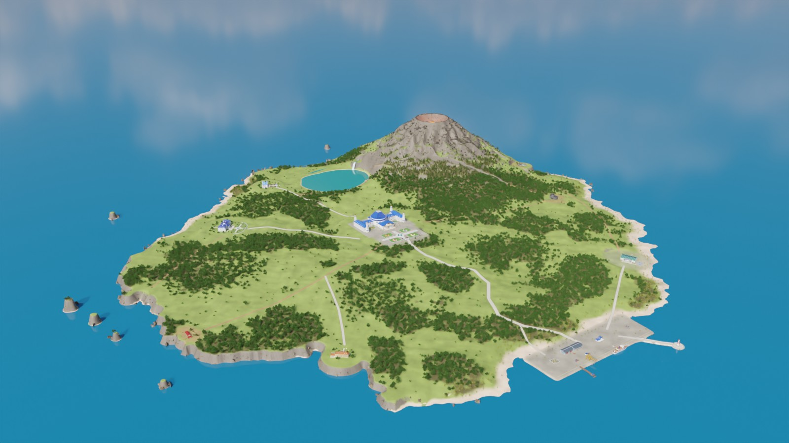

| | |
|---|---|
| 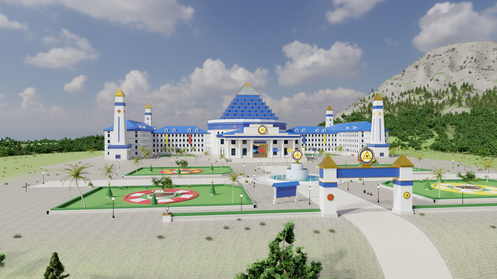 | 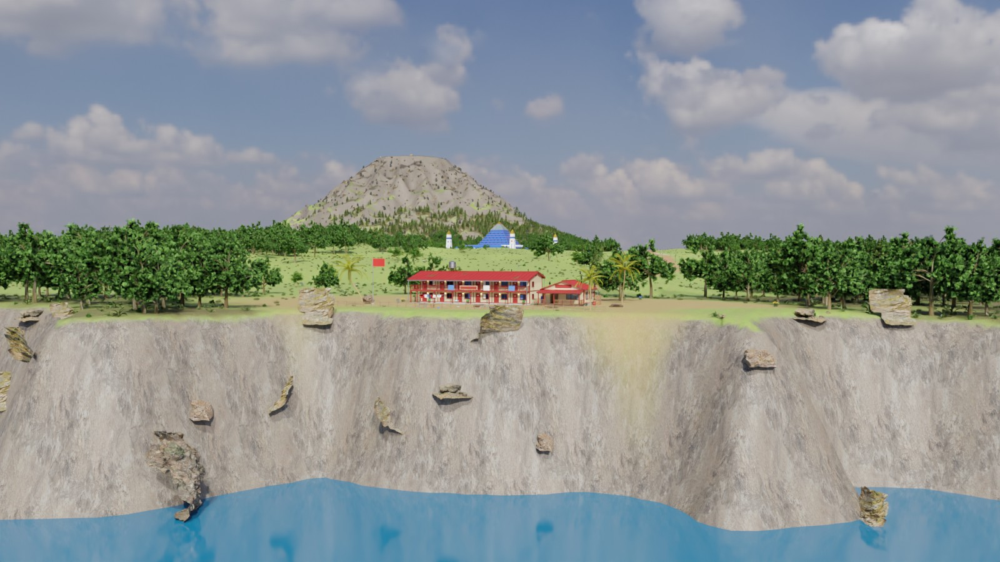 |
| 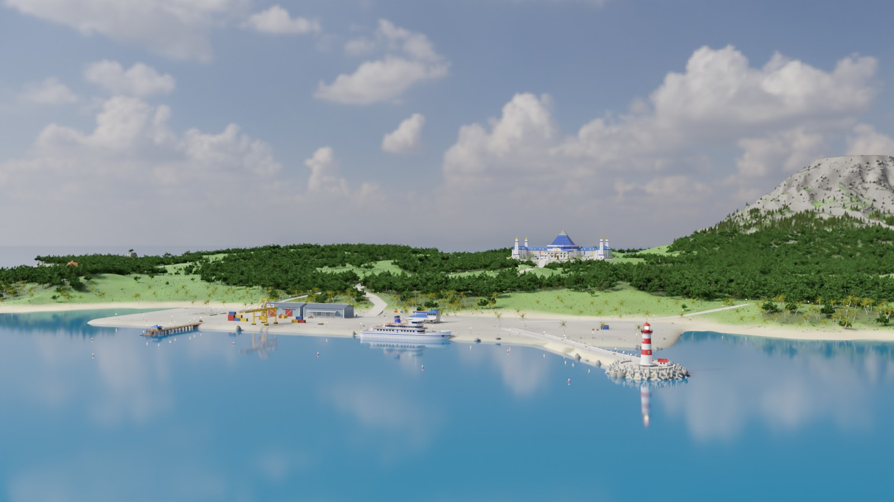 | 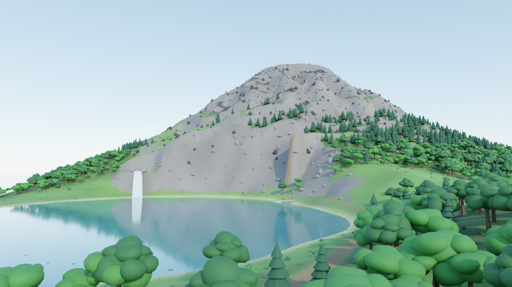 |
| 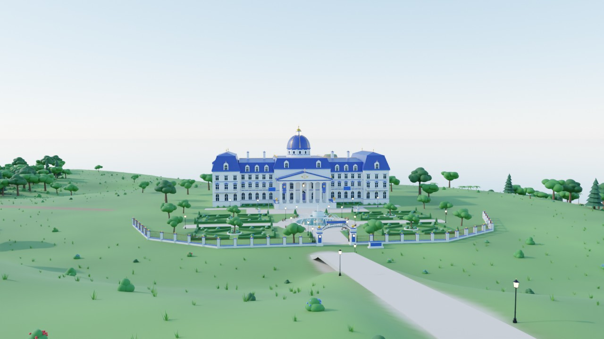 | 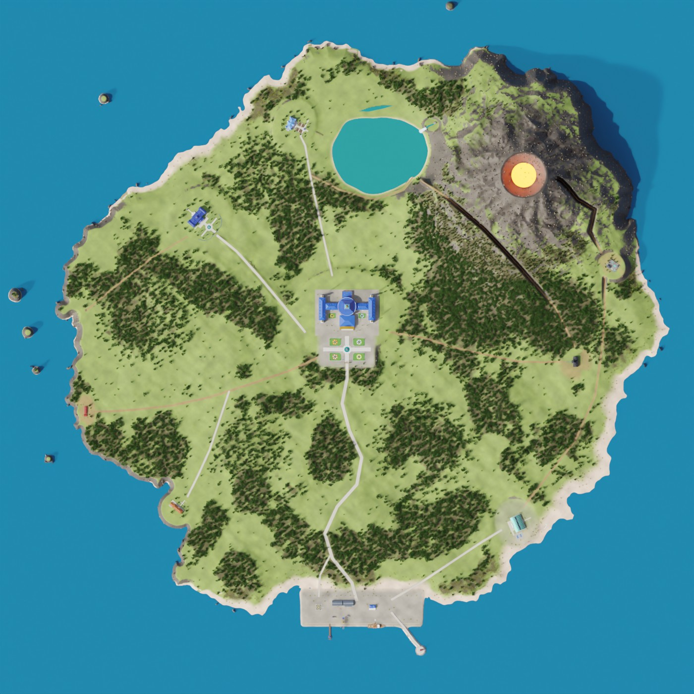 |

*(Cycles previews of the generated island. In Unreal it is lit by Lumen, a dynamic sky atmosphere,
volumetric clouds and a full day/night cycle.)*

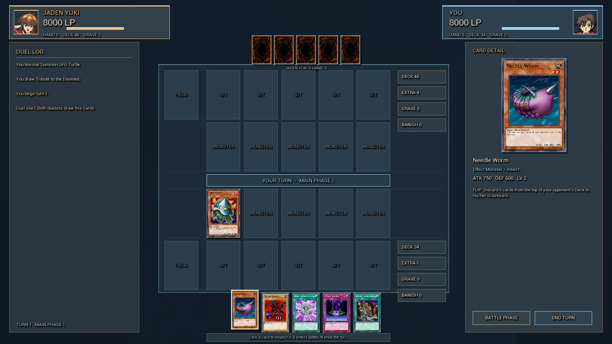

*The ported duel board: hand, field, card detail, piles, duel log and AI opponent. The deck picker and
result screen are in `Docs/renders/duel_deck.png` and `duel_result.png`.*

## GBA campaign port (Gate 1)

This branch (`port/baseline`) ports the single-player campaign of the GBA game into the 3D island. The masterplan is [Docs/PORT_MASTERPLAN.md](Docs/PORT_MASTERPLAN.md); live status is [Docs/PORT_STATUS.md](Docs/PORT_STATUS.md).

| 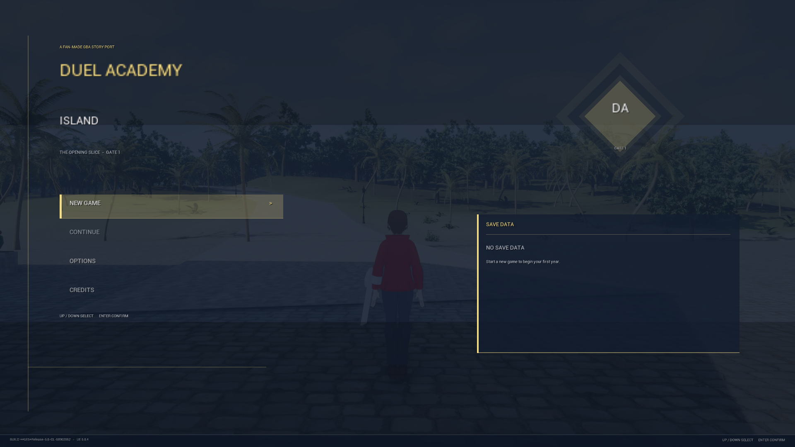 | 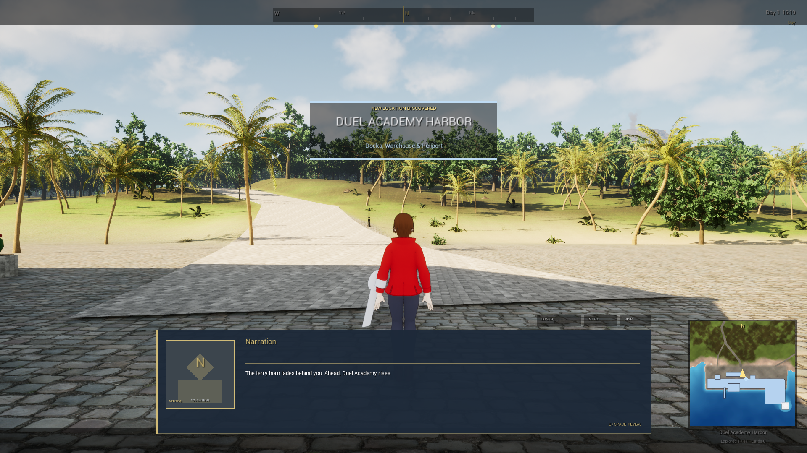 |
|---|---|
| **Title / New Game / Continue** | **Opening ceremony → Slifer dorm → first free roam** |
| 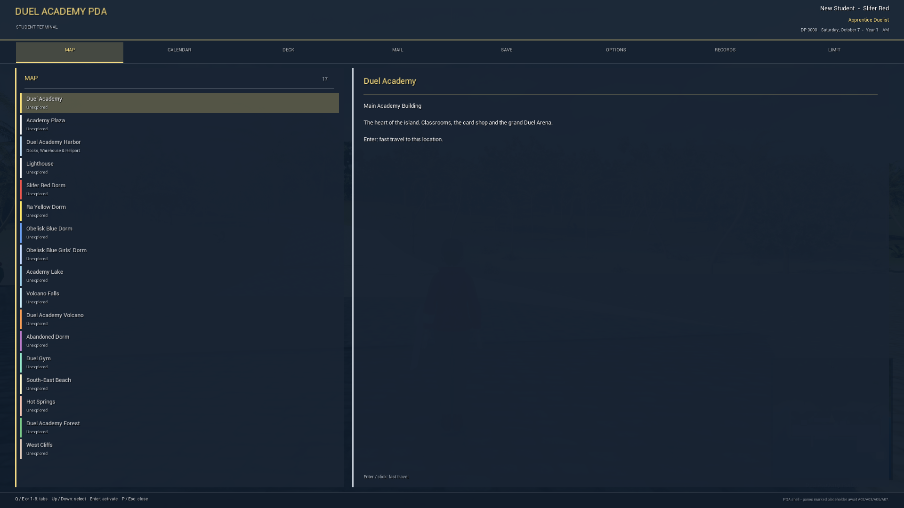 | 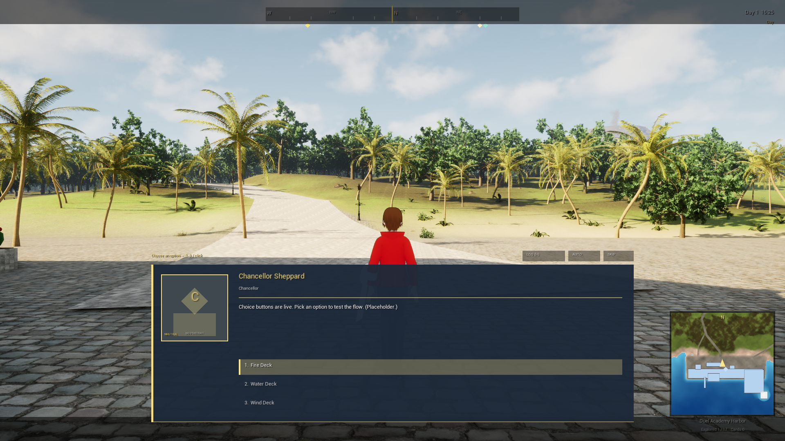 |
| **PDA map, calendar, deck, mail, save, options, records, limit** | **Dialogue with portraits, typewriter, choices and history** |

Implemented so far:

- **Campaign backbone:** 37 event definitions (35 canon + the opening checkpoint/free duel), 56 scenes, 161 dialogue lines, 6 email contacts, schedules, flags and rewards. The opening (`E01`/`E01b`) is fully runnable; the 35-event campaign scaffold validates and is reachable with progress.
- **Progression:** profile, 12-month calendar, DP, titles, dorm promotion/demotion, Dropout Boy recovery, flags, counters and settings.
- **Save/load:** 3 slots + autosave, atomic writes, checksum trailer, backup recovery, corruption detection and v0→v1 migration.
- **Duel content:** 25 duelists / 31 decks, 100 timed puzzles, 12 exam cycles, 48 booster packs, the full 1,200-card database, 76 Fusion recipes and 22 Ritual procedures.
- **Rules:** chain stack, targeting/choice queue, activation timing, Quick-Play/Counter Trap scaffolding, banned/limited list, deck validation, ante, scenarios and result statistics.
- **Economy:** 1,200-card inventory, 3-copy ownership, deterministic pack opening, 48-pack shop, deck construction/validation.
- **UI:** title/new game/continue, PDA, dialogue, choices, history, credits, options and debug screenshot harnesses.
- **World data:** 36 mapped GBA locations, 89 scene anchors, 10 planned interior cells and 20 portal pairs.

Run the runtime suites from the editor/game command line:

```text
-DAProfileSelfTest        # 182/182
-DAEconomySelfTest        # 119/119
-DADuelRulesSelfTest      # 57/57
-DAStorySelfTest          # 14/14
-DAFullStorySelfTest      # 20/20, 35/35 reachable with progress
-DAPuzzleSelfTest         # 100/100 authored puzzles replayed in-engine
-DAExamSelfTest           # 12/12 monthly exam cycles
-DAPuzzleExamSelfTest     # both A07 suites in one process
-DAUITest                 # 8 PDA + 2 dialogue screenshots
-DATitleTest / -DANewGameTest
```

Data validators:

```text
python Tools/validate/validate_all.py      # PASS, known gaps listed
python Tools/puzzles/validate.py           # 141 checks, 0 failures
python Tools/opponents/import_canon_decks.py --check  # 31/31 runtime decks, 36/36 constructed
python Tools/effects/audit.py              # PASS; 119 scripted + 321 vanilla, 760 pending
```

Still open before calling the port complete: the 760 pending card effects, an in-engine playthrough of events E02–E33 (the data and self-test are in, but not a full scripted run), interior cell generation/entry tests, shop/deck/exam UI interaction wiring, exact GBA dialogue (the full text is local-only), and the remaining canon gaps recorded in [Docs/PORT_STATUS.md](Docs/PORT_STATUS.md).

## What's on the island

| Location | What you'll find |
|---|---|
| **Duel Academy** (main building) | The landmark: classroom wings, four obelisk towers, a stepped-pyramid **Grand Duel Arena** you can walk into (full duels), lobby and **Card Shop** (booster packs). |
| **Academy Plaza** | Fountain courtyard, dorm flags, the direction board and the gate where the harbor road arrives. |
| **Slifer Red Dorm** | The humble two-storey cliff-top shack with the outdoor walkway, curry-scented dining hall and the best sunset view. |
| **Ra Yellow Dorm** | Tidy yellow dormitory with its famous cafeteria and sea-side balconies. |
| **Obelisk Blue Dorm** | Palatial white-and-blue mansion with portico, cupola, fountain and formal gardens. |
| **Obelisk Blue Girls' Dorm** | Elegant lakeside mansion with turrets, gazebo and a jetty with rowing boats. |
| **Academy Lake & Volcano Falls** | Lily pads, reeds, a waterfall plunging off the volcano's flank. |
| **Duel Academy Volcano** | Smoking, glowing crater with a lava lake, fumaroles and a viewpoint (that's still active!). |
| **Abandoned Dorm** | The decaying old Special Dorm deep in the forest — boarded windows, broken gate, an explorable creepy hall. |
| **Harbor & Lighthouse** | Quay, pier, warehouses, crane, terminal, heliport, the island ferry (bobbing at its berth) and the breakwater lighthouse with a rotating beam at night. |
| **Duel Gym & South-East Beach** | Beachside sports hall with practice duel fields, beach umbrellas, lifeguard tower and a beach duel court. |
| **Hot Springs** | Volcanic onsen with steaming rock pools. |
| **Forest, West Cliffs (Sunset Point), sea stacks** | Dense jungle with a hidden spirit shrine, cliff-top viewpoint deck, roaming students. |

The exact architecture of the anime's buildings was never published, so every building is a
faithful-in-spirit interpretation of the show's style (colours, silhouettes, dorm hierarchy, the
Egyptian-god theming), not a copy of any copyrighted asset. All card names in the card shop are original.

## The cast

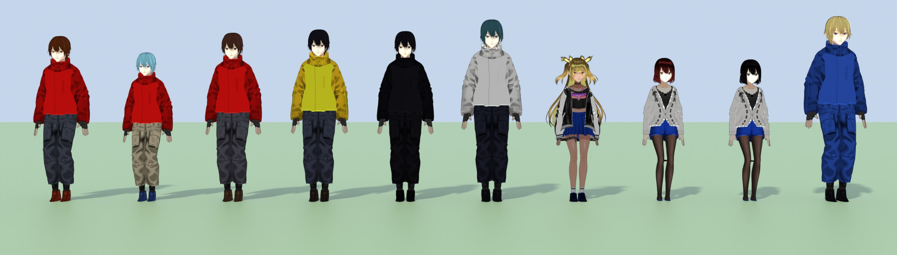

*Jaden, Syrus, Chumley, Bastion, Chazz, Zane, Alexis, Jasmine, Mindy and Dr. Crowler (Cycles preview).*

Everyone on the island is an **anime character model**: the VRoid sample avatars (VRoid Project / pixiv,
whose terms allow modification and redistribution) restyled by the pipeline after the characters' official
designs, with a cel-style material and ink outline in Unreal:

* **Uniforms are tailored onto the models' bodies** (`Tools/dai/anime/outfit.py`): the base outfits are
  replaced by Duel Academy jackets and long coats cut from the body itself (they share its bone weights, so
  they deform with it), with stand-up collars, capelets, painted trims, chest panels, cuffs and buttons,
  plus turtlenecks, trousers, pleated skirts, boots and gloves.
* **Matched to the official art** (Konami's *Tag Force Special* and *Duel Links* character art on
  Yugipedia's media server, the *Tag Force* cover and portraits from public GitHub mod repositories; used as
  references only, nothing redistributed here). Colours were sampled from the art and it sets the designs:
  every Duel Academy jacket has a white shield-shaped chest panel bordered in a darker dorm colour; Slifer
  Red and Ra Yellow jackets are waist-length with white-lined stand-up collars (Jaden wears his open over a
  dark shirt with white trousers and red sneakers, Syrus a yellow turtleneck, Bastion a green one under his
  pale yellow jacket, Chumley the inverted white-and-red uniform); Zane wears the white Obelisk jacket with
  a royal blue capelet yoke and long coat tails at the back; the Obelisk girls a sleeveless white top with a
  navy capelet edged periwinkle and white, black turtleneck, blue miniskirt with a light blue belt and
  royal blue boots (Alexis also her blue fingerless gloves); Chazz his black coat with grey trim over a
  mauve shirt; Crowler his blue frock coat with gold trim, pink ruffles, crescent earrings and purple
  lipstick. `Tools/preview_anime.py <id> --portrait` / `--bust` render the close-ups used for the
  side-by-side comparison.
* **Faces**: each character's resting expression is baked from the VRoid face blendshapes after the art
  (Chazz's scowl, Zane's stern eyes, Bastion's confident smile, Syrus's worried look, Crowler's grin), and
  the face is reshaped towards it (longer faces and pointed chins for Zane, Chazz, Bastion and Jaden,
  Crowler's long narrow face, Chumley's round one).
* **Hair is restyled per character** (`Tools/dai/anime/hairdo.py`): Jaden's spiky orange-over-brown mop,
  Syrus's cyan spikes, Zane's long slate-teal hair, Chazz's black spikes, Bastion's swept-up grey hair,
  Chumley's black koala puffs, long olive-blond hair for Alexis, Jasmine's auburn flared cut, Mindy's grey
  bob with flipped wings, Crowler's blond bob and ponytail with a black band, plus Syrus's round glasses and
  Chumley's round nose; eye colours per character. The spiky manes
  (Jaden, Chazz, Syrus) are thickened with turned copies of the strands, which brings those meshes to about
  80k triangles.

The GX regulars stand where you'd expect them (Jaden, Syrus and Chumley at the Slifer dorm, Bastion at Ra
Yellow, Chazz at Obelisk Blue, Alexis, Jasmine and Mindy at the girls' dorm, Zane at the lighthouse, Crowler on
the arena field) and have their own lines; every other student gets a generic look tinted by dorm.

The bones are renamed to the **UE5 Mannequin** scheme (`pelvis`, `spine_01`, `upperarm_l` …), so the cast plays
CC0 Quaternius animation takes retargeted onto each model (idle, walk, run, jump / fall / land, wave, yes / no,
sit, clap, interact) plus hand-authored duel-stance and swim takes — and Unreal's IK Retargeter auto-maps the
skeletons to Manny/Quinn if you want the engine's own animations.

**Using your own models.** The likenesses are limited by what is freely redistributable: faces are the
VRoid samples' own and hairstyles are restyled from their cuts. Any rigged humanoid **VRM / glTF / FBX** (VRoid Hub, Sketchfab,
Fab, a model you made in VRoid Studio …) can replace them: put it in `Tools/thirdparty/<pack>/<asset>/` with
a `SOURCE.txt`, register it under `"anime_models"` in `Tools/thirdparty/registry/anime.json`, point the
character's `model` at it in `Tools/dai/anime/cast.py` and run `Tools/build_island.py cast`. Check the
model's license allows redistribution before committing it.

## Gameplay features

* Third-person anime student (the cast's generic boy) — switch your **dorm jacket**
  (Slifer Red / Ra Yellow / Obelisk Blue / Society of Light white) with **J**; NPC students wear theirs. The
  older CC0 low-poly student and a procedural avatar remain as fallbacks when no cast is imported.
* Location banners + "**New location discovered**" tracking (17 named locations), compass, minimap.
* **Island map with fast travel** (M): pick a location with Up/Down + Enter or click a marker.
* **A full duel system**: a deterministic 1,200-card rules engine (summons, tributes, Fusion and Ritual
  summons, chains, traps, hand-limit discards and a duelist AI), a Canvas board with hand, field,
  deck/extra/graveyard/banish piles, card detail, duel log, animations and a result/rematch screen.
  Duel fields pick a resident opponent; named students (Jaden, Syrus, Bastion, Chazz, Alexis, Zane and
  Crowler) can also be challenged after talking to them once. Card scans are shown on the board.
* **Card Shop**: open booster packs (32 original cards, rarities from Common to Ultra Rare), track your collection.
* Signs with lore everywhere, students from all three dorms who wander around and chat (E).
* **Day/night cycle** (Lumen GI, sky atmosphere, moon): lamps, windows and the lighthouse turn on at
  night, the crater glows. Time controls: **T** pause, **[ ]** speed, **N** skip 3 h.
* Swimmable ocean and lake (single-layer water), volcano smoke, hot-spring steam, waterfall mist,
  bobbing ferry and boats, synthesized ambience (surf, wind, birds, volcano rumble, waterfall, crowd).
* ~90 000 instanced trees, palms, bushes, ferns, flowers and rocks (Nanite).

### Controls

| Key | Action |
|---|---|
| WASD / left stick | Move (Z/Q also work on AZERTY) |
| Mouse / right stick | Look, mouse wheel = zoom |
| Shift | Sprint |
| Space | Jump |
| E | Interact (signs, card shop, duel fields, students) / close message |
| M or Tab | Island map & fast travel |
| J | Switch dorm jacket |
| F | Raise duel disk |
| T, [ ], N | Pause time, slower / faster, skip 3 hours |
| F1 or H | Controls overlay |
| **In a duel** | |
| Mouse | Select a card, use the action buttons, inspect piles |
| B | Enter the Battle Phase |
| N / End | End the turn |
| Esc | Deselect / close a pile / leave the duel |
| 1, 2, 3 | Pick a starter deck in the deck picker |

## Getting started

**Requirements:** Unreal Engine **5.8** and a C++ toolchain for your platform (Visual Studio 2022 with the
"Game development with C++" workload on Windows, Xcode on macOS, the bundled clang toolchain on Linux).

1. Clone this repository.
2. Open `DuelAcademyIsland/DuelAcademyIsland.uproject`. Unreal asks to build the missing
   `DuelAcademyIsland` module — click **Yes**. (Or right-click the .uproject → *Generate project files*
   and build the `DuelAcademyIslandEditor` target from your IDE.)
3. On first launch the editor asks **"Build the island now?"** — click **Yes**. The script imports the
   generated assets from `DuelAcademyIsland/SourceAssets`, creates all materials, assembles the level
   `/Game/DuelAcademy/Maps/DuelAcademyIsland` and saves it (takes a few minutes). You can re-run it
   any time from the **Duel Academy** menu in the main menu bar (*Build Island* / *Rebuild Level Only*).
4. Press **Play**. You arrive at the harbor next to the ferry — welcome to Duel Academy!

Headless alternative for step 3:

```bash
UnrealEditor-Cmd DuelAcademyIsland/DuelAcademyIsland.uproject -ExecutePythonScript="$PWD/DuelAcademyIsland/Content/Python/build_island_cli.py"
```

## How it's built

```
Tools/                      procedural asset pipeline (Python + Blender 5.2 "bpy" module)
  build_island.py           runs every stage -> DuelAcademyIsland/SourceAssets
  preview_asset.py          render previews of a single location module
  dai/config.py             island layout: locations, heights, paths, volcano, lake ...
  dai/terrain.py            heightfield, splat maps, colour map, Landscape heightmap
  dai/terrain_mesh.py       64 terrain chunks + ocean / sea floor / lake surfaces
  dai/geo.py                MeshBuilder modelling kit (walls with openings, roofs, lathes, stairs ...)
  dai/palette.py            material palette (slot names -> UE material instances)
  dai/assets/*.py           one module per location (academy, dorms, harbor, ...) + props + avatar
  dai/layout.py             places everything, scatters vegetation, writes layout.json
  dai/textures.py           detail/normal maps from the photo sets (procedural fallback), terrain layers
  dai/thirdparty.py         third-party ingestion: registry, glTF/FBX/OBJ import, PBR texture extraction
  dai/character.py          rigged third-party student -> SK_Student + A_Student_<State> FBX
  dai/anime/                anime cast: VRM/glTF base models -> UE5-Mannequin-named skeletons, tailored
                            uniforms (outfit.py), restyled hair (hairdo.py), ink outlines, CC0 takes
                            retargeted onto every skeleton, cast.json
                            (cast.py = who is who; a procedural fallback builds anyone without a model)
  dai/credits.py            CREDITS.md from the SOURCE.txt files
  thirdparty/               curated CC0 / CC-BY source assets + registry/*.json
  dai/audio.py              synthesized seamless ambience loops and UI sounds
  dai/render.py             Cycles preview renders (Docs/renders)
DuelAcademyIsland/          the Unreal Engine 5.8 project
  Source/DuelAcademyIsland  C++ gameplay module (character, NPCs, HUD, zones, day/night, duels, ...)
  Content/Python            editor build scripts (import, materials, level assembly, menu)
  SourceAssets/             generated FBX / PNG / WAV / JSON (committed, so Blender is optional)
  Config/                   Lumen + Nanite + Virtual Shadow Maps + MegaLights, Enhanced Input
```

* **Terrain**: a 3 km × 3 km heightfield (west cliffs, south-east beach, harbor cove, lake, 300 m
  volcano with crater) → 64 mesh chunks with complex collision and a splat-mapped 8-layer material
  (grass, forest floor, sand, wet sand, rock, volcanic ash, dirt paths, paving).
* **Buildings**: modelled procedurally in Python with a small modelling kit; every face carries a
  palette material name that becomes a Material Instance in Unreal; walkable interiors use per-poly
  collision.
* **Third-party art (CC0 / CC-BY)**: generic assets come from free, openly licensed libraries instead of
  being modelled by hand — Poly Haven / ambientCG photo-scanned PBR textures for every terrain layer
  and building surface, Poly Haven pure-sky HDRIs, and curated vegetation, rocks, props and an
  animated student character (see [CREDITS.md](CREDITS.md)). Each asset lives in
  `Tools/thirdparty/<source>/<asset>/` with a `SOURCE.txt` (URLs, license evidence, hashes) and is
  mapped onto the catalog by `Tools/thirdparty/registry/*.json`; the pipeline imports, normalises
  and re-exports it with PBR material instances (`M_DA_PBR`, `M_DA_PBRFoliage`). Anything not
  registered falls back to the procedural version, so the build never breaks on a missing asset.
* **Unreal side**: no binary assets are committed. `init_unreal.py` registers the menu; the build script
  creates master materials node-by-node (terrain splat blend, single-layer water, hologram, smoke, lava,
  foliage wind …), imports meshes/textures/sounds and spawns ~1 500 actors + ~90 000 instances.
  Input actions, HUD and effects are created in C++ at runtime, so nothing depends on hand-made assets.

### Regenerating / customising the island (optional)

```bash
python3.13 -m venv .venv && .venv/bin/pip install bpy numpy scipy pillow   # Blender 5.2 as a module
npm install -g @gltf-transform/cli                 # optional: decodes meshopt-compressed glTF downloads
.venv/bin/python Tools/build_island.py            # textures, terrain, meshes, audio, layout, cast
.venv/bin/python Tools/build_island.py render     # preview renders -> Docs/renders
.venv/bin/python Tools/preview_asset.py academy   # iterate on one location
.venv/bin/python Tools/build_island.py cast       # rebuild the anime cast only
.venv/bin/python Tools/preview_anime.py jaden alexis --state Walk --frame 10   # cast preview render
```

Edit `Tools/dai/config.py` (positions, heights, paths), a location module in `Tools/dai/assets/`, or
`Tools/dai/palette.py` (colours), regenerate, then *Duel Academy → Build Island* in the editor.

### Optional: real Landscape instead of mesh terrain

`SourceAssets/Heightmap/T_IslandHeight16.png` (2017 × 2017, 16 bit) matches the mesh terrain exactly.
In Landscape mode → *Import from file*: **Location** X = -153600, Y = -153600, Z = 19200;
**Scale** X = Y = 152.381, Z = 100. Then hide the `Island/terrain` actors.

## Asset sources

| What | Source (license) |
|---|---|
| Terrain layers (grass, forest floor, sand, wet sand, volcanic ash, rock, dirt, paving) | Poly Haven / ambientCG photo-scanned PBR sets (CC0) |
| Building surface detail (plaster, marble, tiles, concrete, planks, siding, roof tiles, bricks, corrugated metal, fabric) | Poly Haven / ambientCG (CC0) |
| Skies for the preview renders | Poly Haven pure-sky HDRIs (CC0) |
| Palms, acacia, hydrangea and rose bushes | Sweet Home 3D library by Space Mushrooms & Scopia (CC BY 3.0) |
| Broadleaf, pine and dead trees, bushes | generated with EZ-Tree (MIT) with Poly Haven / TextureCan bark (CC0) |
| Fern, grass clumps, tropical undergrowth | Poly Haven photoscans (CC0) |
| Boulders, rock faces, cliffs, coastal rocks, driftwood, stumps, pebbles | Poly Haven photoscans (CC0); basalt by yonimantz (CC BY 4.0) |
| Street lamps, bins, drums, buoys, picnic tables | Poly Haven (CC0), Khronos glTF samples (CC0) |
| Benches, signposts, fences, crates, containers, rowboats, beach umbrellas and chairs, stone lanterns | Sketchfab authors (CC BY 4.0) |
| Fishing trawlers | Poly by Google (CC BY 3.0) |
| Duel Academy buildings, dorms, arena, harbor, lighthouse, ferry, volcano/waterfall features, flagpoles, bollards, duel dummies, vending machines, sounds | original, built by the pipeline in `Tools/` |
| Duel card names, card text, card scans, fusion recipes and starter deck lists | Yu-Gi-Oh! TCG, Konami/Shueisha - non-commercial fan reference; scans via YGOPRODeck, data ported from the reference UE5 duel engine |
| Duel character busts / expression frames (`Content/Data/Portraits`) | Konami *Duel Links* character renders (fan-project reference set); not redistributable. The in-world island cast remains the project's own VRoid-derived models |

Every third-party folder under `Tools/thirdparty/` has a `SOURCE.txt`; [CREDITS.md](CREDITS.md) lists all of
them with the required CC BY attribution text (also shown in-game on the F1 controls panel).

## Notes & limitations

* The C++ module and editor scripts target the UE 5.8 API. They were written and smoke-tested outside
  the engine (the editor scripts against a mocked `unreal` module), so if your engine build reports an
  API difference, the error will point at a single, isolated call — please open an issue.
* Performance: the island uses Nanite foliage, MegaLights for ~300 small lights and Lumen; on low-end
  GPUs lower *Settings → Engine Scalability*.
* Non-commercial fan project. *Yu-Gi-Oh! GX* and its characters, names and settings belong to their
  respective owners. The duel card database uses card names and scans for identification and commentary;
  the character busts in `Content/Data/Portraits` are Konami *Duel Links* fan-reference renders and must
  be kept out of any public build. The island's in-world cast is built from the licensed VRoid sample
  avatars (see [CREDITS.md](CREDITS.md)).
