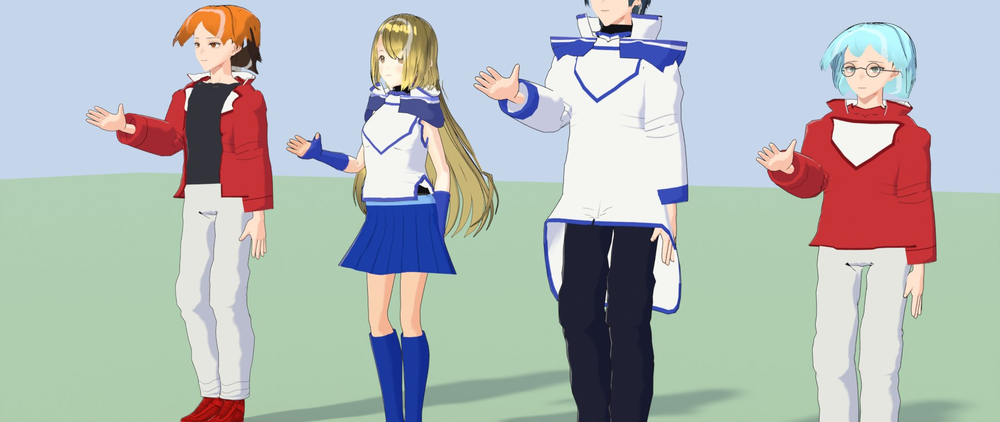
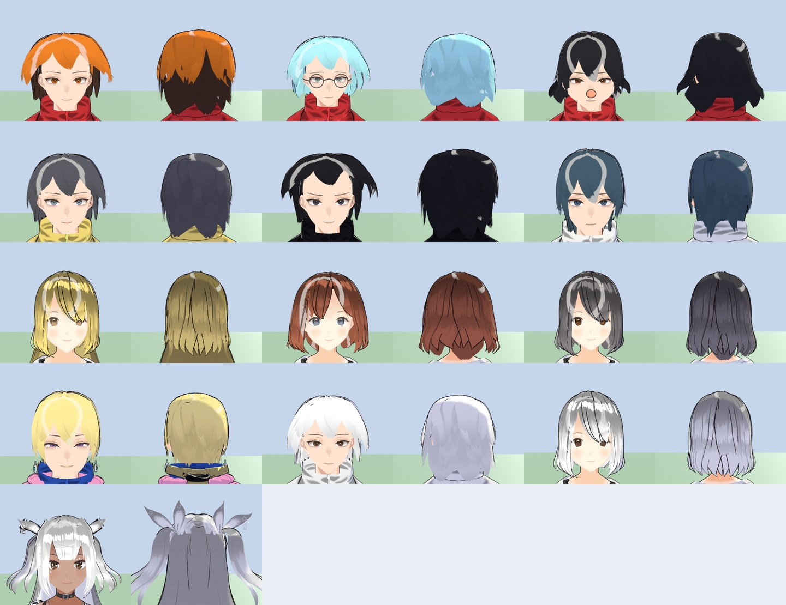
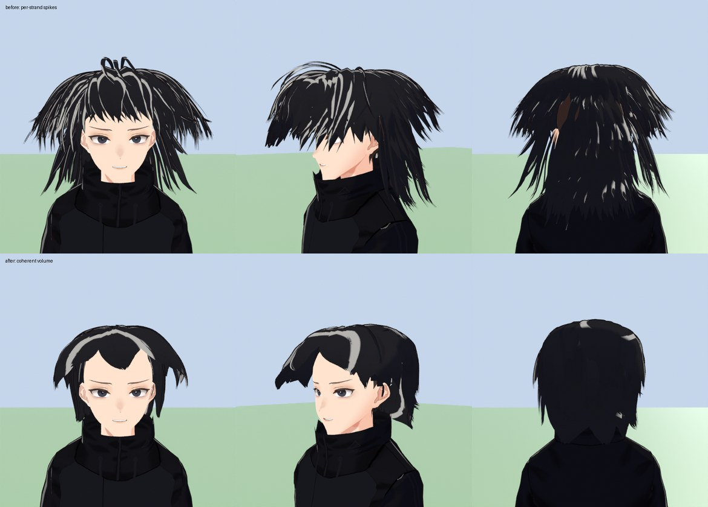
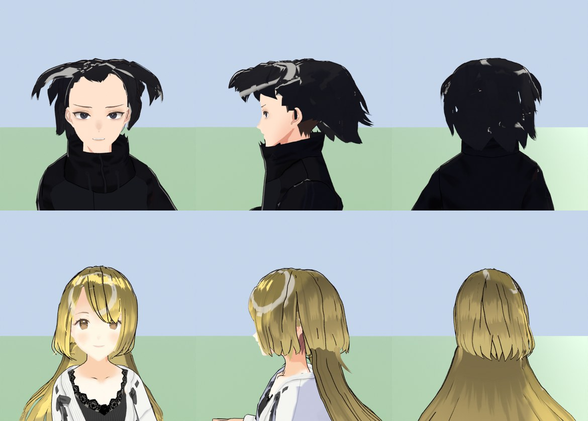

# Duel Academy Island — Unreal Engine 5.8

A fully explorable, fan-made recreation of **Duel Academy island** from *Yu-Gi-Oh! GX*, built for
**Unreal Engine 5.8** entirely with free tools: Blender 5.2 (used as a Python module), Python/numpy and
the Unreal Editor's own Python + C++.


| | |
|---|---|
|  |  |
|  |  |
|  |  |

*(Cycles previews of the generated island. In Unreal it is lit by Lumen, a dynamic sky atmosphere,
volumetric clouds and a full day/night cycle.)*


*The ported duel board: hand, field, card detail, piles, duel log and AI opponent. The deck picker and
result screen are in `Docs/renders/duel_deck.png` and `duel_result.png`.*

## GBA campaign port (Gate 1)

This branch (`port/baseline`) ports the single-player campaign of the GBA game into the 3D island. The masterplan is [Docs/PORT_MASTERPLAN.md](Docs/PORT_MASTERPLAN.md); live status is [Docs/PORT_STATUS.md](Docs/PORT_STATUS.md).

|  |  |
|---|---|
| **Title / New Game / Continue** | **Opening ceremony → Slifer dorm → first free roam** |
|  |  |
| **PDA map, calendar, deck, mail, save, options, records, limit** | **Dialogue with portraits, typewriter, choices and history** |

Implemented so far:

- **Campaign backbone:** 37 event definitions (35 canon + the opening checkpoint/free duel), 56 scenes, 161 dialogue lines, 6 email contacts, schedules, flags and rewards. The opening (`E01`/`E01b`) is fully runnable; the 35-event campaign scaffold validates and is reachable with progress.
- **Progression:** profile, 12-month calendar, DP, titles, dorm promotion/demotion, Dropout Boy recovery, flags, counters and settings.
- **Save/load:** 3 slots + autosave, atomic writes, checksum trailer, backup recovery, corruption detection and v0→v1 migration.
- **Duel content:** 26 duelists / 32 decks, 100 timed puzzles, 12 exam cycles, 48 booster packs, the full 1,200-card database, 76 Fusion recipes and 22 Ritual procedures.
- **Rules:** chain stack, targeting/choice queue, activation timing, Quick-Play/Counter Trap scaffolding, banned/limited list, deck validation, ante, scenarios and result statistics.
- **Economy:** 1,200-card inventory, 3-copy ownership, deterministic pack opening, 48-pack shop, deck construction/validation.
- **UI:** title/new game/continue, PDA, dialogue, choices, history, credits, options and debug screenshot harnesses.
- **World data:** 36 mapped GBA locations, 89 scene anchors, 10 planned interior cells and 20 portal pairs.

Run the runtime suites from the editor/game command line:

```text
-DAProfileSelfTest        # 182/182
-DAEconomySelfTest        # 446/446
-DADuelRulesSelfTest      # 102/102
-DAStorySelfTest          # 14/14
-DAFullStorySelfTest      # 20/20, 35/35 reachable with progress
-DAPuzzleSelfTest         # 100/100 authored puzzles replayed in-engine
-DAExamSelfTest           # 12/12 monthly exam cycles
-DAPuzzleExamSelfTest     # both A07 suites in one process
-DAUITest                 # 8 PDA + 2 dialogue screenshots
-DATitleTest / -DANewGameTest
-DACastLifeTest           # anime cast: cel materials + stencil + PP, face morphs, lip-sync, springs, look-at
```

Data validators:

```text
python Tools/validate/validate_all.py      # PASS, known gaps listed
python Tools/puzzles/validate.py           # 145 checks, 0 failures
python Tools/opponents/import_canon_decks.py --check  # 32/32 runtime decks, 37/37 constructed
python Tools/effects/audit.py              # PASS; 362 scripted + 345 vanilla, 493 pending
```

Still open before calling the port complete: the 493 pending card effects, exact GBA dialogue (the full text is local-only), renderer/interaction QA for the shop/deck/exam screens, interior generation/entry polish, and the remaining canon gaps recorded in [Docs/PORT_STATUS.md](Docs/PORT_STATUS.md). The full E02–E33 campaign playthrough is covered by `-DAStoryPlaythroughTest`.

## What's on the island

| Location | What you'll find |
|---|---|
| **Duel Academy** (main building) | The landmark: classroom wings, four obelisk towers, a stepped-pyramid **Grand Duel Arena** you can walk into (full duels), lobby and **Card Shop** (booster packs). |
| **Academy Plaza** | Fountain courtyard, dorm flags, the direction board and the gate where the harbor road arrives. |
| **Slifer Red Dorm** | The humble two-storey cliff-top shack with the outdoor walkway, curry-scented dining hall and the best sunset view. |
| **Ra Yellow Dorm** | Tidy yellow dormitory with its famous cafeteria and sea-side balconies. |
| **Obelisk Blue Dorm** | Palatial white-and-blue mansion with portico, cupola, fountain and formal gardens. |
| **Obelisk Blue Girls' Dorm** | Elegant lakeside mansion with turrets, gazebo and a jetty with rowing boats. |
| **Academy Lake & Volcano Falls** | Lily pads, reeds, a waterfall plunging off the volcano's flank. |
| **Duel Academy Volcano** | Smoking, glowing crater with a lava lake, fumaroles and a viewpoint (that's still active!). |
| **Abandoned Dorm** | The decaying old Special Dorm deep in the forest — boarded windows, broken gate, an explorable creepy hall. |
| **Harbor & Lighthouse** | Quay, pier, warehouses, crane, terminal, heliport, the island ferry (bobbing at its berth) and the breakwater lighthouse with a rotating beam at night. |
| **Duel Gym & South-East Beach** | Beachside sports hall with practice duel fields, beach umbrellas, lifeguard tower and a beach duel court. |
| **Hot Springs** | Volcanic onsen with steaming rock pools. |
| **Forest, West Cliffs (Sunset Point), sea stacks** | Dense jungle with a hidden spirit shrine, cliff-top viewpoint deck, roaming students. |

**Every building can be entered.** Each door on the island is a real doorway with an automatic door (it swings
open away from you as you walk up, shoji and glass doors slide) and leads into a furnished interior designed
after its building - see [Interiors](#interiors) below.

The exact architecture of the anime's buildings was never published, so every building is a
faithful-in-spirit interpretation of the show's style (colours, silhouettes, dorm hierarchy, the
Egyptian-god theming), not a copy of any copyrighted asset. All card names in the card shop are original.

## The cast


*Jaden, Syrus, Chumley, Bastion, Chazz, Zane, Alexis, Jasmine, Mindy and Dr. Crowler (Cycles preview: real heights, cel shading, draped uniforms).*


*Cel-shaded close-ups: smoothed anime face normals, coloured shadows, rim light, hair highlight arcs.*



*The Talk take over the contrapposto idle.*



*Every cast member's hair from the front and back: soft, coherent masses with a rounded outline. See
"Anime hair volume" below.*



*Chazz before (each strand turned on its own: gaps, needles, a wide ragged outline) and after.*



*A Run frame with the spring solver on (`hairrig.simulate`, the same solver as in game). The locks swing
together, and Alexis's long hair flows back in one sheet.*

Everyone on the island is an **anime character model**: the VRoid sample avatars (VRoid Project / pixiv,
whose terms allow modification and redistribution) restyled by the pipeline after the characters' official
designs, with a cel-style material and ink outline in Unreal:

* **Uniforms are tailored onto the models' bodies** (`Tools/dai/anime/outfit.py`): the base outfits are
  replaced by Duel Academy jackets and long coats cut from the body itself (they share its bone weights, so
  they deform with it), with stand-up collars, capelets, painted trims, chest panels, cuffs and buttons,
  plus turtlenecks, trousers, pleated skirts, boots and gloves.
* **Matched to the official art** (Konami's *Tag Force Special* and *Duel Links* character art on
  Yugipedia's media server, the *Tag Force* cover and portraits from public GitHub mod repositories; used as
  references only, nothing redistributed here). Colours were sampled from the art and it sets the designs:
  every Duel Academy jacket has a white shield-shaped chest panel bordered in a darker dorm colour; Slifer
  Red and Ra Yellow jackets are waist-length with white-lined stand-up collars (Jaden wears his open over a
  dark shirt with white trousers and red sneakers, Syrus a yellow turtleneck, Bastion a green one under his
  pale yellow jacket, Chumley the inverted white-and-red uniform); Zane wears the white Obelisk jacket with
  a royal blue capelet yoke and long coat tails at the back; the Obelisk girls a sleeveless white top with a
  navy capelet edged periwinkle and white, black turtleneck, blue miniskirt with a light blue belt and
  royal blue boots (Alexis also her blue fingerless gloves); Chazz his black coat with grey trim over a
  mauve shirt; Crowler his blue frock coat with gold trim, pink ruffles, crescent earrings and purple
  lipstick. `Tools/preview_anime.py <id> --portrait` / `--bust` render the close-ups used for the
  side-by-side comparison.
* **Faces**: each character's resting expression is baked from the VRoid face blendshapes after the art
  (Chazz's scowl, Zane's stern eyes, Bastion's confident smile, Syrus's worried look, Crowler's grin), and
  the face is reshaped towards it (longer faces and pointed chins for Zane, Chazz, Bastion and Jaden,
  Crowler's long narrow face, Chumley's round one).
* **Hair is restyled per character** (`Tools/dai/anime/hairdo.py`): Jaden's spiky orange-over-brown mop,
  Syrus's cyan mop, Zane's long slate-teal hair, Chazz's swept-back black spikes, Bastion's neat grey hair,
  Chumley's black koala puffs, long olive-blond hair for Alexis, Jasmine's auburn flared cut, Mindy's grey
  bob with flipped wings, Crowler's blond bob and ponytail with a black band, plus Syrus's round glasses and
  Chumley's round nose; eye colours per character.
* **Anime hair volume** (`Tools/dai/anime/hairshape.py`). VRoid hair is a stack of thin strands lying on the
  scalp, and turning each strand on its own fans them apart into gaps, needles and a wide, ragged outline.
  Every step here moves neighbouring hair together instead:
  * **flow**: strands *bend* towards the style direction, with the bend averaged over the strands rooted
    nearby. `sweep` turns the side locks back rather than out.
  * **coherence**: the displacement is smoothed in space, whatever strand a point belongs to, so layers
    keep their order and nothing splits.
  * **clump**: strand tips gather into a few big locks that end in soft points.
  * **widen**: each lock gets wider across, within the hair surface.
  * **volume**: the hair layer stands off the skull, more on top and at the back than at the sides. A
    strand carries its lift down to its tip, so no shelf forms and the crown rises into a dome.
  * **envelope**: the width is softly capped at the temples and narrows towards the jaw, the bulb outline
    of anime hair.
  * **under-layer**: a hair-coloured shell on the scalp, taking only opaque root texels, so skin never
    shows where locks part.

  Two-tone hair (Jaden) is coloured per lock (the outer locks orange, the under layer and nape dark) instead
  of with a horizontal cut. In the cel shading the hair gets **volume normals**
  (`shading.hair_normals`): the strand normals are blended into the smoothed shape of the whole mass. The
  shadow then falls as one clean line and there is one angel-ring highlight instead of a streak on every
  strand.
* **Hair physics** (`Tools/dai/anime/hairrig.py`). Every restyled head of hair gets its own spring chains,
  fitted to the hair as it now is:
  * Ten short chains go round the head. Hair hanging below the shoulders gets eight longer, heavier
    ones, which also lie on the back.
  * Each vertex is shared between its two nearest chains and blended along each chain, so locks can't
    part.
  * The roots stay on the head, and the pivots sit part-way down the locks.
  * Bones are named per character (`HairJoint_<Key>_Short03_1`), so the union skeleton keeps every
    member's own pivots. Unreal skips chains a mesh doesn't skin.

  In Unreal the solver runs level by level and pulls each joint towards the motion of its neighbouring
  chains (cohesion), so the hair moves as one mass. A cone limit keeps styled hair in shape. The tails also
  ride along with most of the character's own motion (`Inertia`): a 4 m/s run gives a lively bounce, not
  a wind tunnel. `hairrig.simulate` is the same solver in Python. With it, a Blender preview shows the
  hair as the game does. Styled short hair settles at about 1° in Idle and swings 3-4° on average in a
  walk and about 7° in a run, with footfall peaks capped at 18°. Long hair (Alexis) flows about 19° on
  average in a run, up to 50°, and stays on her back. The Unreal solver itself is compiled and run outside
  the engine by `Tools/tests/test_hair_springs.py`. It copies `ApplySprings` / `BuildChains` verbatim from
  `DAAvatarAnimInstance.cpp`, builds them against stand-in UE types and checks a synthetic head of hair:
  * the results stay finite;
  * the cones hold while idle, running at 4.2 m/s and running into a turn (short hair peaks at 8.6°);
  * cohesion keeps a kicked long lock with its neighbour: the gap changes by 0.19 cm, against 1.59 cm
    without cohesion.
* **Hair audit** (`Tools/hair_check.py`, `dai/anime/hairaudit.py`) measures the exported FBXs Unreal
  imports, with a budget (exit 1 when a character is over it):
  * hair width over the face width;
  * see-through holes in the silhouette, front and side;
  * outline roughness: perimeter over the convex hull's, where 1 is a smooth outline;
  * scalp visible from behind;
  * the fitted chains each mesh is skinned to.

  All 13 restyled characters are within budget:
  * Width: 1.1-1.55x the face (Jasmine's flipped bob 1.46x). The old per-strand spikes were 2.0-2.6x.
  * Holes: at most 4 small holes, under 1 % of the silhouette, against up to 25 before.
  * Roughness: 1.1-1.5, against up to 4.4 before.
  * Scalp: none visible, against up to 21 % before.

  Student F2's twin tails spread from her head by design: her cast entry allows 2.45x
  (`audit=dict(width=...)`).

The GX regulars stand where you'd expect them (Jaden, Syrus and Chumley at the Slifer dorm, Bastion at Ra
Yellow, Chazz at Obelisk Blue, Alexis, Jasmine and Mindy at the girls' dorm, Zane at the lighthouse, Crowler on
the arena field) and have their own lines; every other student gets a generic look tinted by dorm.

The bones are renamed to the **UE5 Mannequin** scheme (`pelvis`, `spine_01`, `upperarm_l` …). Locomotion is
solved rather than lifted from a stock clip: `Tools/dai/anime/gait.py` generates the **idle, walk and run**
cycles from a biomechanical gait model. The stance shoe rolls heel → flat → ball → toe, a two-bone leg IK
plants the ankle on the ground while the pelvis follows the natural bob (lowest at double support, highest at
midstance), the pelvis sways/yaws under a counter-rotating spine, the head stays level, and the arms swing in
opposition with bent elbows and relaxed wrists. The run has a real flight phase, stance compression, high heel
recovery and a forward lean. Every cycle is validated at build time for contact speed, ground penetration,
contact percentage, knee range and loop closure (the walk measures 1.50 m/s, the run 4.20 m/s).

At runtime a native animation instance (`DAAvatarAnimInstance`) blends **idle → walk → run** by ground speed,
drives both locomotion clips from one contact phase and solves the cadence from the blended stride length, so
the planted foot moves at exactly the character's speed (no foot skating from a stroll to a sprint). Jump,
Fall, Land, Swim and Duel are crossfaded action layers on top. The player moves at a human-scale 1.5 m/s walk
and 4.2 m/s sprint; NPCs stroll at 1.4 m/s. The other takes (jump / fall / land, wave, yes / no, sit, clap,
interact) are still CC0 Quaternius takes retargeted onto each model, plus hand-authored duel-stance and swim
poses — and Unreal's IK Retargeter auto-maps the skeletons to Manny/Quinn if you want the engine's own
animations.


*Walk and run cycles rendered from the gait solver: heel strike, flat, heel-off and toe-off; a real flight phase and stance compression in the run, with the arms and shoulders counter-swinging.*

### Anime rendering, cloth and animation

The cast is rendered, dressed and animated with the techniques current anime games use, all built from
free tools (Blender as a Python module, numpy / scipy, Unreal's own C++):

* **Cel shading** (`Tools/dai/anime/cel.py`): every cast material is classed as skin, face, hair, cloth or flat
  (eyes, brows, lashes, mouth). Each class has a hard half-Lambert light/shadow step with a coloured shadow
  (warm for skin, cool for cloth and hair), a rim light on the side the key light comes from, and an
  "angel ring" highlight arc on hair. In Unreal the characters stay lit by the real scene (Lumen GI, cast
  shadows, interior lamps, the night): `M_DA_Cel` turns specular off (no plastic sheen) and adds the rim
  and hair highlight from the key-light direction that `ADAIslandManager` publishes (`MPC_DuelAcademy`
  `SunDirection`, sun by day and moon by night). The stencil-masked post-process `PP_DA_Cel` then bands the
  lighting on the cast (custom stencil 1) into a lit tone and a shadow tone with a saturated, cooler
  shadow colour. The Cycles previews evaluate the same ramp.
* **Anime face normals** (`Tools/dai/anime/shading.py`): the face's corner normals are blended towards an
  ellipsoid fitted round the skull, so the face shades as one clean shape instead of throwing blotchy
  nose and lip shadows. They are exported as custom normals and imported as such.
* **Cloth drape** (`Tools/dai/anime/drape.py`): tailored garments no longer shrink-wrap the body. Every
  horizontal slice of a jacket, shirt or skirt is pushed out to the convex hull of itself and the layers
  under it, then hangs from its widest point above (chest, shoulder blades, seat). Sleeves become round
  tubes that widen towards the cuff, trousers get straight legs that run from the thigh to the hem, and
  shrink-free Taubin smoothing removes the remaining anatomy. The open edges (hems, cuffs, the jacket
  front) get a turned-in band, so the fabric has visible thickness, and crease lines are painted into the
  cloth textures: elbow and armpit folds, waist pull lines, knee and crotch folds, hem stacking and pleat
  lines. Everything is computed by position, so vertices split along UV seams move together and the cloth
  never cracks open.
* **Fit system** (`Tools/dai/anime/drape.py`, `outfit.py`, `fitcheck.py`): clothes have to fit in motion,
  not just in the rest pose, so the build checks and fixes that:
  * *Layered skinning*: each garment takes its bone weights from the layer right under it at that spot
    (body, then trousers and shirt, then jacket, then collar and capelet). Neighbouring layers then deform
    together and keep their spacing. The lookup is region-aware (arm, trunk, leg), so a sleeve never picks up
    torso weights at the armpit, and the trouser crotch weights are smoothed.
  * *Hidden-surface removal*: inner cloth that an outer garment covers completely (a shirt's shoulders and
    armpits under a jacket, skin under a capelet) is removed, as character outfit systems do. Only solid
    regions are removed, never near an open edge or under a free-hanging hem, and never on trimmed garments.
  * *Leg-side consistency*: no garment vertex on one side is skinned to the other leg.
  * *Long coats* have a front parting plus side and back vents. Each panel is skinned to the trouser leg
    under it, and its cloth chains ride that thigh. Shirts are tucked in under long coats. Hems hang from
    the draped garment, so tails keep a clean cut.
  * *Fit relaxation*: at build time every member is posed through its takes. Wherever an inner layer would
    break through, the covering cloth is loosened and the layer under it tucked in along the covering
    surface's normal, over repeated passes with a growing coverage set, keeping the best pass.
  * *Pose-space correctives* (`correctives.py`): linear blend skinning collapses the seat and the front of
    the hip when a thigh swings far, and that is beyond any static fit. Per side, the build solves
    corrective morph targets for key poses: thigh forward 25° / 50° / 90°, back 15° / 30°, out 30°, and the
    knee bent 60° / 110°. It measures what breaks through in each pose and moves the cloth out (and the layer
    under it in) along the covering normal. Only the keys that fix something are kept. They are driven by
    the thigh's pitch and spread in the pelvis frame and by the knee flexion, with blended weights along each
    chain. The audit and Unreal (`UDAAvatarAnimInstance::UpdateCorrectives`) use the same formula. A second
    relaxation pass then runs with the correctives active.
  * *Residual binding*: a covered vertex that still breaks through in any frame takes the exact interpolated
    weights and corrective displacement of the cloth triangle over it, together with its seam twins (its
    neighbours go half way). This runs last on the exported mesh itself.
  * *Reproducible*: the cloth code iterates in mesh order and the build entry points pin `PYTHONHASHSEED`,
    so the same inputs give the same cast and the audit measures exactly what was exported.
  * Result: all 13 cast members (named characters and generic students) audit at **zero breakthroughs in
    every pose and zero holes**, including the vented long coats.
  * *Audit*: `python Tools/fit_check.py [ids] [-v]` skins every member into Idle / Walk / Run / Duel / Sit /
    Talk frames. It anchors each covered inner vertex to the exact garment triangle covering it at rest and
    reports any that break through it (count and depth) and any holes in the cloth. It exits with status 1
    when a member is over budget.
  * In Unreal the skirt and coat-tail spring chains also collide with thigh and calf capsules.
* **Cloth bones**: skirts and long coats get eight two-segment bone chains round the hem (`skirt_*`,
  `coattail_*`). They carry 72 % of the hem, and the thighs carry the rest, so the legs still push the
  fabric. Their rest pose comes from body landmarks only, so the shared skeleton stays identical across the
  members of a group.
* **Secondary motion** (`UDAAvatarAnimInstance`): a VRM-style verlet spring solver in the native
  animation proxy swings the hair (the fitted `HairJoint_*` chains, see "Hair physics"), the skirt and
  coat-tail bones and the `J_Sec_*` coat helpers in world space. They lag, overshoot and settle when a character starts, stops or
  turns, and a head sphere keeps hair out of the face. It runs after the blended takes, so it works on every
  clip.
* **Facial animation**: the VRoid blendshapes are kept as 16 **morph targets** relative to each
  character's baked resting expression (`Blink`, `Blink_L/R`, the visemes `A I U E O`, `Joy`, `Angry`,
  `Sorrow`, `Surprised`, `Fun`, `EyeJoy`, `BrowAngry`, `BrowSorrow`). At runtime the characters blink every
  2-6 s (one in five is a double blink) and lip-sync while speaking, and emotions ease in and out
  (`UDAAvatarComponent::SetTalking / SetEmotion`). NPCs smile a little while you chat with them.
* **Look-at**: neck and head turn towards the player while talking or standing close (clamped to 65° yaw and
  28° pitch, split 40 / 60 between neck and head, released when you walk behind them).
* **Takes**: the idle stands in contrapposto (the weight on one leg, hip shifted over it, the free knee
  relaxed and the shoulders counter-tilted) with breathing on top. A new **Talk** take raises a hand
  palm-up in two explanatory beats with head nods, and plays over the idle while a character speaks.
* **Real heights**: each character has a standing height in cm (`cast.py` `height`: students 153-183 cm,
  Crowler 186 cm, generic boys 170 cm and girls 160 cm ±5 %). The runtime scale is derived from the base
  model's measured height, so a door, a stair step and a 1.5 m/s walk read at the same human scale as
  the people using them.

**Using your own models.** The likenesses are limited by what is freely redistributable: faces are the
VRoid samples' own and hairstyles are restyled from their cuts. Any rigged humanoid **VRM / glTF / FBX** (VRoid Hub, Sketchfab,
Fab, a model you made in VRoid Studio …) can replace them: put it in `Tools/thirdparty/<pack>/<asset>/` with
a `SOURCE.txt`, register it under `"anime_models"` in `Tools/thirdparty/registry/anime.json`, point the
character's `model` at it in `Tools/dai/anime/cast.py` and run `Tools/build_island.py cast`. Check the
model's license allows redistribution before committing it.

## Interiors


Behind every door there is a room built in the style of its building and kept in the show's anime look:

* **Cel-shaded interiors**: walls, floors and fittings use the same cel material as the cast (`M_DA_Toon`: flat
  colour with a soft fill light, a faint plank / tile / tatami detail), and the furniture gets the anime
  treatment too (see below).
* **Open-source furniture**: 67 CC0 models from [Poly Haven](https://polyhaven.com) (sofas, armchairs, school
  desks and chairs, beds, wardrobes, bookshelves, chandeliers and lamps, plants, paintings, clocks, a CRT TV, a
  cash register, lifebuoys, a rubber duck ...), fetched md5-verified by `Tools/fetch_polyhaven.py` and
  registered in `Tools/thirdparty/registry/interiors.json`. On import (`"toon": true`) their photo textures are
  re-painted into flat cel colours, the normal / ORM maps are dropped and an inverted-hull **ink outline** is
  added, so they sit in the anime scenes instead of looking photographic. Every model has a procedural
  stand-in (`Tools/dai/assets/furniture.py`), so the build never depends on the downloads.
* **GX pieces modelled by the pipeline** (`Tools/dai/assets/interior.py`): the Slifer triple bunk beds, kotatsu
  tables with mikan, tatami rooms, curved lecture-hall tiers, chalkboards with duel theory, lockers, bulletin
  boards, posters, kitchens, fireplaces, a grand piano, spiral stairs.
* **Automatic doors** (`ADADoor`, C++): one actor per doorway with a leaf mesh in the building's door style
  (`Tools/dai/assets/doors.py`); it opens when the player or a student comes close and closes behind them.
  The leaves never block anyone, so nobody gets stuck on a door.

| Building | Inside |
|---|---|
| **Slifer Red Dorm** | 12 dorm rooms (101-106, 201-206 off the walkway): genkan, tatami, triple bunk bed, kotatsu, desk under the window, CRT TV, WC. Room 101 is Jaden, Syrus and Chumley's; 206 is Professor Banner's study (with Pharaoh's basket). Dining hall with kitchen door. |
| **Ra Yellow Dorm** | Entrance hall with sun-emblem floor, reception and oak staircase; lounge with fireplace and piano, duel practice room, study, supervisor's office, laundry, kitchen; 22 twin dorm rooms behind the 30 balcony French doors, washrooms, landing lounge, top-floor library and Bastion's room 309 with chalk equations on every wall; rebuilt cafeteria serving line. 68 doors. |
| **Obelisk Blue Dorm** | Double-height marble foyer with imperial staircase, banners and busts; library, lounge with billiards, music room, banquet hall with a 28-seat table, kitchen, duel salon, trophy hall; rooms 201-208 and four suites (bedroom + study with fireplaces) off the balconies. 41 doors. |
| **Obelisk Blue Girls' Dorm** | Pink chequered foyer with twin staircases, parlour, garden hall to the conservatory, library, tea room, dining room, salon and music gallery; four suites with canopy beds, vanities and tea nooks in the turrets. 24 doors. |
| **Duel Academy** | Four tiered GX lecture halls (curved desk rows, 9 m blackboards, crest screens), corridors with lockers, duelist waiting rooms behind the arena gates; pavilion classrooms, infirmary, staff room, alchemy lab, library, music room, student council, cafeteria, Hall of Legends, computer room, duel club; tower stair halls; Chancellor Sheppard's and Dr. Crowler's offices, faculty rooms; admissions and duel disk service in the lobby; glazed card shop front. 60 doors. |
| **Harbor** | Warehouse 01 hall with racks, lamps and site office; warehouse 02 card-carton hall with a rare card vault; ferry terminal waiting hall, ticket office and a spiral stair to the harbour master's room; ferry saloon, sky lounge and bridge. |
| **Lighthouse** | Store room and a 75-step spiral stair up the tower to the keeper's watch room; furnished keeper's hut. |
| **Abandoned Dorm** | Dusty library with toppled shelves, portrait salon under dust sheets, shadow-duel ritual room with a glowing chalk field, a ruined upstairs dorm room; the back door opens again. |
| **Duel Gym** | Coach's office, equipment store, locker room and showers behind the hall. |
| **Hot Springs** | Men's and women's changing rooms with baskets and vanities, bandai reception, washing areas with tap stations (and rubber ducks), shoji and glass sliding doors. |
| **Lifeguard tower, spirit shrine** | Open structures: dressed with a lookout chair, radio and lifebuoy / an offering box and candles. |

Every room has its own light sockets and an interior preview camera (about 140 in total). Not walk-in: the
attics and the upper storeys that have no outside door (Duel Academy wings and pavilions, the Obelisk dorms'
second floors).

Preview any room without Unreal: `.venv/bin/python Tools/preview_asset.py slifer --views inside` renders every
interior camera of a location (`--camera room101` for one) to `Docs/previews/`.

## Gameplay features

* Third-person anime student (the cast's generic boy) — switch your **dorm jacket**
  (Slifer Red / Ra Yellow / Obelisk Blue / Society of Light white) with **J**; NPC students wear theirs. The
  older CC0 low-poly student and a procedural avatar remain as fallbacks when no cast is imported.
* **Human-scale locomotion**: a 1.5 m/s walk (WASD) and 4.2 m/s sprint (Shift), with phase-matched
  idle/walk/run blending, foot-planted cycles and smooth jump/fall/land transitions. The old
  450/950 cm/s arcade speeds were retired because they made any authored stride skate.
* Location banners + "**New location discovered**" tracking (17 named locations), compass, minimap.
* **Island map with fast travel** (M): pick a location with Up/Down + Enter or click a marker.
* **A full duel system**: a deterministic 1,200-card rules engine (summons, tributes, Fusion and Ritual
  summons, chains, traps, hand-limit discards and a duelist AI), a Canvas board with hand, field,
  deck/extra/graveyard/banish piles, card detail, duel log, animations and a result/rematch screen.
  Duel fields pick a resident opponent; named students (Jaden, Syrus, Bastion, Chazz, Alexis, Zane and
  Crowler) can also be challenged after talking to them once. Card scans are shown on the board.
* **Card Shop**: open booster packs (32 original cards, rarities from Common to Ultra Rare), track your collection.
* Signs with lore everywhere, students from all three dorms who wander around and chat (E).
* Walk into every building: automatic doors, furnished rooms on every floor that has a door.
* **Day/night cycle** (Lumen GI, sky atmosphere, moon): lamps, windows and the lighthouse turn on at
  night, the crater glows. Time controls: **T** pause, **[ ]** speed, **N** skip 3 h.
* Swimmable ocean and lake (single-layer water), volcano smoke, hot-spring steam, waterfall mist,
  bobbing ferry and boats, synthesized ambience (surf, wind, birds, volcano rumble, waterfall, crowd).
* ~90 000 instanced trees, palms, bushes, ferns, flowers and rocks (Nanite).

### Controls

| Key | Action |
|---|---|
| WASD / left stick | Move (Z/Q also work on AZERTY) |
| Mouse / right stick | Look, mouse wheel = zoom |
| Shift | Sprint |
| Space | Jump |
| E | Interact (signs, card shop, duel fields, students) / close message |
| M or Tab | Island map & fast travel |
| J | Switch dorm jacket |
| F | Raise duel disk |
| T, [ ], N | Pause time, slower / faster, skip 3 hours |
| F1 or H | Controls overlay |
| **In a duel** | |
| Mouse | Select a card, use the action buttons, inspect piles |
| B | Enter the Battle Phase |
| N / End | End the turn |
| Esc | Deselect / close a pile / leave the duel |
| 1, 2, 3 | Pick a starter deck in the deck picker |

## Getting started

**Requirements:** Unreal Engine **5.8** and a C++ toolchain for your platform (Visual Studio 2022 with the
"Game development with C++" workload on Windows, Xcode on macOS, the bundled clang toolchain on Linux).

1. Clone this repository.
2. Open `DuelAcademyIsland/DuelAcademyIsland.uproject`. Unreal asks to build the missing
   `DuelAcademyIsland` module — click **Yes**. (Or right-click the .uproject → *Generate project files*
   and build the `DuelAcademyIslandEditor` target from your IDE.)
3. On first launch the editor asks **"Build the island now?"** — click **Yes**. The script imports the
   generated assets from `DuelAcademyIsland/SourceAssets`, creates all materials, assembles the level
   `/Game/DuelAcademy/Maps/DuelAcademyIsland` and saves it (takes a few minutes). You can re-run it
   any time from the **Duel Academy** menu in the main menu bar (*Build Island* / *Rebuild Level Only*).
4. Press **Play**. You arrive at the harbor next to the ferry — welcome to Duel Academy!

Headless alternative for step 3:

```bash
UnrealEditor-Cmd DuelAcademyIsland/DuelAcademyIsland.uproject -ExecutePythonScript="$PWD/DuelAcademyIsland/Content/Python/build_island_cli.py"
```

## How it's built

```
Tools/                      procedural asset pipeline (Python + Blender 5.2 "bpy" module)
  build_island.py           runs every stage -> DuelAcademyIsland/SourceAssets
  preview_asset.py          render previews of a single location module
  dai/config.py             island layout: locations, heights, paths, volcano, lake ...
  dai/terrain.py            heightfield, splat maps, colour map, Landscape heightmap
  dai/terrain_mesh.py       64 terrain chunks + ocean / sea floor / lake surfaces
  dai/geo.py                MeshBuilder modelling kit (walls with openings, roofs, lathes, stairs ...)
  dai/palette.py            material palette (slot names -> UE material instances)
  dai/assets/*.py           one module per location (academy, dorms, harbor, ...) + props + avatar
  dai/assets/interior.py    interior kit: cel palette, walls with doors/windows, stairs, lights, GX furniture
  dai/assets/doors.py       door styles -> SM_Door_* leaf meshes for the automatic doors
  dai/assets/furniture.py   SM_Int_* furniture catalog (Poly Haven CC0) + procedural stand-ins
  fetch_polyhaven.py        downloads / verifies the CC0 Poly Haven models + writes their SOURCE.txt
  dai/layout.py             places everything, scatters vegetation, writes layout.json
  dai/textures.py           detail/normal maps from the photo sets (procedural fallback), terrain layers
  dai/thirdparty.py         third-party ingestion: registry, glTF/FBX/OBJ import, PBR texture extraction
  dai/character.py          rigged third-party student -> SK_Student + A_Student_<State> FBX
  dai/anime/                anime cast: VRM/glTF base models -> UE5-Mannequin-named skeletons, tailored
                            uniforms (outfit.py), restyled hair (hairdo.py), ink outlines; biomechanical
                            idle/walk/run gait solver (gait.py, foot-planting IK + validation); CC0 takes
                            retargeted onto every skeleton, cast.json
                            (cast.py = who is who; a procedural fallback builds anyone without a model)
  dai/credits.py            CREDITS.md from the SOURCE.txt files
  thirdparty/               curated CC0 / CC-BY source assets + registry/*.json
  dai/audio.py              synthesized seamless ambience loops and UI sounds
  dai/render.py             Cycles preview renders (Docs/renders)
DuelAcademyIsland/          the Unreal Engine 5.8 project
  Source/DuelAcademyIsland  C++ gameplay module (character, NPCs, HUD, zones, day/night, duels, ...)
  Content/Python            editor build scripts (import, materials, level assembly, menu)
  SourceAssets/             generated FBX / PNG / WAV / JSON (committed, so Blender is optional)
  Config/                   Lumen + Nanite + Virtual Shadow Maps + MegaLights, Enhanced Input
```

* **Terrain**: a 3 km × 3 km heightfield (west cliffs, south-east beach, harbor cove, lake, 300 m
  volcano with crater) → 64 mesh chunks with complex collision and a splat-mapped 8-layer material
  (grass, forest floor, sand, wet sand, rock, volcanic ash, dirt paths, paving).
* **Buildings**: modelled procedurally in Python with a small modelling kit; every face carries a
  palette material name that becomes a Material Instance in Unreal; walkable interiors use per-poly
  collision.
* **Third-party art (CC0 / CC-BY)**: generic assets come from free, openly licensed libraries instead of
  being modelled by hand — Poly Haven / ambientCG photo-scanned PBR textures for every terrain layer
  and building surface, Poly Haven pure-sky HDRIs, and curated vegetation, rocks, props and an
  animated student character (see [CREDITS.md](CREDITS.md)). Each asset lives in
  `Tools/thirdparty/<source>/<asset>/` with a `SOURCE.txt` (URLs, license evidence, hashes) and is
  mapped onto the catalog by `Tools/thirdparty/registry/*.json`; the pipeline imports, normalises
  and re-exports it with PBR material instances (`M_DA_PBR`, `M_DA_PBRFoliage`). Anything not
  registered falls back to the procedural version, so the build never breaks on a missing asset.
* **Unreal side**: no binary assets are committed. `init_unreal.py` registers the menu; the build script
  creates master materials node-by-node (terrain splat blend, single-layer water, hologram, smoke, lava,
  foliage wind …), imports meshes/textures/sounds and spawns ~1 500 actors + ~90 000 instances.
  Input actions, HUD and effects are created in C++ at runtime, so nothing depends on hand-made assets.

### Regenerating / customising the island (optional)

```bash
python3.13 -m venv .venv && .venv/bin/pip install bpy numpy scipy pillow   # Blender 5.2 as a module
npm install -g @gltf-transform/cli                 # optional: decodes meshopt-compressed glTF downloads
.venv/bin/python Tools/build_island.py            # textures, terrain, meshes, audio, layout, cast
.venv/bin/python Tools/build_island.py render     # preview renders -> Docs/renders
.venv/bin/python Tools/preview_asset.py academy   # iterate on one location
.venv/bin/python Tools/build_island.py cast       # rebuild the anime cast only
.venv/bin/python Tools/preview_anime.py jaden alexis --state Walk --frame 10   # cast preview render
```

The gait solver validates every generated cycle before export (contact speed, penetration, contact
percentage, knee range, loop closure). To check the runtime blend and planted feet in the engine:

```text
UnrealEditor-Cmd DuelAcademyIsland.uproject /Game/DuelAcademy/Maps/DuelAcademyIsland -game -windowed -DALocomotionTest
```

`-DACastLifeTest` checks the cast's runtime layer the same way: the player's mesh must carry the face
morph targets and use `M_DA_Cel*` on its slots with custom-depth stencil 1, `PP_DA_Cel` must load, the
visemes must move while it talks, the spring chains must deflect while it sprints and stops, and the head
must turn to a look-at target. It logs `DACastLifeTest: PASS|FAIL <check>`, saves `DACastLife*.png` and
exits with status 0 only if every check passed.

It teleports to the plaza, walks, sprints and stops from a side camera, saves `DAWalk*/DARun*/DAStop`
screenshots and logs the planted ball-joint speed (about 7 cm/s at the 1.5 m/s walk and 13 cm/s at
the 4.2 m/s run; 0 would be a perfectly locked foot).

Edit `Tools/dai/config.py` (positions, heights, paths), a location module in `Tools/dai/assets/`, or
`Tools/dai/palette.py` (colours), regenerate, then *Duel Academy → Build Island* in the editor.

### Optional: real Landscape instead of mesh terrain

`SourceAssets/Heightmap/T_IslandHeight16.png` (2017 × 2017, 16 bit) matches the mesh terrain exactly.
In Landscape mode → *Import from file*: **Location** X = -153600, Y = -153600, Z = 19200;
**Scale** X = Y = 152.381, Z = 100. Then hide the `Island/terrain` actors.

## Asset sources

| What | Source (license) |
|---|---|
| Terrain layers (grass, forest floor, sand, wet sand, volcanic ash, rock, dirt, paving) | Poly Haven / ambientCG photo-scanned PBR sets (CC0) |
| Building surface detail (plaster, marble, tiles, concrete, planks, siding, roof tiles, bricks, corrugated metal, fabric) | Poly Haven / ambientCG (CC0) |
| Skies for the preview renders | Poly Haven pure-sky HDRIs (CC0) |
| Palms, acacia, hydrangea and rose bushes | Sweet Home 3D library by Space Mushrooms & Scopia (CC BY 3.0) |
| Broadleaf, pine and dead trees, bushes | generated with EZ-Tree (MIT) with Poly Haven / TextureCan bark (CC0) |
| Fern, grass clumps, tropical undergrowth | Poly Haven photoscans (CC0) |
| Boulders, rock faces, cliffs, coastal rocks, driftwood, stumps, pebbles | Poly Haven photoscans (CC0); basalt by yonimantz (CC BY 4.0) |
| Street lamps, bins, drums, buoys, picnic tables | Poly Haven (CC0), Khronos glTF samples (CC0) |
| Interior furniture and decor (67 models: seating, tables, beds, storage, lighting, decor, appliances) | Poly Haven (CC0), cel-painted + ink outline by the pipeline |
| Benches, signposts, fences, crates, containers, rowboats, beach umbrellas and chairs, stone lanterns | Sketchfab authors (CC BY 4.0) |
| Fishing trawlers | Poly by Google (CC BY 3.0) |
| Duel Academy buildings, dorms, arena, harbor, lighthouse, ferry, volcano/waterfall features, flagpoles, bollards, duel dummies, vending machines, interiors, door leaves, sounds | original, built by the pipeline in `Tools/` |
| Duel card names, card text, card scans, fusion recipes and starter deck lists | Yu-Gi-Oh! TCG, Konami/Shueisha - non-commercial fan reference; scans via YGOPRODeck, data ported from the reference UE5 duel engine |
| Duel character busts / expression frames (`Content/Data/Portraits`) | Konami *Duel Links* character renders (fan-project reference set); not redistributable. The in-world island cast remains the project's own VRoid-derived models |

Every third-party folder under `Tools/thirdparty/` has a `SOURCE.txt`; [CREDITS.md](CREDITS.md) lists all of
them with the required CC BY attribution text (also shown in-game on the F1 controls panel).

## Notes & limitations

* The C++ module and editor scripts target the UE 5.8 API. They were written and smoke-tested outside
  the engine (the editor scripts against a mocked `unreal` module), so if your engine build reports an
  API difference, the error will point at a single, isolated call — please open an issue.
* Performance: the island uses Nanite foliage, MegaLights for ~300 small lights and Lumen; on low-end
  GPUs lower *Settings → Engine Scalability*.
* Non-commercial fan project. *Yu-Gi-Oh! GX* and its characters, names and settings belong to their
  respective owners. The duel card database uses card names and scans for identification and commentary;
  the character busts in `Content/Data/Portraits` are Konami *Duel Links* fan-reference renders and must
  be kept out of any public build. The island's in-world cast is built from the licensed VRoid sample
  avatars (see [CREDITS.md](CREDITS.md)).
